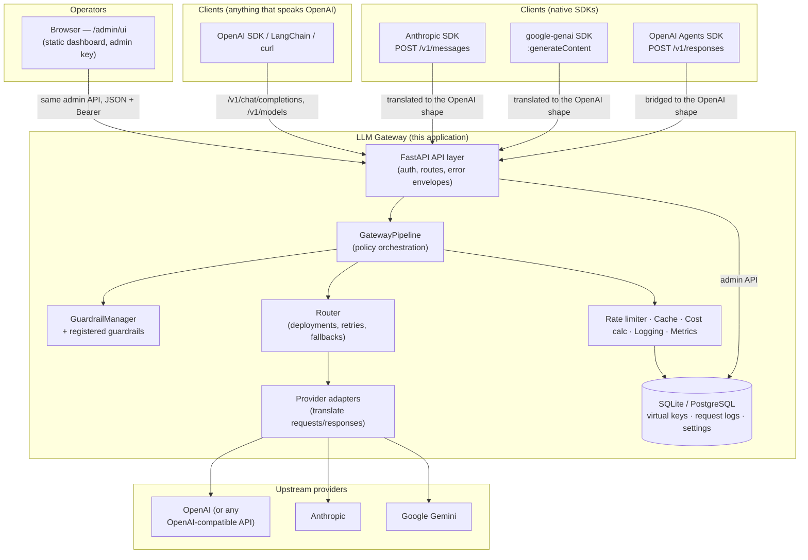
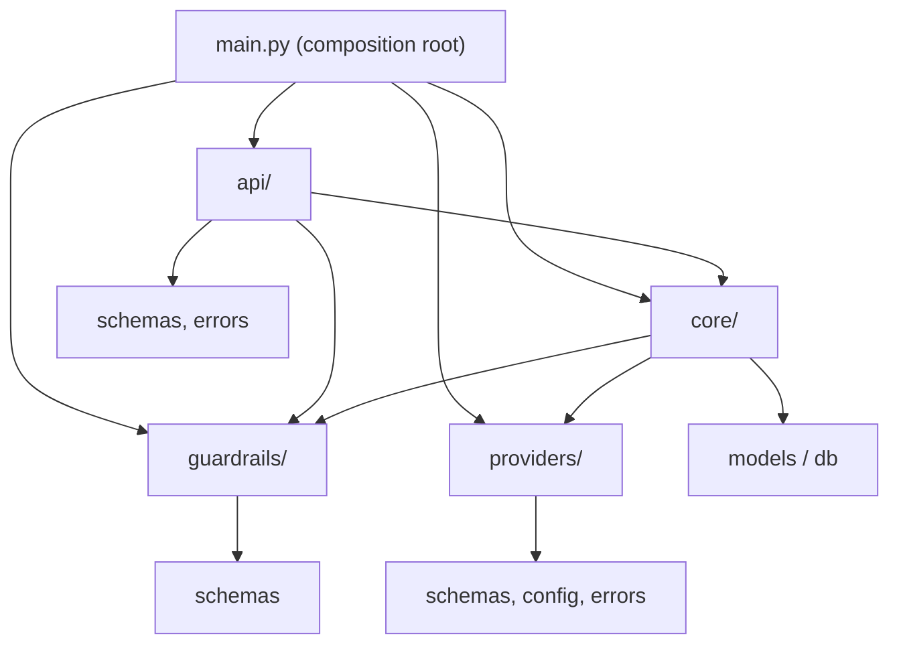
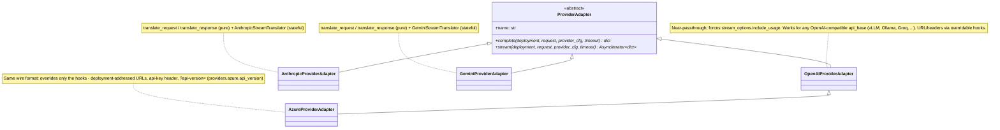
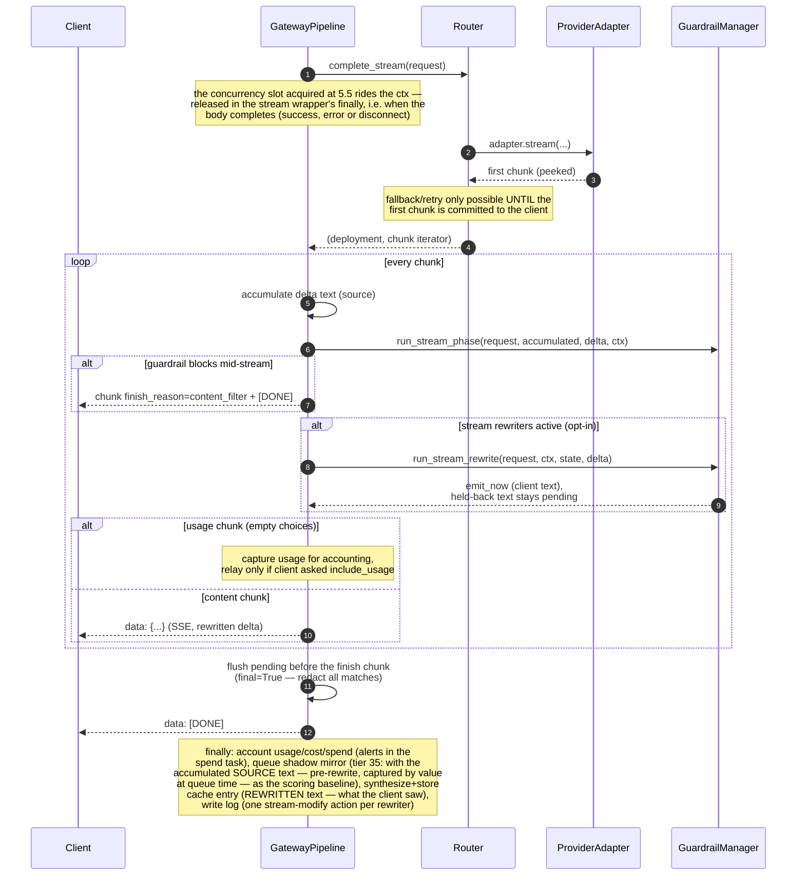
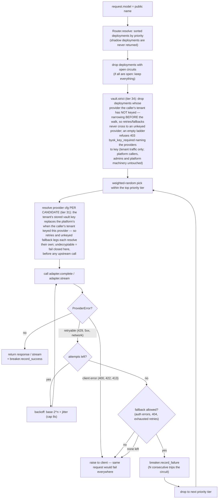
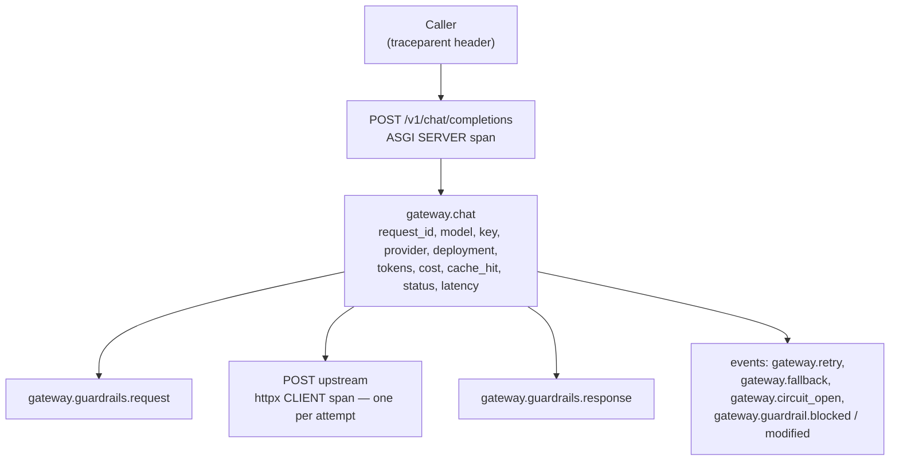

# Architecture

This document describes the LLM Gateway's architecture, module boundaries, request lifecycle, extension points, and an honest assessment of how modular and flexible the system currently is.

- **Codebase**: 96 Python files, ~39,100 lines, 1498 tests (+ one static HTML file — the admin dashboard)
- **Stack**: Python 3.12+ / FastAPI (async) / httpx / SQLAlchemy 2 (async) / Pydantic v2
- **Companion docs**: [README.md](README.md) for usage, configuration and quick start

---

## 1. Design goals

The gateway exists to sit **between clients and LLM providers** and provide centralized control. Four properties drove every structural decision:

| Goal | How it shaped the code |
|---|---|
| **Clients see one API** | The gateway speaks the OpenAI wire format north (client) and translates to provider-native formats south. Clients switch providers by changing a model name, never their code. |
| **Everything is inspectable** | Every request/response flows through explicit pipeline phases that can observe, modify, or reject traffic. Nothing bypasses the pipeline. |
| **Policies are pluggable** | Guardrails, provider adapters, authenticators, rate limiting, caching, cost and logging are interfaces + registries, not hardcoded branches. New behaviour is added by *registering*, not by editing the pipeline. |
| **Composition is config-driven** | Which providers exist, which guardrails run, which models map to which deployments — all declared in `config.yaml`, assembled by the app factory at startup. |

---

## 2. System context



---

## 3. Module map

```
gateway/
├── main.py                 App factory (create_app): composes ALL services; lifespan (DB init,
│                           key seeding, candidate-trial orphan sweep (tier 36:
│                           pending/running rows a dead process left are marked
│                           cancelled — a live run on another replica sees it
│                           at its next between-wave check; runs whether or
│                           not trials are enabled now, best-effort),
│                           log-retention background task, key-expiry warning
│                           sweep (tier 52: one expiry_alerts pass per
│                           alerts.expiry_interval_seconds — always started,
│                           config re-read each pass), PII-scan sweep (tier
│                           53: one pii_sweep pass per pii_scan.
│                           sweep_interval_seconds, the current scanner +
│                           knobs handed over each pass — reload applies
│                           from the next pass; the purged/flagged state
│                           lands via guarded UPDATE), quiet-key alert
│                           sweep (tier 56: one quiet_alerts pass per
│                           alerts.quiet_interval_seconds — always
│                           started, config re-read each pass), SIGHUP →
│                           reload, readiness flag, drain-before-close), reload_gateway
│                           (one path for /admin/reload + SIGHUP), /healthz liveness
│                           (never checks deps) + /readyz readiness (503 while
│                           starting/draining/DB-down; breakers informational),
│                           exception handlers
├── config.py               Two-layer config: env Settings (secrets/DB) + YAML GatewayConfig (providers,
│                           models — incl. shadow deployments/canary weights — model_aliases/default_model,
│                           guardrails + their scopes (key/tenant/model/route fnmatch globs), cache, routing incl. breaker backend, auth chain
│                           (admin_key/virtual_key/jwt/sso_session/custom + JWT verification,
│                           dashboard OIDC SSO — issuer/allowlist/env-only secrets),
│                           audit + alerts webhooks,
│                           pricing (per-1M-token + modality unit prices), logging incl.
│                           store_bodies/retention_days/
│                           background_write, metrics incl. per_key,
│                           prompts incl. system_prompt/variables, mcp (the proxy
│                           surface: servers with url/auth headers/timeout +
│                           session TTL), vault (ttl_seconds + backend for the
│                           cache-invalidation fan-out + strict, the tenant-only
│                           ladder stance — hot-reloadable, backend/TTL report
│                           restart_required), trials (the deliberate-replay
│                           ceilings + enabled), migration (the five verdict
│                           thresholds, read live off the running config —
│                           hot-reloadable, tier 37), multipart upload cap)
├── schemas.py              OpenAI-compatible pydantic models (request, response, chunks, admin);
│                           ChatCompletionRequest carries private attrs (never serialized,
│                           excluded from cache identity/logs) for the native Responses
│                           southbound — the bridge body + pristine-messages snapshot;
│                           PlaygroundChatRequest (tier 41) is the closed admin
│                           surface's body — key optional (the impersonated
│                           key's name), model + messages required, the two
│                           chat knobs, and stream DECLARED (default false)
│                           so refusing it is an explicit explained 400
│                           instead of an ignored extra
├── errors.py               OpenAI-style error envelope + typed errors (ProviderError, GuardrailBlocked,
│                           RateLimitError, BudgetExceededError, BudgetProjectionError — the tier-50
│                           trending denial: same 429/insufficient_quota, message says it is the
│                           projection with the numbers, ...)
├── models.py / db.py       SQLAlchemy ORM (Tenant, VirtualKey, RequestLog, Prompt,
│                           SettingKV, Trial) + async engine management incl. get_engine (readiness
│                           checks, VACUUM INTO backups); RequestLog's
│                           tier-35 shadow-diff columns (shadow_verdict /
│                           shadow_similarity, mirror rows only) and tier-36
│                           trial_id (trial replay rows only) ride the
│                           auto-upgrade like every nullable addition; the
│                           trials table is created by the same create_all
├── bootstrap.py           First-boot seeding: admin key, default virtual key
├── serve.py + __main__.py `python -m gateway` runner (wrapped by scripts/gateway.sh):
│                           HTTP by default, HTTPS via three certificate modes —
│                           --self-signed (dev pair generated under deploy/certs/,
│                           reused after), --ssl-cert/--ssl-key (any PEM pair —
│                           private/org CA; also GATEWAY_SSL_CERT/GATEWAY_SSL_KEY
│                           env), --letsencrypt DOMAIN (certbot's live layout;
│                           restart after renewal — certs load at bind time);
│                           --redirect-http [PORT] adds a plain-HTTP listener
│                           308-redirecting every request to the HTTPS URL
│                           (method-preserving, Host-header aware, own daemon
│                           thread — uvicorn skips signals off the main thread);
│                           flags > env; TLS config errors surface as CLI usage
│                           errors, never stack traces
├── utils.py                Content flattening (text + [image]/[audio] part
│                           placeholders), token estimation, truncation,
│                           audio format<->MIME mapping helpers
│
├── cli.py                  The ``gateway`` console script (tier 64): the admin
│                           API's terminal client — a thin HTTP client of the
│                           same JSON admin API as the dashboard (same
│                           --key/GATEWAY_ADMIN_KEY credential, same scoping;
│                           every error is the API's own envelope message,
│                           rendered "gateway: <message>" on stderr, exit 1)
│                           that imports nothing from the gateway package and
│                           adds zero dependencies (argparse + httpx, both
│                           already required). Command groups cover every
│                           admin surface except the playground chat and the
│                           promotion applies (all evidence reads included):
│                           keys (create/show/edit/rotate/revoke — the API's
│                           DELETE is a revoke, so the CLI exposes one honest
│                           word), tenants, BYOK vault (interactive-TTY stdin
│                           refused — shell history), prompt library, logs +
│                           capture/replay, feedback, fleet state (routing,
│                           breakers reset, guardrails, canaries, runaway,
│                           concurrency, MCP, SLOs, PII scan), billing
│                           (invoices incl. --csv, anomalies, forecasts,
│                           usage-export) and migration evidence (shadow-diff,
│                           verdicts, watch, pairs, trials), reload, backups.
│                           Conventions: aligned plain-text tables; --json
│                           prints the EXACT response payload; single objects
│                           as key-value dumps; exports to stdout or --out
│                           FILE; absent flags are absent body fields (a
│                           patch touches only what the operator named), with
│                           dedicated flags where a plain --flag cannot carry
│                           a tri-state: --cache-bypass sends cache_enabled:
│                           false, --cache-inherit an explicit null (reset to
│                           the global policy), --expires null clears the
│                           deadline. Async core run(argv, client, key) so
│                           tests drive it against the in-process app; the
│                           console-script shim main() wraps it in asyncio.run
│                           with its own client (--url/GATEWAY_URL). The
│                           SERVER entry point remains python -m gateway —
│                           the console script only operates a running gateway
│
├── api/                    ── HTTP layer (thin: parse → authenticate → delegate) ──
│   ├── deps.py             require_api_key: extract credential (Bearer,
│   │                       x-api-key, x-goog-api-key, api-key, ?key= — one
│   │                       namespace for all inbound wire formats) → hand it
│   │                       to the auth chain (app.state), then enforce token
│   │                       scoping (allowed_endpoints — chat / embeddings
│   │                       (incl. Gemini :embedContent/:batchEmbedContents) /
│   │                       images / audio / models / batch (files +
│   │                       batches) / realtime (WS sessions — checked by
│   │                       api/realtime.py's authenticate_websocket, the
│   │                       WS twin of require_api_key) / mcp (the MCP
│   │                       proxy — checked right here like every HTTP
│   │                       surface) — + allowed_ips, never
│   │                       on admins); require_admin gates the admin API,
│   │                       require_platform_admin additionally excludes
│   │                       tenant admins (the platform's own config
│   │                       endpoints: tenants, prompts, routing, guardrails,
│   │                       reload, backups). Every rejection — missing
│   │                       credential, chain 401, IP/endpoint-scope 403 —
│   │                       also logs one WARNING line on gateway.auth
│   │                       (method, path, client, reason, 12-char
│   │                       credential hint; failed auth never reaches
│   │                       the request-log pipeline, so this is its
│   │                       only server-side trace besides the
│   │                       gateway_auth_total counter)
│   ├── chat.py             POST /v1/chat/completions → pipeline.handle_chat
│   ├── embeddings.py       POST /v1/embeddings → pipeline.handle_embedding
│   ├── models.py           GET /v1/models (per-key filtered, incl. the key's mapping
│   │                       names) + GET /v1/models/{model}
│   │                       (OpenAI model object; the endpoint agent frameworks
│   │                       validate models against at startup)
│   ├── anthropic_native.py POST /v1/messages — native Anthropic Messages API
│   │                       inbound: parses to the internal OpenAI shape and
│   │                       re-renders responses/SSE (message_start, text/tool
│   │                       deltas, message_delta usage). Pure translation
│   │                       functions + a stateful stream renderer, like the
│   │                       provider adapters but reversed. Image blocks
│   │                       become image_url parts; the format has no audio
│   │                       input blocks at all; an image in an assistant
│   │                       response (image-capable routing) renders as an
│   │                       honest [generated image: …] text note
│   ├── gemini_native.py    POST /v1[/beta]/models/{model}:generateContent and
│   │                       :streamGenerateContent — native Gemini inbound with
│   │                       the same structure (parse → pipeline → render);
│   │                       inlineData parts parse to image_url (images) or
│   │                       input_audio (audio) parts and render back to
│   │                       inlineData on the response side; generationConfig
│   │                       responseModalities AUDIO + speechConfig parse to
│   │                       the internal audio-output request (modalities +
│   │                       audio.voice) and message.audio renders back to a
│   │                       text part + inlineData. Also serves native
│   │                       embeddings: :embedContent / :batchEmbedContents
│   │                       parse to the internal EmbeddingRequest (→
│   │                       pipeline.handle_embedding) and render replies in
│   │                       Gemini's {embedding}/{embeddings} shape;
│   │                       taskType/title are refused with 400s (they
│   │                       change embedding quality) and mixed batch
│   │                       sub-request models/dimensionalities likewise
│   ├── openai_responses.py POST /v1/responses — OpenAI Responses API inbound
│   │                       (the OpenAI Agents SDK's default transport):
│   │                       stateless bridge to the chat-completions core.
│   │                       Parses the chat-convertible subset (input items,
│   │                       instructions, function tools, text.format,
│   │                       input_image and input_audio parts) and
│   │                       re-renders responses/SSE in Responses shape
│   │                       (response.created → output_text.delta →
│   │                       response.completed); stateful features
│   │                       (previous_response_id, background, server-side
│   │                       tools) are rejected with clear 400s. Shares
│   │                       cache entries with /v1/chat/completions.
│   │                       Also attaches the original body + a pristine
│   │                       messages snapshot as private attrs, feeding
│   │                       the native Responses southbound
│   ├── realtime.py         WS /v1/realtime — the fifth inbound surface and the
│   │                       first stateful one: one long-lived session instead
│   │                       of request/response. The route is the HTTP-layer
│   │                       twin of every other api/ module (accept →
│   │                       authenticate → delegate): authenticate_websocket
│   │                       extracts the same credential namespace
│   │                       (Bearer / x-api-key / x-goog-api-key / api-key
│   │                       — plus ?key=, because browsers cannot set
│   │                       WebSocket headers), runs the same chain and the
│   │                       same scoping (allowed_ips; the 'realtime'
│   │                       endpoint scope — its own, since a session is a
│   │                       different kind of commitment than a call), then
│   │                       requires ?model= and hands the socket to
│   │                       pipeline.handle_realtime. Rejection semantics
│   │                       are accept-first: every failure to OPEN
│   │                       (auth, scope, model permission, rate limit,
│   │                       budget, realtime_unavailable, refused
│   │                       handshakes) is an OpenAI-shaped realtime
│   │                       {"type":"error","error":{...}} event followed
│   │                       by close 1008 — the session-shaped equivalent
│   │                       of the HTTP error envelope, so a client with
│   │                       no HTTP surface still gets a debuggable
│   │                       message instead of a bare refusal; a normal
│   │                       disconnect returns quietly (the pipeline's
│   │                       teardown wrote the row), a crash closes 1011
│   ├── images.py           POST /v1/images/generations → pipeline
│   │                       .handle_image_generation (stream: true rejected
│   │                       with a 400 — it would bypass accounting) +
│   │                       /v1/images/edits + /v1/images/variations
│   │                       (multipart parsed once at the edge, validated
│   │                       against uploads.max_upload_mb — 413 beyond;
│   │                       image parts may be files, repeated image[]
│   │                       files or base64 strings; unknown form fields
│   │                       ride along for provider passthrough)
│   ├── audio.py            POST /v1/audio/transcriptions + /translations
│   │                       (multipart parsed once at the edge, validated
│   │                       against uploads.max_upload_mb — 413 beyond —
│   │                       unknown form fields ride along for provider
│   │                       passthrough) + /v1/audio/speech (JSON in,
│   │                       binary audio streamed out)
│   ├── batches.py          OpenAI-style files + batches surface: POST /v1/files
│   │                       (multipart upload, purpose='batch', capped at
│   │                       batch.max_file_bytes — 413 beyond), GET /v1/files
│   │                       [/{id}[/content]] (owned by the calling virtual key —
│   │                       another key 404s), POST /v1/batches (input validated
│   │                       synchronously: JSONL lines with custom_id + body,
│   │                       method POST, url /v1/chat/completions, bodies parsed
│   │                       as ChatCompletionRequest, count within
│   │                       batch.max_requests — a created batch is always
│   │                       runnable; no 'validating' status), GET /v1/batches
│   │                       [/{id}], POST /v1/batches/{id}/cancel (guarded
│   │                       update — never overwrites a terminal state).
│   │                       Requires a virtual key (the platform admin key has
│   │                       no key row to own files or bill) + the 'batch'
│   │                       endpoint scope; batch.enabled: false → 404s
│   ├── mcp.py              POST/DELETE/GET /v1/mcp/{server} — the sixth inbound
│   │                       surface and the first not for the gateway's models
│   │                       at all: a transparent MCP Streamable-HTTP proxy
│   │                       (2025-06-18). Thin like every api/ module:
│   │                       authenticate (the same chain + ?key=, so
│   │                       browser-based MCP clients work) → validate the
│   │                       JSON-RPC envelope (-32700 non-JSON, -32600
│   │                       not-a-message — arrays rejected: the transport
│   │                       removed batching) → pipeline.handle_mcp. The
│   │                       documented error split lives here in miniature:
│   │                       envelope failures answer in the JSON-RPC
│   │                       envelope (400, id null), everything upstream of
│   │                       them keeps the gateway's OpenAI envelope
│   │                       (auth, 'mcp' scope, disabled/unknown server,
│   │                       rate limit). DELETE hands the session header
│   │                       to pipeline.mcp_terminate; GET is the
│   │                       out-of-scope standalone stream answered 405
│   │                       (spec-permitted; 404 when the proxy is off)
│   ├── feedback.py        POST /v1/feedback: client-reported quality for
│   │                       one request-log row (X-Request-Id + rating
│   │                       1..5 + optional comment). Ownership follows
│   │                       the files/batches rule — the row must belong
│   │                       to the calling key (platform admin exempt);
│   │                       foreign and unknown ids get the same 404.
│   │                       Rides the chat scope. key/model/tenant
│   │                       denormalized from the log row at feedback
│   │                       time; multiple signals per request allowed
│   │                       (corrections). Counted on FEEDBACK{rating};
│   │                       feedback.recorded lifecycle event; the admin
│   │                       list/stats live in admin.py
│   ├── sso.py              Dashboard SSO routes, all under /admin/ui/sso/ (tier
│   │                       60): GET config (the login overlay's probe — is SSO
│   │                       on, what the button says; honest {enabled: false}
│   │                       when off), GET login (302 to the IdP's authorization
│   │                       endpoint, state + PKCE verifier in a 5-min HttpOnly
│   │                       SameSite=Lax cookie — the flat "state:verifier"
│   │                       pair, both URL-safe tokens; JSON in a Set-Cookie
│   │                       value gets mangled by cookie-jar quoting), GET
│   │                       callback (state validated against the cookie before
│   │                       the code is exchanged — a mismatch never redeems
│   │                       a stolen authorization code; the allowlist applied;
│   │                       success mints the session cookie, failure lands on
│   │                       /admin/ui?sso=error&reason=… — an honest message,
│   │                       never a stack trace), POST session (the one-time
│   │                       cookie→Bearer exchange the dashboard's api() uses —
│   │                       SameSite=Lax + no CORS means a cross-site POST may
│   │                       mint a token it can never read; the admin API stays
│   │                       Bearer-only, zero CSRF surface) and POST logout
│   │                       (drops the cookie — the TTL is the real bound on a
│   │                       stateless session, the documented trade). All
│   │                       deliberately public: these routes ARE the login —
│   │                       their anti-abuse story is the OAuth machinery
│   │                       (state binding, PKCE, the allowlist), not a
│   │                       dashboard credential; 404 sso_disabled when SSO is
│   │                       off. Cookie paths are scoped (/admin/ui[/sso]) so no
│   │                       cookie ever rides an /admin/* API call
│   └── admin.py            Keys CRUD (incl. per-key model_mappings / default_model,
│                           prompt policy fields and scoping fields; GET
│                           /admin/keys takes the tier-61 per-tenant lens
│                           ?tenant_id= — platform admins narrow to one
│                           tenant, tenant admins are forced to their own
│                           regardless, mirroring /admin/logs; GET
│                           /admin/whoami — tier 61: the signed-in identity
│                           (name, auth_method, platform_admin, tenancy),
│                           the dashboard's one honest role probe; POST
│                           /admin/keys/{id}/rotate — tier 51: replaces the
│                           credential, the row keeps its identity; new raw
│                           key shown exactly once, previous hash remembered
│                           for the honest post-grace 401, grace_seconds
│                           0 = immediate cutover, a second rotation
│                           supersedes mid-window, revoked keys refused
│                           (400), audited as key.rotated, never either raw
│                           key; PATCH grace_until is the incident knob —
│                           explicit null kills the old credential at once,
│                           a future timestamp re-arms it; key create/PATCH
│                           also arm the expiry-warning levels (tier 52:
│                           setting or moving expires_at marks every
│                           already-crossed day-level fired via the
│                           expiry manager's rearm — a chosen deadline
│                           never pages; rotation itself never touches
│                           the state); key create/PATCH carry the
│                           per-key cache policy (tier 54:
│                           cache_enabled / cache_ttl_seconds, explicit
│                           null on PATCH resets to inherit);
│                           GET /admin/keys?idle_days=N (tier 55)
│                           narrows the listing to stale keys —
│                           last used ≥ N days ago or never used
│                           (NULL last_used_at, a rotation
│                           candidate — never-used is not proof of
│                           death, the key may predate tracking);
│                           filtered on the loaded rows, not in
│                           SQL, on purpose: the endpoint returns
│                           every matching row anyway and SQLite
│                           hands datetimes back naive while
│                           Postgres keeps them aware — one Python
│                           comparison after the codebase's
│                           existing normalization is correct on
│                           both; negative values 400; tenant
│                           scoping unchanged (a tenant admin
│                           sweeps their own); tenancy —
│                           tenant admins are forced into their own tenant on
│                           create (mismatch 400), refused re-homing (403),
│                           and see 404s for other tenants' keys/logs),
│                           tenants CRUD (platform admins: slug + display
│                           name + policy ceiling, budget re-arm on PATCH,
│                           delete refused while keys reference it), the
│                           BYOK vault surface — GET /admin/vault status
│                           (tier 34: enabled/unavailable_reason/strict/
│                           backend/TTL + admin_context; no secrets) and
│                           the tenant provider-key CRUD (list/put/delete,
│                           hints only, tenant admins pinned to their
│                           own, cross-tenant 404), the prompt
│                           library CRUD (create/version, summaries, per-name
│                           versions, activate/candidate/fraction patch, delete —
│                           every mutation audited), logs (list omits
│                           bodies, /admin/logs/{id} returns
│                           them in full; ?key_id= filter beside key_name
│                           — the replay harness pins exact callers by it;
│                           GET /admin/logs/export streams the replayable
│                           rows as JSONL — the capture leg of the
│                           capture-replay harness, same scoping/filters,
│                           shadow mirrors and bodiless rows excluded,
│                           each line carrying the recorded baseline +
│                           comparable/skip_reason; POST /admin/replay is
│                           the replay+diff leg — see core/replay.py;
│                           GET /admin/shadow-diff + /admin/shadow-diff/
│                           pairs (tier 35, platform-admin-only — the
│                           pairs carry request bodies, which cross
│                           tenants) serve core/shadow_diff's migration
│                           evidence over mirrored traffic; the
│                           candidate-trials surface (tier 36, same
│                           platform-admin boundary, trial.created/
│                           trial.cancelled audited): POST /admin/trials
│                           validates + clamps a run (model window,
│                           candidate deployment — any configured one —
│                           and the three caps) and spawns it,
│                           GET /admin/trials lists runs newest-first
│                           with each verdict summary + migration
│                           recommendation folded in (tier 37: one
│                           grouped query, then core/migration.
│                           evaluate per row — no N+1), GET
│                           /admin/trials/{id} is the run + summary +
│                           recommendation, GET /admin/trials/{id}/
│                           pairs the drilldown (shadow_diff.pairs
│                           scoped by trial_id — same pair shape as
│                           the standing drilldown), POST
│                           /admin/trials/{id}/cancel a guarded
│                           UPDATE (finished runs 409; a live run
│                           stops within one wave) — see core/trials;
│                           GET /admin/migration/verdicts (tier 37,
│                           same platform-admin boundary — it reads
│                           the same cross-tenant evidence) turns the
│                           standing mirror groups into go / hold /
│                           no_go / insufficient_evidence
│                           recommendations, thresholds echoed live
│                           (?model=/?deployment=/?since= narrow);
│                           POST /admin/migration/plan +
│                           /admin/migration/promote (tier 38, same
│                           platform-admin boundary — they rewrite
│                           the routing configuration) turn a go
│                           verdict into serving traffic through
│                           config.yaml itself: plan renders the
│                           exact line edits (mode shadow_flip /
│                           rebalance / cross_model_insert,
│                           structured changes, unified diff, canary
│                           share) + the evidence verdict justifying
│                           them with NO side effects (file read,
│                           never written; evidence_source says
│                           which leg — standing mirror group, else
│                           latest completed trial, else none);
│                           promote re-builds the plan from the file
│                           at apply time (never a stale preview),
│                           gates on the verdict (no_go → 409
│                           promotion_blocked with the reasons,
│                           unless force=true — audited as forced;
│                           hold/insufficient_evidence promote with
│                           the concern as a plan warning), then
│                           timestamped backup → write → the same
│                           hot-reload path /admin/reload takes →
│                           promotion.applied audit; on reload
│                           refusal the backup is restored and the
│                           running config never moved — see
│                           core/promotion;
│                           GET /admin/migration/backups +
│                           /admin/migration/backups/{name} +
│                           POST /admin/migration/rollback (tier 39,
│                           same platform-admin boundary) are the
│                           undo surface over the backups every apply
│                           leaves next to config.yaml: the list is
│                           a pure read, newest first (the name's
│                           stamp IS the order), each row explaining
│                           its backup (parses — schema drift is
│                           honest; is_current — byte-identical to
│                           live; changes — compare_configs over the
│                           parsed pair), the detail adds the
│                           line-level diff (the human preview);
│                           rollback applies the same discipline in
│                           reverse — the chosen backup (None = the
│                           latest, "undo the last promotion") must
│                           parse (409 backup_invalid — never start
│                           an edit that cannot land), a
│                           byte-identical one is refused as the
│                           no-op it is (409 rollback_noop), the
│                           live file is backed up FIRST (the
│                           rollback's own undo point — one rollback
│                           away from undone, in both directions:
│                           rolling back again with no body REDOES
│                           the promotion), then write → the
│                           /admin/reload path (source="rollback")
│                           → promotion.rolled_back audit, with the
│                           undo point restored on reload refusal;
│                           flat names only (charset bars path
│                           separators — the resolution can never
│                           leave the config directory);
│                           GET /admin/migration/watch (tier 40,
│                           same platform-admin boundary) is the
│                           post-promotion leg — the migration story
│                           continued after the promotion flips the
│                           candidate live and the mirrors stop: one
│                           row per serving deployment, re-verdicted
│                           on the rows attributed to it (mirrors,
│                           trial replays and cache replays
│                           excluded; a row lands on a deployment
│                           only when a dispatch COMPLETED on it, so
│                           a candidate failing at dispatch shows up
│                           as traffic that ran away — the expected
│                           vs actual share split on the row says
│                           it, never fabricated attributed errors),
│                           from when it started serving the model
│                           (its first serving row — the promotion
│                           moment measured on the traffic itself,
│                           no side state), against its same-priority
│                           tier peers over exactly that window, with
│                           the same go/hold/no_go/
│                           insufficient_evidence vocabulary and
│                           migration: thresholds echoed live — a
│                           recommendation to keep serving or roll
│                           back, never an automatic one;
│                           ?model=/?deployment= narrow, ?since=
│                           (ISO-8601) overrides every window;
│                           POST /admin/playground/chat (tier 41, same
│                           platform-admin boundary) is the
│                           dashboard's own chat client — one
│                           completion through the REAL pipeline: the
│                           optional body key names a virtual key to
│                           impersonate, resolved through the same
│                           chain the JWT auth step uses (name ->
│                           active/expiry -> tenant ->
│                           auth_context_from_key), so the
│                           impersonated key's allowlists, budgets,
│                           residency, guardrail scopes and rate
│                           limits bind and its spend accrues
│                           (omitted = the calling admin's own,
│                           unrestricted context); impersonating
│                           also stamps the key's last_used_at
│                           (tier 55 — the run is its traffic,
│                           exactly what a live request would
│                           count as); auth_method
│                           "playground" labels every row and event;
│                           route="chat" keeps guardrail route-scopes
│                           identical; stream:true is an explicit
│                           400; the answer wraps the client-facing
│                           completion (verbatim, json off the
│                           pipeline's JSONResponse) beside the
│                           request-log row the run just wrote as
│                           diagnostics (request id, key,
│                           model/deployment/provider, status,
│                           tokens, cost, latency, cache-hit,
│                           guardrail verdicts) read back by
│                           request_id — one honest source, the same
│                           row /admin/logs shows and the export
│                           bills; errors pass through verbatim (the
│                           GatewayError re-raised into the standard
│                           envelope) while every attempt — success,
│                           blocked or failed — is audited as
│                           playground.chat with the calling admin
│                           as the actor;
│                           GET /admin/slos (tier 42, same
│                           platform-admin boundary — SLO definitions
│                           are platform health config) is the SLO
│                           verdict surface: every slos: target from
│                           app.state.config measured over its
│                           rolling window (slos_core.status —
│                           non-shadow, non-trial rows, cache replays
│                           included, unattributed errors at model
│                           scope, attributed rows only under a
│                           deployment scope) and verdicted met /
│                           breached / insufficient_evidence, each row
│                           echoing the definition beside the full
│                           measurement (requests/errors/error-rate,
│                           latency p50/p95/p99, ttft p95), the
│                           metric value and the check with its
│                           human reason — the numbers always beside
│                           the verdict; tier 43 adds the
│                           error-budget lens to every row: budget
│                           (the bar's bad-event allowance — the
│                           bar itself for error_rate, the implied
│                           1-p tail for the percentile metrics —
│                           beside the bad count, the burn rate =
│                           observed/allowed, remaining, and the
│                           on_track / at_risk / exhausted /
│                           insufficient_evidence state) and burn
│                           (each slos.burn rule's multiwindow pace
│                           verdict: the long window establishes the
│                           burn is real, the short one confirms it
│                           is still burning — a burst that already
│                           ended never fires; zero-tolerance bars
│                           have no rate to compute and say so); tier
│                           44 attaches the target's persisted
│                           alert state (firing / condition / since
│                           — the same settings KV row the
│                           evaluator wrote, so the panel shows
│                           exactly what on-call was paged for;
│                           null when never fired or recovered);
│                           the config echoes as
│                           model_dump(); read-at-request-time means
│                           hot-reload re-verdicts on the next call;
│                           delivery itself is the background
│                           evaluator's job (slo_alerts.py);
│                           tenant scoping forced for tenant
│                           admins, ?tenant_id= filter for platform), feedback
│                           (GET /admin/feedback list with key/model/rating
│                           filters + GET /admin/feedback/stats — overall /
│                           by-model / by-key quality buckets, positive =
│                           rating 4-5, negative = 1-2; the same forced
│                           tenant scoping), canaries (GET /admin/canaries
│                           fleet view — last probe outcome/latency per
│                           deployment, "unknown" before the first wave +
│                           POST /admin/canaries/probe to run a wave on
│                           demand; platform-admin-only, like /admin/routing
│                           — deployment health is platform configuration),
│                           pii-scan (GET /admin/pii-scan bulk over recent
│                           rows — per-row findings + by_kind aggregates,
│                           bodies_not_captured counted separately from
│                           clean, tenant scoping like /admin/logs,
│                           and (tier 57) a config echo — enabled/
│                           quarantine/purge_days/bounds, the public
│                           knobs the dashboard panel's teeth-status
│                           badges read, no second endpoint; GET
│                           /admin/logs/{id}/pii-scan for one row; kind +
│                           count only, never matched text; tier 53:
│                           findings LAND once per row via a guarded
│                           UPDATE — re-scans report the recorded state
│                           without re-counting, and a row the sweep
│                           already recorded answers identically),
│                           log reads honor quarantine (tier 53: GET
│                           /admin/logs/{id} serves a flagged row's
│                           bodies MASKED — the scanner's own detector
│                           set, wire capture included, structure
│                           preserved, pii_quarantined: true — and
│                           /admin/logs/export withholds flagged
│                           bodies: the line stays, body-less, with a
│                           skip_reason, so history is honest while
│                           the capture file carries no exposure;
│                           pii_scan.quarantine/enabled gate it),
│                           stats
│                           (by_tenant breakdown for platform admins),
│                           usage export (CSV/JSON billing
│                           extract, tenant filter + per-tenant
│                           aggregates; cached_tokens is a column —
│                           prompt-cache reads itemized for chargeback),
│                           usage invoices (tier 45, GET
│                           /admin/invoices — the month statement:
│                           the same request-log rows rolled up per
│                           tenant/key/model into line items, with
│                           the key's and tenant's
│                           monthly_budget_usd beside the spend so a
│                           statement doubles as a spend-vs-plan
│                           check; month=YYYY-MM selects the period
│                           (calendar months in UTC, default the
│                           current month, future = 400 — never a
│                           fake empty invoice); the billing lens
│                           is client-consumed usage — shadow
│                           mirrors and trial replays excluded,
│                           cache hits included at the cached rate;
│                           zero-usage keys included (an unused key
│                           is a finops finding), deleted keys bill
│                           under the tenant they lived in with no
│                           budget; require_admin: tenant admins
│                           forced to their own tenant, platform
│                           admins may ?tenant_id=; format=csv is
│                           one row per line item in
│                           INVOICE_CSV_COLUMNS order, attachment
│                           invoice_<month>.csv; the composition
│                           lives in core/billing.py),
│                           cost anomaly flags (tier 46, GET
│                           /admin/anomalies — the invoice's
│                           follow-up: is any of this unusual? the
│                           recent window (finops.window_hours,
│                           default 24h) vs each key's trailing
│                           baseline (finops.baseline_days, default
│                           the 14d immediately before it), per
│                           key and per model over the same
│                           client-consumed lens; four kinds —
│                           cost_spike / traffic_spike (window
│                           daily rate ≥ spike_ratio × the
│                           baseline's), traffic_stop (real
│                           baseline traffic gone silent — the
│                           churn signal a spend dashboard
│                           structurally cannot show) and
│                           first_seen_model (a zero-baseline
│                           model appeared); honesty rules:
│                           thin baseline (< min_baseline_requests
│                           rows) = no verdict, brand-new keys
│                           cannot spike, zero-cost baseline with
│                           window spend = ratio null (never an
│                           invented infinity); every flag carries
│                           window/baseline numbers + a human
│                           message, the bounds in the envelope;
│                           informational only (no loop, no state,
│                           no delivery — errors are SLO
│                           territory, this is the money lens);
│                           enabled=false = honest empty list while
│                           the invoice keeps serving; require_admin
│                           with the invoice's tenant scoping;
│                           detection lives in core/finops.py),
│                           spend forecasts (tier 47, GET
│                           /admin/forecasts — the invoice's
│                           forward-looking sibling: where will
│                           this month land? Two projections per
│                           key and per tenant over the billing
│                           lens — the run-rate (spend so far
│                           over the elapsed fraction, scaled to
│                           the month) and the recent pace (the
│                           last 7 days' daily spend, bounded to
│                           the month, carried over the
│                           remaining days) — with the trend
│                           ratio beside them and the budget
│                           verdicts decided by the recent pace
│                           when both exist (verdict_based_on
│                           says which); a complete month serves
│                           its actuals (month_complete — the
│                           invoice IS the final bill), a trend
│                           needs 2+ days of month and a nonzero
│                           average, the clock context (elapsed/
│                           remaining days) ships in the envelope
│                           so every number is auditable against
│                           the response itself; require_admin
│                           with the invoice's tenant scoping;
│                           the math lives in core/forecasts.py),
│                           spend forecast alert delivery (tier 48,
│                           riding the same envelope: every
│                           section carries its persisted alert
│                           state — firing/condition/since, what
│                           on-call was already paged for, from
│                           the same settings row the evaluator
│                           wrote, null when never fired or
│                           recovered — and the forecast_alerts
│                           delivery config echoes beside it; the
│                           evaluator itself lives in core/
│                           forecast_alerts.py),
│                           routing/guardrail introspection
│                           (/admin/routing echoes each model's
│                           context_window, the cost_aware flag and
│                           per-deployment input/output/cached_input
│                           prices — the same lookup the cost-aware
│                           router ranks by; key mutations
│                           and breaker resets emit audit records), operations —
│                           POST /admin/reload (hot-reload config.yaml; invalid
│                           config = 400, running one stays live; restart_required
│                           lists what a reload cannot swap) and the SQLite
│                           backup endpoints (POST /admin/backup online VACUUM
│                           INTO snapshot; GET/DELETE /admin/backups, flat
│                           names only) — and GET /admin/ui serving the static
│                           dashboard
│
├── core/                   ── Policy & orchestration (framework-agnostic; no FastAPI types) ──
│   ├── pipeline.py         GatewayPipeline: the chat request lifecycle (see §5) + the
│   │                       embeddings path (same pre-flight checks, no guardrails);
│   │                       steps 0-1 (model resolution + window, prompt
│   │                       policy, permissions) and 4-4.5 (request-phase
│   │                       guardrails + redirect re-validation) live in
│   │                       shared helpers — _prepare_request_policy /
│   │                       _apply_request_guardrails — that both _handle
│   │                       and the replay harness's replay_request call,
│   │                       so a replayed request passes through the exact
│   │                       policy code a live one does;
│   │                       _serve_simple is the shared wrapper for every non-chat
│   │                       surface (embeddings, images, audio: context, in-flight
│   │                       metric, span, error-path logging — streaming-aware, like
│   │                       handle_chat: a StreamingResponse finishes its own span)
│   │                       and handle_image_generation / handle_image_edit /
│   │                       handle_image_variation (one _serve_image tail: resolve →
│   │                       permission → rate limit → budget → dispatch → per-image
│   │                       cost) and handle_transcription / handle_speech run the
│   │                       modality pipelines on it — no guardrails, no response
│   │                       cache (X-Gateway-Cache: NONE), unit-priced cost via
│   │                       _account_cost (per image / per minute / per 1M chars);
│   │                       speech streams the provider's audio through a generator
│   │                       that accounts/logs/ends the span once the body completes
│   │                       (the streaming-chat shape — spend survives disconnects);
│   │                       uploaded files are never persisted (log rows carry file
│   │                       metadata; speech responses a note with media type + byte
│   │                       count);
│   │                       _resolve_model normalizes requested names to public names
│   │                       (per-key model_mappings → real names → global aliases →
│   │                       key default_model → global default) before any check,
│   │                       so permissions/caches/scopes/logs see one name;
│   │                       step 1.1 checks the tool-call policy (tier 30):
│   │                       allowed_tools fnmatch patterns on the key (platform
│   │                       admins exempt) and pooled on the tenant (no bypass —
│   │                       a declared tool must pass BOTH, tenant only narrows);
│   │                       None = unrestricted and tool-less requests are
│   │                       unchanged; a violation 400s tool_not_allowed naming
│   │                       up to five offenders, and an unnameable tool fails
│   │                       closed as <unnamed>. One shared check covers every
│   │                       inbound surface — OpenAI chat, Responses, native
│   │                       Anthropic/Gemini all normalize tools to the OpenAI
│   │                       shape before the pipeline (_tool_names reads
│   │                       function.name, then a top-level name extra);
│   │                       step 4.6 re-checks it after the guardrail phase (a
│   │                       guardrail overlaying tools via
│   │                       modified_request_fields can never inject a tool
│   │                       past the allowlist — the same hard boundary model
│   │                       redirects get at 4.5);
│   │                       step 0.5 applies the prompt policy (core/prompts.py) —
│   │                       managed system prompt + {{variables}} — before guardrails
│   │                       and cache lookup, so checks and cache identity see the
│   │                       final prompt; a key's system_prompt_ref resolves through
│   │                       the prompt library first (fail-closed 400 on a name with
│   │                       no active version);
│   │                       step 4.5 re-checks the model allowlist after the
│   │                       guardrail phase (a reject-and-redirect redirect can
│   │                       never bypass permissions — fail closed, key-level
│   │                       admins exempt; the TENANT allowlist binds every
│   │                       member, tenant admins included) and updates
│   │                       ctx.model/span so rate-limit
│   │                       series, logs, response-phase scopes and cache
│   │                       identity all see the final model;
│   │                       tenancy (see §6): member keys additionally pass
│   │                       the tenant's model allowlist, a second pooled
│   │                       rate-limit window (tenant:{id} namespace, TPM
│   │                       included) and the tenant's three budget windows
│   │                       — no admin bypass at that layer by design;
│   │                       spend accounting writes the tenant row too and
│   │                       responses carry X-Gateway-Tenant;
│   │                       cache lookup/store salt the key with a
│   │                       response-policy token (tenant + active
│   │                       response-capable guardrails — see manager.py)
│   │                       so entries never cross tenants or policies;
│   │                       per-key cache policy (tier 54) gates phase 5
│   │                       and the embeddings cache step from the auth
│   │                       snapshot: cache_enabled=false bypasses BOTH
│   │                       caches (lookup AND store, key stays None —
│   │                       answering X-Gateway-Cache: BYPASS and
│   │                       counting no miss; narrowing only, global-off
│   │                       keeps MISS for compat), cache_ttl_seconds is
│   │                       the caller's read-side max_age on every
│   │                       lookup and the writer's ttl stamp on every
│   │                       store (chat non-stream, stream-completion
│   │                       and embeddings alike); the semantic switch
│   │                       keeps its own global scope (cache.enabled
│   │                       never silenced semantic lookups before and
│   │                       still doesn't — the opt-out gates it, the
│   │                       global exact-cache flag does not);
│   │                       idempotency (phase 2b, before the cache)
│   │                       is deliberately untouched — retry safety ≠
│   │                       caching
│   │                       _stream_with_guardrails runs block-style checks on
│   │                       the SOURCE text, then chains stream rewriters
│   │                       (rewrite_stream_text) — held-back text flushes
│   │                       before the finish chunk and at end-of-stream, and
│   │                       the cache entry / log response_body record the
│   │                       rewritten text the client actually saw;
│   │                       _queue_shadow mirrors successful requests to shadow
│   │                       deployments and _queue_prompt_ab mirrors a fraction of
│   │                       them to the library prompt's candidate version (same
│   │                       deployment, candidate swapped into the system slot;
│   │                       background tasks, like spend accounting); tier 35
│   │                       threads the primary's RAW answer text through both
│   │                       — extracted before the response phase on the
│   │                       buffered path, accumulated source text on the
│   │                       streaming path, captured BY VALUE at queue time so
│   │                       no rewrite or scheduling race leaks into the
│   │                       baseline — and each mirror row is scored on it
│   │                       (core/shadow_diff): shadow_verdict +
│   │                       shadow_similarity land on the shadow row;
│   │                       tier 37 fixes the mirror rows' latency:
│   │                       both mirror tasks stamp the row's ctx
│   │                       with the CALL's start (started_monotonic=
│   │                       started), so the logged latency_ms is the
│   │                       mirror call's own duration — before, the
│   │                       ctx was created after the call and every
│   │                       mirror row logged ~0ms, making the
│   │                       evidence aggregate's latency deltas read
│   │                       as implausible speedups (trials.py had
│   │                       it right from the start);
│   │                       _note_byok (tier 31) marks the ctx right after
│   │                       every dispatch when the upstream call rode
│   │                       the TENANT'S stored vault credential —
│   │                       cache-only peek, provider NAME only
│   │                       (X-Gateway-Byok-Provider, RequestLog.
│   │                       byok_provider, gateway_byok_requests_total),
│   │                       and all eight router call sites pass
│   │                       auth=ctx.auth so the vault resolves
│   │                       per candidate inside retries/fallbacks;
│   │                       per-key series (metrics.per_key) emit beside the
│   │                       global ones in _request_metric/_account_usage — the
│   │                       same call sites the mirrors never reach
│   │                       apply_config swaps config-derived policy in place
│   │                       (hot-reload: guardrails, models/routing, pricing,
│   │                       aliases, prompt knobs; built before assignment so
│   │                       a bad config raises with the old one still live),
│   │                       and _spawn/drain_background_tasks track that
│   │                       fire-and-forget work so shutdown drains it before
│   │                       the engine goes away; handle_realtime (tier 32)
│   │                       is the session twin of _handle — the open gates
│   │                       run ONCE per session, in HTTP order (model
│   │                       resolution/permission, the realtime scope via the
│   │                       route, RPM at open, budget, a concurrency slot
│   │                       held for the session's LIFE, INFLIGHT +
│   │                       REALTIME_SESSIONS gauges), then routing walks
│   │                       the residency/breaker-filtered ladder at CONNECT
│   │                       time only (websockets.connect per candidate with
│   │                       the BYOK-resolved cfg + adapter.ws_headers — a
│   │                       long-lived session cannot fail over mid-stream),
│   │                       then the relay (core/realtime.py) owns everything
│   │                       per-event; teardown on EVERY exit path closes the
│   │                       upstream session first, then row/metric/slot/
│   │                       INFLIGHT/span — one _log call, one row per
│   │                       session ("realtime session completed");
│   │                       handle_mcp (tier 33) is the message-shaped
│   │                       entry: gates in HTTP order (mcp.enabled →
│   │                       configured server → the two-layer
│   │                       allowed_mcp_servers policy → RPM (no
│   │                       tokens/budget — MCP servers are not
│   │                       language models) → a concurrency slot),
│   │                       then per-method dispatch — initialize
│   │                       consumes the upstream answer and re-emits
│   │                       JSON with a GATEWAY-issued session id,
│   │                       notifications/responses relay 202,
│   │                       tools/list filters the catalog through
│   │                       _tool_name_allowed (the tier-30 policy
│   │                       per name), tools/call runs the request
│   │                       phase over the serialized arguments (a
│   │                       synthetic chat request — MODIFY applied
│   │                       only while the rewrite stays a JSON
│   │                       object, else fail-closed; redirects fail
│   │                       closed) and the response phase over the
│   │                       result's text — each text item, the text
│   │                       of embedded-resource items, and
│   │                       structuredContent guarded as serialized
│   │                       JSON (the same fail-closed rewrite rule;
│   │                       base64 payloads — blobs, image/audio
│   │                       items — are binary, skipped by design);
│   │                       tier 49 factors the pass into
│   │                       _mcp_guard_request / _mcp_guard_
│   │                       response_text / _mcp_guard_result_items,
│   │                       shared with _mcp_content_call — the
│   │                       content methods (resources/read,
│   │                       prompts/get, completion/complete): the
│   │                       whole params in (uri/name/arguments/ref/
│   │                       argument — everything the caller wrote),
│   │                       every server text shape out (contents[].
│   │                       text, message blocks in BOTH content
│   │                       shapes, completion.values[]), denials as
│   │                       MCPToolBlocked → in-band JSON-RPC
│   │                       errors, the generic
│   │                       exchange handling JSON or SSE answers
│   │                       (SSE relayed live, response frame
│   │                       intercepted, everything else verbatim);
│   │                       one log row per message (route mcp,
│   │                       provider mcp, model = server name) via
│   │                       _mcp_account — exactly once per message
│   │                       (the SSE relay finishes its own), mcp_
│   │                       session.closed/tool.blocked events;
│   │                       mcp_terminate drops the local mapping
│   │                       first, then relays the upstream DELETE
│   ├── realtime.py         RealtimeRelay (tier 32) — the stateful twin of the
│   │                       streaming chat path: two pumps (client→upstream,
│   │                       upstream→client) supervised by one asyncio.wait
│   │                       (FIRST_COMPLETED — either leg ending ends the
│   │                       session), relaying the OpenAI Realtime event
│   │                       protocol with policy applied where content
│   │                       actually moves. Client leg: response.create
│   │                       builds a ChatCompletionRequest (the create's
│   │                       own input — fork semantics — or the SHADOWED
│   │                       conversation the relay keeps from
│   │                       conversation.item.create/delete events when
│   │                       the create carries none) and runs the request
│   │                       phase: BLOCK swallows the create (error
│   │                       event, nothing forwarded — the session
│   │                       lives on), modified messages are written
│   │                       back into the forwarded event;
│   │                       malformed events get error events and are
│   │                       skipped. Upstream leg: session.created
│   │                       passes through; output_text.delta runs
│   │                       block-style stream checks on the SOURCE
│   │                       text and chains rewriters (the same
│   │                       held-back protocol as SSE — the client
│   │                       sees rewritten text, the final flush at
│   │                       output_text.done; a mid-response BLOCK
│   │                       sends the error event, response.cancel
│   │                       upstream and suppresses the rest of THAT
│   │                       response via a response-id set — its
│   │                       response.done still bills, the provider
│   │                       ran); response.done accounts (usage→
│   │                       prompt/completion tokens, TPM, cost, spend
│   │                       — the session's ctx accumulates across
│   │                       responses, so the ONE log row sums them);
│   │                       the first delta sets TTFT; budget
│   │                       re-checks that raise mid-session close
│   │                       1008 with the error event (session-fatal,
│   │                       unlike a guardrail block); audio deltas and
│   │                       other event types pass through untouched
│   │                       (text is the guarded surface). _send_error
│   │                       is the OpenAI shape shared with the route's
│   │                       rejections
│   ├── mcp.py              MCP protocol machinery (tier 33) — the wire half
│   │                       of /v1/mcp, so the pipeline keeps only
│   │                       policy: JSON-RPC classification + the error
│   │                       envelope (classify / jsonrpc_error / the -32xxx
│   │                       code vocabulary), MCPSessionRegistry (the
│   │                       gateway-issued Mcp-Session-Id → upstream
│   │                       session + negotiated protocol version map —
│   │                       app.state state, survives hot-reloads, TTL
│   │                       sweep + lazy eviction, MCP_SESSIONS gauge),
│   │                       upstream_headers (the configured server auth
│   │                       + the session/protocol stamps — never the
│   │                       caller's gateway credential), MCPToolBlocked
│   │                       (a plain Exception, NOT a GatewayError: it
│   │                       carries policy/guardrail denials — code,
│   │                       reason, the tool for tools/call, the
│   │                       guardrail, and (tier 49) the denied
│   │                       method — so the exchange turns them
│   │                       IN-BAND — HTTP 200 JSON-RPC error —
│   │                       instead of a transport 4xx that would
│   │                       hide the reason from the client SDK),
│   │                       MCP_CONTENT_METHODS (tier 49: the
│   │                       frozenset of methods that move content
│   │                       worth guarding — resources/read,
│   │                       prompts/get, completion/complete;
│   │                       lifecycle, notifications and catalog
│   │                       reads stay verbatim by design), and
│   │                       SSEReader (the incremental SSE frame parser
│   │                       — \n\n and \r\n\r\n boundaries, multi-line
│   │                       data, keepalive comments — used by the
│   │                       relay for verbatim frames + the one
│   │                       intercepted response frame per exchange)
│   ├── context.py          RequestContext / AuthContext — per-request state threaded
│   │                       everywhere; AuthContext carries the key's routing
│   │                       overrides (model_mappings / default_model) and prompt
│   │                       policy (system_prompt / system_prompt_ref /
│   │                       prompt_variables) plus the snapshotted tenant row
│   │                       (id/name + its allowlist/limits/budget windows —
│   │                       the same auth-time-consistency trade-off the key's
│   │                       budget fields make) — the allowlists include
│   │                       allowed_mcp_servers (key + tenant, the
│   │                       model-permission mechanics pointed at MCP
│   │                       server names); RequestContext.route names
│   │                       the inbound surface (chat / responses /
│   │                       messages / gemini / realtime / mcp) that guardrail route
│   │                       scopes match against
│   ├── concurrency.py      Concurrency admission control + QoS:
│   │                       ConcurrencyLimiter bounds how many
│   │                       requests a key (VirtualKey.max_concurrency)
│   │                       or a tenant (pooled Tenant.max_concurrency
│   │                       — a member passes both) may hold
│   │                       in-flight against the upstream at once;
│   │                       callers with neither cap skip admission
│   │                       entirely. Phase 5.5 in _handle (after the
│   │                       cache miss — hits and idempotent replays
│   │                       never hold a slot — before routing), so
│   │                       the slot wraps exactly the upstream call;
│   │                       released wherever the in-flight gauge
│   │                       decrements (_finish_span for non-streams,
│   │                       the stream wrapper's finally for streams —
│   │                       a streamed response holds its slot until
│   │                       its body completes, every error path
│   │                       releases). At the cap, requests QUEUE:
│   │                       a heap of waiters ordered (-priority, seq)
│   │                       — VirtualKey.priority is the QoS class,
│   │                       higher admitted first, FIFO within a
│   │                       class — and the drain on every release
│   │                       scans in priority order SKIPPING (not
│   │                       stopping at) waiters that do not fit, so a
│   │                       waiter on one saturated key never blocks
│   │                       an unrelated one. asyncio.wait (not
│   │                       wait_for) bounds the queue stay at
│   │                       concurrency.wait_seconds without ever
│   │                       cancelling a granted slot (the race —
│   │                       slot granted in the same tick the timeout
│   │                       fired — hands the slot back); expiry =
│   │                       429 + Retry-After via the pipeline, a
│   │                       concurrency.timeout observer event and
│   │                       gateway_concurrency_rejected_total{key}.
│   │                       Gauges gateway_concurrency_inflight{key} /
│   │                       gateway_concurrency_queued{key} are the
│   │                       limiter's own ground truth; GET /
│   │                       admin/concurrency surfaces them with name
│   │                       joins. No locks — everything runs on the
│   │                       event loop, atomic by construction; state
│   │                       is in-process (like the idempotency
│   │                       in-flight map and runaway detection)
│   │                       unless concurrency.backend: redis —
│   │                       RedisConcurrencyLimiter
│   │                       (redis_backends.py) shares the slot
│   │                       count fleet-wide under the same
│   │                       acquire/release/snapshot contract;
│   │                       multi-replica fleets enforce per-replica
│   │                       shares in memory. Chat-family only — embeddings /
│   │                       images / audio run through _serve_simple
│   │                       and never acquire a slot (same honest
│   │                       boundary as runaway)
│   ├── router.py           Deployment selection, weighted LB, retries w/ backoff, fallback tiers
│   │                       — one shared non-streaming executor (_dispatch: resolve →
│   │                       breaker filter → retries → fallback) behind complete /
│   │                       embed / generate_image / edit_image / vary_image /
│   │                       transcribe / speak, so every
│   │                       modality gets the identical contract. Shadow deployments
│   │                       are excluded from serving (resolve
│   │                       filters them; shadow_deployments() lists the mirroring
│   │                       targets); apply_config hot-swaps models/deployments
│   │                       and routing policy in place — breakers and provider
│   │                       adapters survive the swap. With routing.cost_aware
│   │                       the same-priority tier is ranked by the deployment's
│   │                       upstream-model INPUT price (the router's own
│   │                       CostCalculator, rebuilt on config swap so pricing
│   │                       hot-reloads apply): cheapest first, the price ladder
│   │                       doubles as the failover ladder, weight breaks price
│   │                       ties, unpriced models sort last, and priority still
│   │                       rules across tiers. Tier 28 adds the residency
│   │                       filter: resolve(model, residencies) /
│   │                       shadow_deployments(model, residencies) /
│   │                       _dispatch(..., residencies) and all eight
│   │                       public methods accept the caller's EFFECTIVE
│   │                       data-residency requirement (AuthContext.
│   │                       effective_residencies(): key ∩ tenant,
│   │                       None = unrestricted) and filter the candidate
│   │                       list to deployments whose operator-asserted
│   │                       residency tag is in the set BEFORE the
│   │                       priority ladder, retries and fallbacks —
│   │                       a constrained request can never escape to a
│   │                       non-compliant deployment mid-failover; an
│   │                       untagged deployment satisfies NO requirement
│   │                       (no claim, no compliance), and no
│   │                       compliant deployment is 404
│   │                       residency_not_satisfied (model + tags
│   │                       named). Shadow mirrors are filtered too: a
│   │                       mirror is a copy of the caller's data, so it
│   │                       only lands on compliant deployments. Tier 31
│   │                       adds BYOK: _resolve_provider_cfg(deployment,
│   │                       auth) — called per candidate inside _dispatch
│   │                       and complete_stream — copies the provider
│   │                       config with the TENANT'S stored vault key
│   │                       (api_key set, api_key_env cleared) when the
│   │                       caller's tenant keyed that provider, so
│   │                       resolve_key() — the single place adapters
│   │                       read credentials — returns the tenant's key
│   │                       with ZERO adapter changes, and the stored
│   │                       key follows the request through every
│   │                       retry/fallback leg (per-candidate: an
│   │                       unkeyed fallback provider rides the
│   │                       platform's own). Tier 34 adds
│   │                       _strict_filter/_enforce_strict for
│   │                       vault.strict: the ladder is narrowed BEFORE
│   │                       the walk — only deployments whose provider
│   │                       the tenant keyed survive (the vault's
│   │                       cached lookup, so a dict read), retries and
│   │                       fallbacks can never cross to an unkeyed
│   │                       provider, and an empty ladder raises
│   │                       ByokKeyRequiredError (403, naming the
│   │                       sorted providers + the PUT path). Both
│   │                       ladder heads (_dispatch, complete_stream)
│   │                       and the realtime connect-time ladder
│   │                       (pipeline.handle_realtime) narrow
│   │                       identically; platform callers (no tenant)
│   │                       and the platform's own machinery are
│   │                       untouched, and the stance is read off
│   │                       router.config per request — hot-reloadable.
│   │                       Platform traffic, keyless
│   │                       tenants and disabled vaults get the config
│   │                       untouched; an undecryptable entry raises
│   │                       BEFORE the retry try/except — fail closed
│   │                       (byok_key_unreadable), never a silent
│   │                       platform-key fallback. Shadow mirrors,
│   │                       canary probes and embed_fn_for keep the sync
│   │                       _provider_cfg: the platform's machinery
│   │                       rides platform credentials by design.
│   │                       resolve_realtime (tier 32) is the ladder's
│   │                       stateless front half, exported for the
│   │                       session surface: priority-ordered,
│   │                       breaker-filtered, residency-filtered and
│   │                       realtime_base-filtered (a provider without
│   │                       a realtime endpoint is never realtime-
│   │                       routed) — pipeline.handle_realtime walks
│   │                       it at CONNECT time (per-candidate
│   │                       _resolve_provider_cfg + ws_headers +
│   │                       websockets.connect; first handshake wins,
│   │                       the session stays on its leg)
│   ├── breaker.py         Per-deployment circuit breakers: closed → open (skip) → half-open (probe);
│   │                       request-level failure counting, Prometheus state gauge,
│   │                       admin reset; register() is idempotent — a config
│   │                       hot-reload keeps existing breaker state
│   │                       Async registry facade (in-memory backend — the sync state
│   │                       machine is untouched); RedisCircuitBreakerRegistry below
│   │                       is the interchangeable shared-state backend
│   ├── ratelimit.py        Sliding-window RPM/TPM, in-memory (async interface)
│   ├── redis_backends.py   RedisRateLimiter + RedisResponseCache + RedisCircuitBreaker
│   │                       Registry + RedisConcurrencyLimiter — shared windows, cache
│   │                       entries, circuit-breaker state and in-flight
│   │                       concurrency slots across workers/replicas, semantics
│   │                       preserved;
│   │                       RedisVaultInvalidator (tier 34) fans BYOK cache
│   │                       invalidations across the same fleet (see vault.py);
│   │                       RedisSemanticCache (tier 59) shares the
│   │                       similarity store too — one JSON payload
│   │                       per entry (embedding + response + write
│   │                       time, EX = the writer's window), a global
│   │                       zset index whose members are
│   │                       model|policy|entry_id so a lookup filters
│   │                       its bucket by prefix before any payload
│   │                       fetch, brute-force cosine locally, LRU
│   │                       eviction globally, tombstones pruned by
│   │                       the lookups that walk them (see
│   │                       semantic_cache.py).
│   │                       Tier 54 in RedisResponseCache: the writer's
│   │                       window is the entry's own EX (per-entry, not
│   │                       per-cache), and custom-window writes add a
│   │                       companion {entry}:t timestamp key (same EX)
│   │                       as the read-side age source — client-side,
│   │                       where TTL alone cannot recover write time.
│   │                       Default-window writes add NO companion
│   │                       (remaining-TTL recovers their age, and
│   │                       idempotency's wrapped use keeps its exact
│   │                       one-key-per-entry namespace); a default
│   │                       overwrite drops a stale companion so it
│   │                       cannot mis-date the new entry. Eviction and
│   │                       clear() delete companions with their
│   │                       entries (bytes-safe derivation — the LRU
│   │                       index speaks bytes under decode_responses
│   │                       =False). Tier 62 RedisConcurrencyLimiter
│   │                       (concurrency.backend: redis): lease
│   │                       zsets {prefix}:conc:key:{id} /
│   │                       {prefix}:conc:tnt:{id}, members are lease
│   │                       tokens scored by expiry epoch (wall clock
│   │                       — comparable across processes), emptied
│   │                       zsets vanish so idle keys leave no
│   │                       registry; admission = prune-expired then
│   │                       the breaker's WATCH/MULTI optimistic
│   │                       transaction over both zsets (retry on
│   │                       WatchError — two replicas can never both
│   │                       take the last slot); one renewal sweeper
│   │                       per limiter refreshes held leases every
│   │                       ttl/2 and stops with the last release;
│   │                       the wait queue reuses _Waiter from
│   │                       concurrency.py (one definition of the
│   │                       priority ordering) with a poller retrying
│   │                       fleet admission so another replica's
│   │                       release admits this replica's waiter;
│   │                       release is sync (the response path's
│   │                       contract) so the fleet ZREM is
│   │                       fire-and-forget with the lease TTL as
│   │                       backstop; drains serialize on a lock (a
│   │                       pop → admission round trip → re-push
│   │                       cycle must not interleave or priority
│   │                       inverts); timeout/cancel handshakes mark
│   │                       the waiter's future so a mid-flight
│   │                       admission hands the lease straight back;
│   │                       a Redis outage fails admission OPEN,
│   │                       counted in-process (slot.local) so
│   │                       release stays symmetric; snapshot() is
│   │                       SCAN + prune + ZCARD fleet truth plus this
│   │                       replica's queued waiters and outage
│   │                       admissions — RedisError propagates to the
│   │                       admin view, the breaker-snapshot
│   │                       precedent (never KEYS)
│   ├── cache.py            Exact-match response cache + stream replay (async
│   │                       interface); cache_key_for salts the normalized
│   │                       request with the caller's response-policy token.
│   │                       Tier 54 (per-key cache policy) rides two
│   │                       optional parameters shared with the Redis twin:
│   │                       put(ttl_seconds=) stamps the entry with the
│   │                       writer's window (None = the configured global
│   │                       — a longer per-key window materializes; the
│   │                       store tuple is (stored_at, entry_ttl,
│   │                       response)), and get(max_age=) is the CALLER's
│   │                       freshness bound — an entry past it is a miss
│   │                       for that caller without being deleted (it may
│   │                       still serve longer-window callers; an expiry
│   │                       still deletes). Idempotency, which wraps this
│   │                       backend, never passes either
│   ├── semantic_cache.py   Semantic cache: embeds the normalized request (via the
│   │                       configured embeddings model, routed like any embeddings
│   │                       call — see embed_fn_for in router.py) and serves the best
│   │                       same-model response above a cosine threshold; buckets
│   │                       are (model, policy token) so near-duplicates never
│   │                       cross tenants or policies; TTL + LRU
│   │                       bounded, embedder failures degrade to a miss.
│   │                       Tier 54: the same two-sided window as the
│   │                       exact cache — the entry tuple gains the
│   │                       per-entry TTL (the writer's window) and
│   │                       get(max_age=) bounds what the caller
│   │                       accepts (freshness misses leave the entry).
│   │                       Tier 59: the embed step is shared with the
│   │                       Redis store (module-level embed_request),
│   │                       and semantic_cache.backend: redis swaps
│   │                       this class wholesale for RedisSemanticCache
│   │                       (redis_backends.py) — the pipeline depends
│   │                       only on embed/get/put, so replicas share
│   │                       near-duplicate entries with identical
│   │                       cosine/threshold semantics.
│   ├── vault.py            BYOK vault (tier 31): tenant-owned provider
│   │                       credentials, encrypted at rest. VaultService
│   │                       wraps Fernet/MultiFernet under
│   │                       GATEWAY_VAULT_MASTER_KEY (comma-separated =
│   │                       rotation: first encrypts, all decrypt) with
│   │                       a per-(tenant,provider) TTL cache of
│   │                       decrypted keys + a negative cache, both
│   │                       invalidated on admin writes; on_invalidation
│   │                       (tier 34) fans the drop out cross-replica
│   │                       when vault.backend is redis (publish-on-
│   │                       write + RedisVaultInvalidator listeners —
│   │                       both best-effort, the TTL the backstop),
│   │                       while the memory default keeps the
│   │                       converge-within-TTL bound;
│   │                       double-checked lock around the DB read.
│   │                       put/get/peek/delete/list_for_tenant; peek is
│   │                       cache-only (observability after dispatch —
│   │                       a dict read, never a second query). The raw
│   │                       key exists exactly twice: the caller's PUT
│   │                       body and the upstream auth header — every
│   │                       management surface speaks key_hint (last
│   │                       chars), audit records the same, log rows
│   │                       only byok_provider (the name). Disabled
│   │                       (no master key / no cryptography): admin
│   │                       PUT 400s vault_unavailable naming what is
│   │                       missing, serving skips lookups entirely —
│   │                       byte-for-byte neutral. Undecryptable
│   │                       (rotated-away key) 500s byok_key_unreadable
│   │                       — fail closed, never a silent platform-key
│   │                       fallback. Tier 34 adds ByokKeyRequiredError:
│   │                       under vault.strict a tenant whose every
│   │                       deployment is unkeyed refuses 403 naming
│   │                       the providers to key (the ladder narrowing
│   │                       itself lives in router.py)
│   ├── cost.py             CostCalculator: per-1M-token pricing, longest-prefix lookup;
│   │                       unit prices for non-token modalities (image_usd,
│   │                       audio_usd_per_minute, speech_usd_per_1m_chars —
│   │                       same config block, same prefix match). Three token
│   │                       streams per entry: input, output and cached_input
│   │                       (provider prompt-cache reads — OpenAI
│   │                       prompt_tokens_details.cached_tokens, Anthropic
│   │                       cache_read_input_tokens, Gemini
│   │                       cachedContentTokenCount, all normalized to the
│   │                       OpenAI wire shape with cached ⊆ prompt_tokens;
│   │                       Anthropic's out-of-band cache reads fold into the
│   │                       prompt count). cached_input defaults to 50% of
│   │                       input when an entry sets none; billing is
│   │                       (prompt−cached)×input + cached×cached_input +
│   │                       completion×output; cached_tokens_from_usage
│   │                       extracts the split (flat-field fallback, clamped
│   │                       to prompt_tokens); input_price() is the
│   │                       cost-aware router's ranking key
│   ├── auth.py             Pluggable auth chain (Authenticator ABC → AuthChain.
│   │                       from_config): built-in admin_key (constant-time vs
│   │                       app.state), virtual_key (SHA-256 row lookup, with a
│   │                       grace-window fallback: inside grace_until the row's
│   │                       PREVIOUS credential resolves to the same row —
│   │                       identity continuity, shared budgets/logs; past it
│   │                       an explicit "rotated" AuthError, and the row's own
│   │                       is_active/expires_at checks fire first so revocation
│   │                       and expiry refuse both credentials) and jwt
│   │                       (HS256 secret or JWKS with kid-rotation refresh; the
│   │                       token's key_claim names the virtual key whose row
│   │                       supplies all policy) steps, sso_session (the
│   │                       dashboard's gateway-minted sessions: claims only
│   │                       tokens whose unverified iss says ours — a foreign
│   │                       JWT falls through to jwt untouched — then proves
│   │                       the claim with full HS256 verification; the
│   │                       principal is the signed-in human as a platform
│   │                       admin, auth_method "sso" for the audit trail;
│   │                       auto-inserted before jwt when auth.sso.enabled,
│   │                       explicit chain entry also valid) + "pkg.module:ClassName"
│   │                       custom loading, unknown names failing at startup;
│   │                       auth_context_from_key snapshots a row (incl. scoping
│   │                       + routing overrides, the tier-54 cache policy
│   │                       — cache_enabled/cache_ttl_seconds ride the same
│   │                       auth-time snapshot as every other key ceiling,
│   │                       so JWT/playground/batch callers get their key's
│   │                       policy automatically — and auth_method for logs)
│   │                       and
│   │                       record_key_use (tier 55) stamps last_used_at when
│   │                       a valid credential names a key and traffic is
│   │                       about to ride its policy — called at both chain
│   │                       steps (grace-window previous credential included,
│   │                       same row), playground impersonation and the batch
│   │                       worker; replay deliberately never does (a replay
│   │                       must not mark a key alive). Throttled one write
│   │                       per ~60s per key (in-memory check against the
│   │                       loaded row — no extra read, no config knob),
│   │                       best-effort (never fails the request), Core
│   │                       UPDATE touching only last_used_at so updated_at
│   │                       stays an edit marker, in-memory refresh via
│   │                       set_committed_value (the batch worker's row is
│   │                       still attached to its wave session — a dirty
│   │                       attribute would re-write on flush)
│   │                       and
│   │                       load_tenant_for_key loads the key's tenant row
│   │                       into the same snapshot — the ceiling fields
│   │                       plus pricing_markup_pct (cost-plus billing)
│   │                       — failing closed on a
│   │                       dangling tenant_id (corrupt state) and a disabled
│   │                       tenant (the kill switch), so a member key is
│   │                       never served as an unrestricted platform key
│   ├── sso.py               SsoService — the dashboard's OIDC login (tier 60):
│   │                       authorization-code + PKCE S256 redirect build
│   │                       (prepare_login — state + verifier for the caller's
│   │                       HttpOnly cookie), code exchange (the client secret
│   │                       rides the POST body, never the URL; public clients
│   │                       send none — PKCE carries the proof), ID-token
│   │                       verification against the provider's JWKS (iss/aud/
│   │                       exp, one kid-rotation refresh, email_verified
│   │                       required), the email allowlist (exact allowed_emails
│   │                       or allowed_domains suffix, case-insensitive), and
│   │                       the gateway-minted sessions themselves: mint/
│   │                       verify_session (HS256, iss llm-gateway:sso, aud admin,
│   │                       sub the email, exp the TTL) + is_session_token (an
│   │                       unverified iss peek — cheap, claims nothing; the
│   │                       chain step's "is this ours?" test). Discovery cached
│   │                       per discovery_cache_seconds with explicit
│   │                       endpoint overrides winning field-by-field (any unset
│   │                       falls back to discovery); IdP traffic rides a lazily
│   │                       owned non-instrumented client (injected wins,
│   │                       closed in lifespan teardown — the JWKS-fetch pattern)
│   ├── audit.py             AuditLogger: one JSON record per security-relevant
│   │                       admin action (key create/update/rotate/revoke,
│   │                       breaker reset), delivered best-effort by a
│   │                       background task (never blocks the admin call),
│   │                       counted on AUDIT
│   ├── prompts.py          Gateway-managed prompt policy: apply_prompt_policy
│   │                       (managed system prompt prepended when the request
│   │                       carries none — client system/developer messages,
│   │                       incl. every native inbound format's system field,
│   │                       always win) + substitute ({{variable}} resolution,
│   │                       known names only — unknown placeholders and literal
│   │                       braces pass through); runs between model resolution
│   │                       and the guardrail phases, so checks and cache
│   │                       identity see the final prompt
│   ├── prompt_library.py   Versioned prompt library (prompt ops): CRUD over the
│   │                       prompts table (create_version auto-activates the
│   │                       first of a name; patch_version activates/uncandidates
│   │                       siblings — one active, at most one candidate per
│   │                       name; delete refuses the active version) + cached
│   │                       resolve() for the data plane (in-process TTL,
│   │                       admin writes invalidate immediately — the TTL is the
│   │                       cross-replica backstop); feeds pipeline step 0.5
│   │                       and the A/B mirror (_queue_prompt_ab)
│   ├── alerts.py           BudgetAlertManager: threshold crossings → webhook. Fired-level
│   │                       state persists on the budgeted row — key or tenant
│   │                       (kind= on evaluate; the webhook payload says which,
│   │                       tenants identified as tenant:{id}) — survives restarts,
│   │                       correct across workers; raising a budget re-arms;
│   │                       best-effort delivery
│   ├── expiry_alerts.py    Key-expiry warnings (tier 52): the deadline's own pages.
│   │                       days_remaining / crossed_levels / rearm_levels are
│   │                       the pure math (a level crosses when remaining days
│   │                       <= the level — a naive SQLite datetime normalizes to
│   │                       UTC first, the _is_expired rule); ExpiryAlertManager
│   │                       sweeps active keys with an expires_at and fires once
│   │                       per day-level (alerts.expiry_days 14/7/1/0, 0 = the
│   │                       expired page) as the deadline approaches, highest
│   │                       first. The sweep is the canary-loop shape — always
│   │                       started by the lifespan loop, alerts: re-read each
│   │                       pass (enabled, levels, cadence hot-apply); tests
│   │                       drive evaluate_once(now=) directly, pinning the
│   │                       clock. Arming: setting or moving a deadline marks
│   │                       every already-crossed level fired (admin.py calls
│   │                       rearm at create/PATCH — the budget re-arm rule,
│   │                       deadline edition, so a chosen deadline never pages);
│   │                       discovery (fired state NULL) fires honestly; revoked
│   │                       and deadline-less keys never warn; rotation (tier
│   │                       51) never touches the state. Single writer (the
│   │                       loop) → no CAS; fired state persists before
│   │                       delivery (duplicate silence over duplicate noise).
│   │                       Delivery = the budget alerts' webhook/metric family
│   │                       (kind="expiry", gateway_alerts_total; no URL →
│   │                       counted skipped) + expiry.threshold observer events
│   ├── quiet_alerts.py     Quiet-key alerts (tier 56): the liveness edition —
│   │                       the page a key's own silence never sends (spend
│   │                       alerts cannot see a key that stopped
│   │                       authenticating: it costs nothing). idle_days_
│   │                       count / crossed_levels / should_rearm are the
│   │                       pure math (idle >= a day-level crosses it;
│   │                       naive SQLite datetimes normalize to UTC, the
│   │                       _is_expired rule); QuietKeyAlertManager sweeps
│   │                       ACTIVE keys WITH a last_used_at (never-used
│   │                       keys were never alive — that finding is the
│   │                       idle_days listing filter's; revoked keys are
│   │                       excluded) and fires once per day-level
│   │                       (alerts.quiet_days 7/30: 7 the early page, 30
│   │                       the churn page), LOWEST FIRST — the mirror of
│   │                       expiry's highest-first, because a quiet
│   │                       period counts UP from an event (a deadline
│   │                       counts down to one): a key discovered 40 days
│   │                       quiet pages 7-then-30, never 30 alone. The
│   │                       canary-loop shape — always started, alerts:
│   │                       re-read each pass, tests drive evaluate_once
│   │                       (now=) with a pinned clock. Resumed use
│   │                       RE-ARMS ON THE SWEEP: idle below every level
│   │                       clears quiet_alerts_fired (no recovery page —
│   │                       the happy path is not news), so one row pages
│   │                       once per quiet period forever, and the
│   │                       decision lives entirely here: record_key_use
│   │                       (tier 55) never touches alert state, the
│   │                       separation expiry keeps from rotation. NO
│   │                       arming hook at create/PATCH — the mirror-
│   │                       image difference: a deadline is the operator's
│   │                       choice (arms silently), quiet is earned by
│   │                       traffic. Single writer → no CAS; fired state
│   │                       persists before delivery (duplicate silence
│   │                       over duplicate noise). Delivery = the shared
│   │                       webhook/metric family (kind="quiet", one
│   │                       retry, no URL → counted skipped) + quiet.
│   │                       threshold observer events; quiet_days: []
│   │                       stops this sweep alone
│   └── logging_svc.py      Request log persistence + spend accounting — add_spend uses
│                           UPDATE…RETURNING for an atomic post-update snapshot and
│                           feeds it to the alert manager (same background task);
│                           _add_tenant_spend runs the identical statement on the
│                           tenant row (pooled member spend + tenant alerts, a
│                           separate transaction so a tenant-write failure never
│                           loses the key's accounting);
│                           the same statement rolls the daily/monthly budget
│                           windows (CASE on the stored bucket id: same window →
│                           accumulate, rolled → replace), so concurrent requests
│                           can never straddle a boundary;
│                           store_bodies=false skips persisting bodies (PII-safe mode),
│                           prune() deletes rows older than retention_days (called from
│                           the lifespan retention loop, counted on LOGS_PRUNED);
│                           get_key_by_hash / get_tenant_by_id are the auth
│                           chain's row lookups — the key leg falls back to
│                           previous_key_hash (rotation's grace window; the
│                           window judgment stays in the authenticator),
│                           values there always came from key_hash's unique
│                           column, so at most one row matches;
│                           every RequestContext field maps to a column —
│                           tier 35's shadow_verdict/shadow_similarity
│                           persist on mirror rows like prompt_variant;
│                           QueuedLoggingService (logging.background_write) is a
│                           drop-in subclass whose write_request_log only
│                           enqueues — a lazily started consumer performs the
│                           writes; full queue drops (LOGS_DROPPED), stop()
│                           drains (lifespan teardown + tests)
│   ├── batch_worker.py     Batch executor: one tick = expire in_progress
│   │                       batches past their completion window, then run
│   │                       one wave (batch.wave_size lines) of the oldest
│   │                       runnable batch — each line a full interactive
│   │                       request via handle_chat (fresh auth snapshot per
│   │                       wave, which also stamps the owning key's
│   │                       last_used_at — tier 55: background execution
│   │                       is still the key's traffic, and per-wave is
│   │                       per-use at the ~60s throttle's resolution;
│   │                       request_id '<batch id>-L<line>',
│   │                       auth_method 'batch'). Line failures are exactly
│   │                       what the interactive request would return (error
│   │                       envelope in the batch's error file); rate limits
│   │                       and budget ceilings defer the batch instead
│   │                       (retry_not_before, window expiry bounds it).
│   │                       Results append one row per line in the same
│   │                       transaction that advances the cursor (crash →
│   │                       resume from the cursor, worst case re-running
│   │                       the in-flight wave); 'finalizing' is the
│   │                       crash-recovery checkpoint between 'all results
│   │                       in' and 'output files written'. Finalization
│   │                       assembles the output/error JSONL as StoredFile
│   │                       rows, guarded so a racing cancel is never
│   │                       overwritten. Runs on app.state.batch_worker;
│   │                       the lifespan loop (skipped under pytest's
│   │                       ASGITransport — tests tick manually) paces it
│   │                       with batch.poll_interval_seconds and re-reads
│   │                       app.state.config each iteration so hot reloads
│   │                       apply live
│   ├── canary.py           Synthetic deployment health probes: one wave =
│   │                       a tiny chat request (canary.prompt,
│   │                       canary.max_tokens) sent straight to every
│   │                       configured deployment's provider via
│   │                       adapter.complete — direct calls, no pipeline:
│   │                       no guardrails, no cache, no request-log rows,
│   │                       no spend, no circuit-breaker accounting, so
│   │                       probes can neither affect nor be mistaken for
│   │                       client traffic and never half-open a breaker.
│   │                       Timeout is the probe's own clock
│   │                       (canary.timeout_seconds, not the routing
│   │                       timeout): finding slow/dead deployments is
│   │                       the job. Outcomes ok / timeout (httpx
│   │                       timeout in the ProviderError cause chain) /
│   │                       error; results live in memory on
│   │                       app.state.canary (deployment -> last result),
│   │                       dropped when the config drops the deployment.
│   │                       Failed probes emit canary.failed; a return to
│   │                       ok after a failure emits canary.recovered —
│   │                       first waves have no transitions. Optional
│   │                       fnmatch allowlist (canary.deployments); the
│   │                       lifespan loop (always running; 30s re-check
│   │                       idle when disabled, so hot-enabling is
│   │                       immediate) paces waves with canary.
│   │                       interval_seconds and re-reads
│   │                       app.state.config.canary each iteration;
│   │                       under pytest tests drive probe_once() directly
│   ├── slos.py            Service level objectives (tier 42): the
│   │                       query+verdict legs for GET /admin/slos.
│   │                       _CLIENT_ROW defines client experience once
│   │                       (non-shadow, non-trial rows; cache replays
│   │                       INCLUDED — a cached answer is a fast answer
│   │                       the client really received). measure() is
│   │                       one windowed aggregation per target —
│   │                       requests, errors, error_rate, latency
│   │                       percentiles, ttft p95 — all from the same
│   │                       rows so every metric of a target shares one
│   │                       truth; unmeasurable legs are None, never
│   │                       fabricated; deployment scope adds the
│   │                       attributed-rows filter (tier-40 story:
│   │                       a request that failed before any dispatch
│   │                       completed has no deployment to match, so it
│   │                       can neither inflate nor flatter a
│   │                       deployment's SLO), model scope counts the
│   │                       unattributed failures too. _percentile is
│   │                       the same nearest-rank /admin/stats uses, so
│   │                       a bar and the stats panel can never
│   │                       disagree about the method. evaluate() is
│   │                       pure — every input in the arguments, no DB,
│   │                       no clock — met / breached (reason says the
│   │                       metric, the number and the bar) /
│   │                       insufficient_evidence (min_requests gate
│   │                       first, then no-measurement for ttft);
│   │                       status() reads config.slos at request time
│   │                       and sorts by name: no loop, no persistence,
│   │                       no cached verdicts, so a tightened bar
│   │                       re-verdicts on the next read (hot-reload
│   │                       applies instantly). Tier 43 adds
│   │                       the error-budget lens, same query+pure
│   │                       split: measure_bad is one window's
│   │                       bad-event accounting (denominator = the
│   │                       rows the metric can measure — all rows for
│   │                       error_rate, latency-bearing rows for the
│   │                       percentiles, streamed rows for ttft;
│   │                       bad = failed+blocked, or rows OVER the
│   │                       bar for the percentile metrics — the same
│   │                       rows their percentile was computed over,
│   │                       so budget and verdict can never disagree
│   │                       about what counts), allowed_bad_fraction
│   │                       maps each bar to its implied allowance
│   │                       (the bar itself for error_rate, the 1-p
│   │                       tail for percentiles), budget_state is
│   │                       the pure verdict over the target's own
│   │                       window (burn rate = observed/allowed,
│   │                       remaining = 1 - burn, states on_track /
│   │                       at_risk — within allowance but a rule is
│   │                       burning / exhausted — overspent /
│   │                       insufficient_evidence on thin volume;
│   │                       zero-tolerance bars: no rate, any bad
│   │                       event exhausts, burn stays None — never
│   │                       an invented infinity), and
│   │                       burn_rule_verdict is the multiwindow SRE
│   │                       AND (long window establishes the pace,
│   │                       short window confirms it is STILL burning
│   │                       — a burst that ended reads steady) with
│   │                       per-window sufficiency gates scaled from
│   │                       min_requests by the window's share of
│   │                       the target's own window, floored at 1;
│   │                       status computes burn rules first so
│   │                       at_risk can see them
│   ├── slo_alerts.py      SLO alert delivery (tier 44): the verdicts
│   │                       get teeth. alert_condition is the pure
│   │                       (firing, condition) machine over one
│   │                       status() row — breached first (the
│   │                       promise itself), then any burn rule
│   │                       burning (the pace), then budget
│   │                       exhausted; provably healthy needs every
│   │                       leg good; anything insufficient is
│   │                       UNKNOWN and the caller holds prior
│   │                       state (a quiet window neither fires
│   │                       nor un-fires — an SLO that stops
│   │                       receiving traffic must never quietly
│   │                       clear a page). SLOAlertEvaluator.
│   │                       evaluate_once reuses slos.status() so an
│   │                       alert is decided by exactly the numbers
│   │                       the dashboard serves (no drift between
│   │                       delivery and measurement); state is a
│   │                       JSON map on the settings KV table
│   │                       (slo_alert_state: name -> firing/
│   │                       condition/since), persisted BEFORE
│   │                       delivery so a crash mid-pass prefers
│   │                       duplicate silence over duplicate noise,
│   │                       surviving restarts (single-writer: the
│   │                       lifespan loop, so no compare-and-swap
│   │                       needed, unlike the concurrent budget
│   │                       alerts); fire-once per target, re-arms
│   │                       only on a genuine recovery, names drop
│   │                       out when the target leaves the config.
│   │                       Transitions emit slo.alert / slo.recovered
│   │                       observer events and POST self-sufficient
│   │                       payloads (definition + condition +
│   │                       numbers + human message) to the
│   │                       slos.alerts webhook — bounded retries,
│   │                       gateway_alerts_total{kind="slo",
│   │                       outcome=sent|failed|skipped}; no URL =
│   │                       skipped no-op while events still fire;
│   │                       alerts.enabled=false turns the evaluator
│   │                       off entirely while measurement keeps
│   │                       serving. The lifespan loop (always
│   │                       started; 30s idle re-check with no
│   │                       targets or disabled, so hot-enabling is
│   │                       immediate) re-reads app.state.config.
│   │                       slos each pass; under pytest tests drive
│   │                       evaluate_once() directly
│   ├── billing.py         Usage invoices (tier 45): the billing epic's
│   │                       first surface — a month statement of what
│   │                       each key and tenant consumed. The usage
│   │                       export is chargeback raw material (one row
│   │                       per request); this is the finance
│   │                       question — what did each tenant consume
│   │                       in October, per key, per model? Same
│   │                       measure/pure split as the SLO tiers:
│   │                       parse_month is pure (calendar months in
│   │                       UTC, YYYY-MM or the current month by
│   │                       default; malformed or future months are
│   │                       400s naming the param — an invoice for a
│   │                       period that has not happened must not
│   │                       pretend to be empty), measure_lines is the
│   │                       query leg (one grouped aggregation over
│   │                       the period's CLIENT-CONSUMED rows —
│   │                       shadow mirrors excluded (never cost the
│   │                       client anything), trial replays excluded
│   │                       (deliberately re-run traffic), cache hits
│   │                       included at the cached rate the
│   │                       calculator already recorded — grouped by
│   │                       tenant/key/model into requests, errors,
│   │                       the token splits and cost, rounded 6),
│   │                       rollup is pure (line items into keys,
│   │                       keys into tenants by the ROW's tenant —
│   │                       a deleted key still bills where it
│   │                       lived, budget None — zero-usage keys
│   │                       included as empty sections because an
│   │                       unused key is a finops finding, budget
│   │                       pct beside every monthly_budget_usd,
│   │                       unassigned keys a separate bucket, cost-
│   │                       desc sorting at all three levels), and
│   │                       statement composes them with the key and
│   │                       tenant metadata (tenant scope narrows
│   │                       both). INVOICE_CSV_COLUMNS pins the
│   │                       downstream column order; the endpoint
│   │                       (/admin/invoices) owns auth + the
│   │                       tenant-admin forced scoping + the CSV
│   │                       reshape
│   ├── finops.py         Cost anomaly flags (tier 46): the invoice's
│   │                       follow-up — is any of this unusual? The
│   │                       recent window (finops.window_hours, by
│   │                       default the last 24h) against the trailing
│   │                       baseline (finops.baseline_days, default
│   │                       the 14d immediately before it), per key
│   │                       and per model, over the same client-
│   │                       consumed lens billing.py bills — the
│   │                       _measure_between twin (shadow mirrors and
│   │                       trial replays excluded, cache hits
│   │                       included). detect_flags is pure — four
│   │                       shapes, each a billing surprise in its
│   │                       own way: cost_spike / traffic_spike
│   │                       (window daily rate ≥ spike_ratio × the
│   │                       baseline's), traffic_stop (real baseline
│   │                       traffic gone silent — the churn signal
│   │                       a spend dashboard structurally cannot
│   │                       show) and first_seen_model (a zero-
│   │                       baseline model appeared: something new
│   │                       is on the bill). The honesty rule is
│   │                       the SLO epic's: fewer than
│   │                       min_baseline_requests baseline rows is
│   │                       no verdict — and a brand-new key cannot
│   │                       spike at all; a zero-cost baseline with
│   │                       window spend fires with ratio null and a
│   │                       message saying so — never a fabricated
│   │                       infinity; every flag carries its own
│   │                       window/baseline numbers, the ratio where
│   │                       one exists and a human message, sorted
│   │                       deterministically (cost spikes by ratio,
│   │                       then traffic, then silences by lost
│   │                       volume, then new models by name);
│   │                       anomalies composes the two windows and
│   │                       their bounds; the endpoint
│   │                       (/admin/anomalies) owns auth + the
│   │                       invoice's tenant scoping, and
│   │                       enabled=false serves an honest empty
│   │                       list while the invoice keeps serving
│   ├── forecasts.py     Spend forecasts (tier 47): the invoice's
│   │                       forward-looking sibling — where will
│   │                       this month land? Two projections over
│   │                       the billing lens (the measure_between
│   │                       rule: shadow/trial rows excluded,
│   │                       cache hits included): the run-rate
│   │                       (spend so far over the elapsed
│   │                       fraction, scaled to the month) and
│   │                       the recent pace (the last 7 days'
│   │                       daily spend, bounded to the month,
│   │                       carried over the remaining days); the
│   │                       trend ratio (recent daily over
│   │                       month-to-date daily) and the budget
│   │                       verdicts ride along, decided by the
│   │                       recent pace when both exist
│   │                       (verdict_based_on says which). The
│   │                       honesty rules: a complete month serves
│   │                       its actuals as the projection
│   │                       (month_complete — the invoice IS the
│   │                       final bill), a trend needs
│   │                       _MIN_TREND_DAYS of month and a nonzero
│   │                       month average (null, never a guess or
│   │                       an invented infinity), no budget →
│   │                       pct and verdict null. The measure/
│   │                       pure split: measure_between (one
│   │                       grouped aggregation per window, plain
│   │                       range predicates — UTC arithmetic
│   │                       pinned in Python, no SQL date
│   │                       functions, so the calendar means the
│   │                       same on SQLite and PostgreSQL),
│   │                       project pure, rollup pure (keys into
│   │                       tenants — the invoice's zero-usage/
│   │                       deleted-key rules, month-end
│   │                       projections leading the sort), and
│   │                       forecast composing them. No config: the
│   │                       window is a module constant and
│   │                       parse_month the invoice's own contract
│   │                       (same months, same 400s). Tier 50 adds
│   │                       run_rate_month_end — the budget gate's
│   │                       pure twin: the COUNTER-lens run-rate (a
│   │                       snapshot spend over elapsed days,
│   │                       scaled to the month; None at the
│   │                       month's first instant) that the
│   │                       request-time projected stance reads.
│   │                       Deliberately not the billing pair above:
│   │                       the gate runs per request (zero
│   │                       queries) and must judge the same
│   │                       numbers the hard cap enforces
│   ├── forecast_alerts.py  Budget forecast alert delivery (tier 48):
│   │                       the tier-47 projections get teeth.
│   │                       alert_condition is the pure (firing,
│   │                       condition) machine over one forecast
│   │                       section — the verdicts verbatim:
│   │                       over_budget fires trending_over, at_risk
│   │                       trending_at_risk, within_budget provably
│   │                       healthy; no verdict (no budget) is NOT
│   │                       alertable — never fires, and a firing
│   │                       entry drops from the state when the
│   │                       bar is removed (nothing to recover to; a
│   │                       re-added budget starts cold). Both levels
│   │                       alert: a key against its own
│   │                       monthly_budget_usd, a tenant against the
│   │                       pooled one. ForecastAlertEvaluator.
│   │                       evaluate_once reuses forecasts.forecast()
│   │                       so an alert is decided by exactly the
│   │                       numbers the dashboard serves; the state
│   │                       is a JSON map on the settings KV table
│   │                       (forecast_alert_state: "{month}|{kind}:
│   │                       {id}" -> firing/condition/since — the
│   │                       month rides in the key, so a new month
│   │                       is a new plan and everything re-arms),
│   │                       persisted BEFORE delivery, surviving
│   │                       restarts (single-writer: the lifespan
│   │                       loop; tests pin evaluate_once's clock);
│   │                       fire-once per (month, entity), re-arms on
│   │                       genuine recovery (often the operator
│   │                       raising the budget — an honest fix
│   │                       recovers honestly). The honesty gate:
│   │                       min_elapsed_days of month before
│   │                       anything fires — a day-one straight-
│   │                       line extrapolation is hours of evidence
│   │                       dressed as a trend and never reaches a
│   │                       webhook. Transitions emit forecast.alert
│   │                       / forecast.recovered observer events and
│   │                       POST self-sufficient payloads (entity +
│   │                       month + condition + the projections +
│   │                       the human message) to the
│   │                       forecast_alerts webhook — bounded
│   │                       retries, gateway_alerts_total{kind=
│   │                       "forecast",outcome=sent|failed|
│   │                       skipped}; no URL = skipped no-op while
│   │                       events still fire; enabled=false turns
│   │                       the evaluator off entirely while the
│   │                       forecast keeps serving — with each
│   │                       section's persisted alert state and the
│   │                       delivery config echoed
│   ├── pii_scan.py        PII/secret scan over stored bodies (the audit
│   │                       that answers "did secrets land in the request
│   │                       log?"): detectors mirror the pii_redaction
│   │                       guardrail — the same compiled patterns,
│   │                       imported from it, so "masked" and "found"
│   │                       never drift — plus jwt/private-key shapes and
│   │                       configured extras (pii_scan.extra_patterns;
│   │                       built-ins droppable via exclude_kinds). The
│   │                       log keeps the ORIGINAL body as received
│   │                       (ctx.request_body captured before the
│   │                       guardrail phase), so this sees what storage
│   │                       holds, not what the provider saw. Findings
│   │                       are kind + count only — never the matched
│   │                       text (the audit must not become its own
│   │                       leak) — and clean vs bodies-not-captured are
│   │                       separate facts (store_bodies=false rows
│   │                       report captured=false, never "safe").
│   │                       Tier 53 gave the audit teeth, all inside the
│   │                       scanner so found/masked/recorded never
│   │                       drift: mask_text/mask_body (the quarantine
│   │                       leg — the SAME detector set, validators
│   │                       respected, structure preserved), recorded_log
│   │                       (the persisted-state mirror of scan_log —
│   │                       same shape, captured stays a live fact so a
│   │                       purged row honestly reports captured=false
│   │                       beside its recorded findings) and
│   │                       findings_flagged (one helper shared by the
│   │                       quarantine reads and the purge leg, so the
│   │                       two can never disagree what flagged means).
│   │                       Scanner rebuilt in create_app and on config
│   │                       swap (reload_gateway)
│   ├── pii_sweep.py       PII-scan sweep + purge (tier 53): findings
│   │                       LAND once per row and a background pass
│   │                       finds what landed without an admin asking.
│   │                       evaluate_once(scanner, config, now) takes
│   │                       the current scanner and knobs each pass
│   │                       (the lifespan loop hands them over, so a
│   │                       hot reload of detectors or thresholds
│   │                       applies from the next pass; tests pin now).
│   │                       The scan leg walks pii_scanned_at IS NULL
│   │                       id-asc, bounded by sweep_max_rows — a
│   │                       native-datetime filter, SQL-safe where a
│   │                       JSON column's NULL is not (SQLite stores
│   │                       Python None as literal 'null'); bodiless
│   │                       rows are marked scanned-clean so the walk
│   │                       converges instead of starving. The persist
│   │                       is a guarded UPDATE (WHERE pii_scanned_at
│   │                       IS NULL) — TWO writers exist (the
│   │                       on-demand endpoints race this pass), so
│   │                       unlike the single-writer alert tiers the
│   │                       landing needs the CAS; a row scanned by
│   │                       both paths still fires pii.found exactly
│   │                       once (payloads captured as tuples before
│   │                       commit — ORM rows expire; state before
│   │                       delivery, the budget rule). The purge leg
│   │                       (purge_days set) NULLs the stored bodies
│   │                       of flagged rows past the window: candidates
│   │                       selected with SQL-safe columns only
│   │                       (pii_flagged Boolean + pii_purged_at +
│   │                       pii_scanned_at cutoff), findings and
│   │                       metadata stay — the audit trail outlives
│   │                       the exposure — and PII_PURGED counts;
│   │                       purged rows leave the candidate set, so
│   │                       the leg cannot starve behind a backlog.
│   │                       Quarantine itself (mask on read, export
│   │                       withholding) lives in admin.py — the sweep
│   │                       only records facts, the read paths act
│   │                       on them
│   ├── idempotency.py      Idempotency-Key replay: IdempotencyStore wraps
│   │                       a response-cache backend (same selection
│   │                       switch as the content cache — memory LRU or
│   │                       Redis, namespaced at <prefix>:idem:cache:*)
│   │                       with caller-keyed entries ("idem:<key id>:
│   │                       <client key>" — private per caller) plus the
│   │                       one thing the content cache cannot do: an
│   │                       in-flight map. Phase 2b in _handle (rate-limit
│   │                       → IDEMPOTENCY → budget — a retry must serve
│   │                       even when the ceiling was crossed since the
│   │                       original was authorized): lookup → miss →
│   │                       begin(); a duplicate racing the original
│   │                       awaits its future bounded by
│   │                       inflight_wait_seconds (shielded — a timeout
│   │                       never kills the original), re-looks-up, and
│   │                       executes itself if the original failed
│   │                       (errors are never stored: a retry SHOULD
│   │                       re-execute them; last writer wins on the
│   │                       wedged-original timeout). Replay = the
│   │                       cache-hit semantics (cache_hit log row, zero
│   │                       cost, X-Gateway-Cache: IDEMPOTENT, streams
│   │                       re-synthesized); fingerprint is the ORIGINAL
│   │                       request (sha256 of the same normalized
│   │                       payload the response cache keys on), stashed
│   │                       on ctx before guardrails rebind request —
│   │                       reuse with different params is a 400
│   │                       (idempotency_key_reuse). Store sites sit
│   │                       beside the cache puts (success-only);
│   │                       finish() releases waiters from every exit —
│   │                       both handle_chat error paths, blocked
│   │                       non-streams, and the stream finally. The
│   │                       in-flight map is in-process: cross-replica
│   │                       Redis dedups completed entries only
│   ├── runaway.py          Runaway-agent protection: identical-request
│   │                       loop detection with an escalating cooldown
│   │                       jail. The fingerprint is the same
│   │                       normalized identity the response cache and
│   │                       idempotency key on (sha256 of
│   │                       cache_payload_for), so a loop is one loop
│   │                       across chat/Responses/native routes and
│   │                       across stream/non-stream. Phase 1.5 in
│   │                       _handle (BEFORE rate limit, idempotency,
│   │                       budget and cache — a jailed key's replay
│   │                       429s too): a key in cooldown fails fast
│   │                       with Retry-After; otherwise the hit joins
│   │                       the (key, fingerprint) window and reaching
│   │                       the threshold jails the key (the tripping
│   │                       request refused). Re-trips escalate
│   │                       geometrically (offense ledger survives jail
│   │                       expiry, decays after a quiet period); loop
│   │                       windows are cleared on trip so a single
│   │                       post-cooldown retry passes while a real
│   │                       loop re-trips on fresh hits. Thresholds are
│   │                       read off the live config per call (hot
│   │                       reload applies, state survives); the clock
│   │                       is injectable for tests. In-process state,
│   │                       like the idempotency in-flight map:
│   │                       multi-replica fleets detect at per-replica
│   │                       rate. Admin surface: GET /admin/runaway
│   │                       (jail snapshot + key-name join + config
│   │                       echo) and POST /admin/runaway/{key_id}/
│   │                       release (escape hatch — clears jail,
│   │                       offenses and loops, audited runaway.
│   │                       released); runaway.trip observer event and
│   │                       gateway_runaway_trips_total{key} per trip.
│   │                       Chat-family only (embeddings/images/audio
│   │                       are single-shot, not loops); admin/env-key
│   │                       traffic (no key id) is exempt like every
│   │                       key-layer ceiling
│   ├── replay.py           Capture-replay harness (the config-change
│   │                       safety net): /admin/logs/export *is* the
│   │                       capture (request-log rows with stored
│   │                       bodies as JSONL, shadow rows excluded,
│   │                       plus the recorded baseline — key identity,
│   │                       route, model, status, deployment, guardrail
│   │                       verdicts; key_id/route are new RequestLog
│   │                       columns, auto-upgrade adds them). This
│   │                       module re-executes each captured request
│   │                       via pipeline.replay_request — the shared
│   │                       _prepare_request_policy/_apply_request_
│   │                       guardrails helpers (steps 0-1 + 4-4.5,
│   │                       extracted from _handle so replay runs the
│   │                       *exact* policy code live traffic does) —
│   │                       with no upstream calls, counters, cache,
│   │                       spend, log rows or lifecycle events, as
│   │                       the recorded caller's CURRENT key (row
│   │                       re-loaded fresh: deleted/revoked/expired
│   │                       keys surface as would-now-401 findings;
│   │                       bare/admin-key entries replay as the
│   │                       calling admin; tenant admins skip other
│   │                       tenants' traffic; the re-loaded row is
│   │                       deliberately never stamped last_used_at —
│   │                       tier 55, a replay proves nothing about
│   │                       the present, so it must not mark a key
│   │                       alive). ctx.dry_run suppresses
│   │                       guardrail counter increments in the
│   │                       manager's _record, so a harness run can
│   │                       never trip block alerts. The per-line diff
│   │                       compares status, model, request-phase
│   │                       verdicts (response/stream verdicts are
│   │                       unpredictable — replay stops at the
│   │                       request phase) and deployment-ladder
│   │                       membership — the ladder is resolved with
│   │                       the CURRENT key's effective residency
│   │                       requirement, so a key whose requirement
│   │                       changed since capture honestly diffs a
│   │                       different ladder (or residency_
│   │                       not_satisfied); error-recorded rows are
│   │                       exported but not comparable (their
│   │                       outcome was state, not policy); outcomes
│   │                       count on gateway_replay_total{result}.
│   ├── shadow_diff.py     Shadow diffing (tier 35): the evidence layer
│   │                       over mirrored traffic. extract_content_text
│   │                       pulls the answer text out of either logged
│   │                       body shape (full OpenAI response or the
│   │                       synthesized {"content": …} streaming body);
│   │                       score_pair buckets a mirror against the
│   │                       primary's RAW provider text — exact
│   │                       (difflib ratio 1.0) / near (≥ 0.80) /
│   │                       divergent / shadow_error (the mirror call
│   │                       failed) / not_comparable (no text on a
│   │                       side — never a fake 0.0) — wired into BOTH
│   │                       mirror tasks (pipeline._mirror_to_shadow,
│   │                       _mirror_prompt_variant) so the verdict +
│   │                       similarity land on the shadow row at write
│   │                       time (RequestLog.shadow_verdict /
│   │                       shadow_similarity, auto-upgraded). aggregate()
│   │                       / pairs() are the admin API's data layer:
│   │                       a GROUP BY over the stored columns (never
│   │                       a re-diff of bodies) for per-(model, shadow
│   │                       deployment) pair counts, verdict breakdown,
│   │                       match rate, similarity mean, latency/token/
│   │                       cost deltas vs the paired primaries, and the
│   │                       per-pair drilldown with text excerpts (null
│   │                       when bodies were not stored — the verdict
│   │                       exists regardless, scored in memory).
│   │                       Deployment mirrors only: prompt_variant rows
│   │                       are excluded (their divergence is by
│   │                       design), pre-tier-35 rows (verdict NULL)
│   │                       are never re-guessed. Tier 36: _pair_
│   │                       conditions takes a trial_id — None (the
│   │                       standing scope) excludes candidate-trial
│   │                       replay rows so a deliberate experiment
│   │                       never pollutes live-mirroring evidence;
│   │                       a trial id selects exactly that run's
│   │                       pairs (the /admin/trials/{id}/pairs
│   │                       drilldown reuses the same query); tier 37
│   │                       also accepts a LIST of ids (one grouped
│   │                       query over many runs — trial_baselines).
│   │                       Tier 37: each aggregate group carries the
│   │                       latency MEANS (not just their delta) so
│   │                       core/migration can express the latency
│   │                       concern as a percent of the primary mean,
│   │                       and trial_baselines (public, same
│   │                       _primary_join) gives each trial run its
│   │                       candidate-vs-primary latency means.
│   ├── trials.py           Candidate trials (tier 36): the deliberate-
│   │                       replay leg of provider migration. Where
│   │                       shadow mirroring is passive (only traffic
│   │                       the model gets, only shadow-wired
│   │                       candidates), run_trial replays a CAPTURED
│   │                       window on demand — one public model's
│   │                       successful, body-storing chat rows
│   │                       (select_entries, newest first, snapshot
│   │                       into dicts so a retention prune can never
│   │                       race a wave) against a named candidate
│   │                       deployment (resolve_deployment: ANY
│   │                       configured deployment — the adapter maps
│   │                       to its upstream model, which is how
│   │                       migrations work) with REAL upstream calls.
│   │                       Three boundaries shape it: (1) mirror-like
│   │                       execution — _run_entry calls adapter.
│   │                       complete directly: no guardrails,
│   │                       counters, budgets, caches, events or
│   │                       metrics, and no BREAKER bookkeeping either
│   │                       (an experiment must not trip a serving
│   │                       candidate; the run row + scored log rows
│   │                       are the evidence surface); (2) throttled
│   │                       + spend-capped — waves of at most
│   │                       concurrency parallel calls (the batch
│   │                       worker's wave precedent), and between
│   │                       waves the row is re-read: cumulative
│   │                       cost_usd ≥ max_cost_usd refuses the NEXT
│   │                       wave (never one in flight), a status
│   │                       change stops the run; (3) DB status is
│   │                       the only truth — claim (pending→running),
│   │                       progress/cost (column-arithmetic UPDATEs,
│   │                       safe under concurrent writers) and the
│   │                       guarded _finalize (running→completed/
│   │                       failed) are all keyed on the row's current
│   │                       status, so a cancel from the API, another
│   │                       replica or the startup sweep
│   │                       (sweep_stale: orphans → cancelled/
│   │                       orphaned_by_restart) wins within one wave.
│   │                       clamp_params folds per-run caps into the
│   │                       trials: ceilings (missing = ceiling,
│   │                       explicit = clamped) — the stored params
│   │                       are the truth that ran. Scoring honesty:
│   │                       the primary's raw provider text is not
│   │                       persisted, so pairs score against the
│   │                       STORED body — and _primary_rewritten
│   │                       (a response/stream "modify" in the
│   │                       primary's guardrail_actions means the
│   │                       stored body is the rewritten client-seen
│   │                       text) forces not_comparable instead of
│   │                       fake divergence. Each replay writes a
│   │                       shadow row sharing the original's
│   │                       request_id + trial_id (cost on the row
│   │                       and the run, nobody's key/tenant spend);
│   │                       run_summaries is the reporting layer —
│   │                       verdict counts + mean similarity per run
│   │                       in one grouped query, folded into the
│   │                       trial list rows. Tier 37 grows the
│   │                       summary into a FULL evidence group (the
│   │                       shadow_diff.aggregate shape: comparable,
│   │                       match_rate, and the latency means against
│   │                       the original primaries via shadow_diff.
│   │                       trial_baselines), so the run verdicts
│   │                       through core/migration.evaluate exactly
│   │                       like a mirrored deployment. stop_reason
│   │                       vocabulary: done / no_entries / cost_cap
│   │                       / cancelled / orphaned_by_restart / error.
│   ├── migration.py        Migration verdicts (tier 37): the go/no-go
│   │                       recommendation engine over the migration
│   │                       evidence — the call tiers 13/35/36
│   │                       collected but nobody made. evaluate is a
│   │                       PURE function over one evidence group (the
│   │                       aggregate-group shape, so mirror evidence
│   │                       and trial evidence verdict through one
│   │                       code path): no DB, no clock, no state to
│   │                       drift — every response echoes what it
│   │                       measured. Vocabulary: go (every bar
│   │                       cleared) / hold (answers fine, a soft
│   │                       concern — marginal similarity mean, a
│   │                       latency regression measured as a PERCENT
│   │                       of the primary mean — needs a business
│   │                       call) / no_go (match rate missed, or the
│   │                       shadow-error rate over its bar — the
│   │                       candidate fails the traffic it is given)
│   │                       / insufficient_evidence. Sufficiency
│   │                       gates BOTH volumes with one bar:
│   │                       min_pairs applies to total pairs (the
│   │                       volume an error rate is measured on) and
│   │                       to comparable pairs (the volume answer
│   │                       equivalence is judged on), with one
│   │                       deliberate exception — a full-volume
│   │                       error-rate failure is a no_go even when
│   │                       nothing was comparable. Honesty: checks
│   │                       carry value + threshold + pass with
│   │                       null pass for unmeasurable legs (never
│   │                       faked), reasons one line per failed check,
│   │                       worst honest call wins (no_go outranks
│   │                       hold). Thresholds are the migration:
│   │                       config section, read live (hot-reload
│   │                       re-verdicts) and echoed by the endpoints.
│   │                       A RECOMMENDATION, not a gate — nothing
│   │                       promotes automatically. Tier 40 adds the
│   │                       POST-promotion leg: once a candidate
│   │                       serves the mirrors stop, so
│   │                       evaluate_serving verdicts what the logs
│   │                       still say — the attributed serving rows
│   │                       the deployment carried (_SERVING_ROW
│   │                       excludes mirrors, trial replays and
│   │                       cache replays; a row lands on a
│   │                       deployment only when a dispatch COMPLETED
│   │                       on it, so a candidate failing at dispatch
│   │                       shows up as traffic that ran away, never
│   │                       as fabricated attributed errors),
│   │                       against its same-priority-tier peers
│   │                       over the same window (serving_overview
│   │                       per model — one grouped query carrying
│   │                       requests, errors, latency/cost means and
│   │                       first_served_at, the promotion moment
│   │                       measured on the traffic itself;
│   │                       serving_baseline for the peers' window
│   │                       aggregate). Same vocabulary, same
│   │                       thresholds, same honesty: sufficiency
│   │                       gate, error rate on attributed rows,
│   │                       latency as a percent of the peers' mean
│   │                       — null + caveat when unmeasurable. A
│   │                       recommendation to keep serving or roll
│   │                       back, never an automatic one.
│   ├── promotion.py        Migration promotion (tier 38): the deliberate
│   │                       act that turns a go verdict into serving
│   │                       traffic, through config.yaml itself (no DB
│   │                       overlay, no side state — the file stays the
│   │                       single routing truth). build_plan is a PURE
│   │                       function over (file text, running config):
│   │                       the config is the ground truth for WHAT the
│   │                       candidate is (shadow? owning model? current
│   │                       weight/priority), the text is what gets
│   │                       edited, and any disagreement between the
│   │                       two is a 409 refusal, never a best-effort
│   │                       guess. Modes: shadow_flip (drop the
│   │                       shadow:/shadow_fraction: lines, serve at the
│   │                       requested weight inside the incumbent's
│   │                       priority tier — the canary ladder: promote
│   │                       again at a higher weight to shift traffic),
│   │                       rebalance (an already-serving deployment's
│   │                       weight; asking for what it has is an honest
│   │                       no-op), cross_model_insert (a candidate on
│   │                       another model is inserted as a block-form
│   │                       copy, original untouched — nothing is ever
│   │                       auto-removed, the incumbent never demoted).
│   │                       Line surgery over the canonical BLOCK form
│   │                       only: comments between entries preserved
│   │                       byte-for-byte, flow-style entries and
│   │                       yaml_mismatch refusals with clear 409s.
│   │                       Returns mode / structured changes / unified
│   │                       diff / canary_share (weight over the
│   │                       serving tier's total) / warnings / new_text.
│   │                       write_with_backup (timestamped copy before
│   │                       the write) + restore_backup are the apply
│   │                       side's safety net; read_config_text refuses
│   │                       newline translation so CRLF files survive
│   │                       byte-for-byte. Tier 39 adds the rollback
│   │                       side over the backups every apply leaves:
│   │                       list_config_backups (newest first — the
│   │                       stamp in the name sorts chronologically,
│   │                       so name order IS time order, no clock),
│   │                       parse_backup_stamp, compare_configs (the
│   │                       auditable story of what restoring a
│   │                       backup does — pure over two parsed
│   │                       configs: shadow/unshadow flags re-set,
│   │                       set_weight/set_priority with from/to,
│   │                       add_deployment/remove_deployment) and
│   │                       unified_diff (the human preview).
│   └── events.py           Lifecycle events (pub/sub over the request
│                           stages): EventBus + EventHandler ABC +
│                           GatewayEvent. Two handler kinds — observer
│                           (fire-and-forget: enqueued for a background
│                           dispatcher, crashes logged+counted, full
│                           queue drops, never affects a request) and
│                           interceptor (awaited in-band at the two
│                           pre-irreversible events, may raise
│                           GatewayError to abort through the normal
│                           error path; other exceptions swallowed —
│                           a buggy handler never 500s traffic; explicit
│                           names only, validated at registration so
│                           hot reload refuses a bad subscription).
│                           INTERCEPTABLE_EVENTS = request.received +
│                           response.completed (everything else is
│                           observer-only by construction). Handlers see
│                           the event (inspect + veto) but never mutate
│                           content — mutation is guardrails' job. With
│                           no handlers, emit() is a no-op lookup (the
│                           bus is inert by design). Pattern
│                           subscriptions (fnmatch) per handler; a
│                           match cache keyed by event name clears on
│                           every registration change. Dispatcher task
│                           starts lazily on first enqueue (and at
│                           lifespan startup), stop() drains; drain()
│                           is the deterministic barrier tests use.
│                           app.state.events; wired into the pipeline,
│                           auth edge, audit choke point, budget alerts
│                           and the batch API/worker.
│
├── guardrails/             ── The policy plugin framework ──
│   ├── base.py             Guardrail ABC (check_request / check_response /
│   │                       check_stream_delta / rewrite_stream_text) +
│   │                       GuardrailResult (allow/modify/block; modify can
│   │                       carry messages, a model redirect and arbitrary
│   │                       request fields — they chain across guardrails)
│   │                       + per-guardrail mode (enforce/observe) + scope
│   ├── manager.py          Registry, config/entrypoint loading, phase
│   │                       execution (one model_copy per MODIFY, chained),
│   │                       observe-mode enforcement (verdicts logged, not
│   │                       applied), mid-stream rewriting (StreamRewriteState
│   │                       per request, run_stream_rewrite chains rewriters —
│   │                       each sees the previous one's output), scoping:
│   │                       _in_scope (fnmatch over key name / tenant
│   │                       name — the whole tenant binds, and a
│   │                       no-tenant platform key matches no tenants
│   │                       pattern / public model / inbound route) +
│   │                       per-key disabled_guardrails
│   │                       override — out-of-scope guardrails are skipped
│   │                       before any phase runs; response_policy_token
│   │                       fingerprints the response-capable guardrails
│   │                       active for a caller (+ the tenant) to salt cache
│   │                       identity — a hit skips response guardrails, so
│   │                       entries may only serve callers whose policy
│   │                       (and tenant) shaped them
│   └── builtins/           pii_redaction · prompt_injection · keyword_blocklist ·
│                           output_moderation · response_schema · request_limits
│                           (block or reject-and-redirect on exceed) ·
│                           context_window (fits requests to the model's
│                           declared models[].context_window pre-flight —
│                           OpenAI-style 400 with the actual numbers, or
│                           redirect to a bigger model; the window is model
│                           metadata resolved onto ctx at step 0/4.5, the
│                           guardrail's params are policy: window override,
│                           default_window, reserve_output_tokens) ·
│                           prompt_compression (the remediation counterpart:
│                           deterministically compresses over-budget prompts
│                           to fit — middle-out folding, no LLM call; always
│                           keeps leading system messages + first keep_first
│                           + last keep_last non-system messages, drops the
│                           middle with a marker note prepended as CONTENT
│                           to the first kept message (roles and part shapes
│                           preserved — every adapter serves the folded
│                           request), then truncates oldest-first toward
│                           min_message_chars, never the system block or the
│                           last message; target = max_input_tokens or the
│                           declared window minus reserve_output_tokens (same
│                           vocabulary as context_window, so compress-then-
│                           check composes when ordered before it); steps
│                           aside — never blocks — when it cannot reach the
│                           target; savings on gateway_prompt_compression_
│                           saved_tokens_total{model}, verdict details carry
│                           tokens_before/after; runs before the cache lookup,
│                           so compressed and uncompressed forms hold
│                           different cache entries) ·
│                           presidio_pii (Microsoft Presidio; optional 'guardrails' extra)
│
├── providers/              ── Upstream translation layer ──
│   ├── base.py             ProviderAdapter ABC (complete / stream / embed /
│   │                       generate_image / edit_image / vary_image /
│   │                       transcribe / speak) + provider
│   │                       error mapping; the non-chat methods default to
│   │                       501-with-fallback, so chat-only providers fall
│   │                       through to a modality-capable deployment
│   ├── openai_adapter.py   Near-passthrough (works for any OpenAI-compatible base URL);
│   │                       URL/header construction lives in overridable hooks
│   │                       (_chat_url / _responses_url / _embed_url /
│   │                       _images_url / _images_edits_url / _images_
│   │                       variations_url / _audio_url / _speech_url /
│   │                       _headers + _auth_headers for multipart, where
│   │                       httpx owns the Content-Type);
│   │                       native_responses deployments forward the original
│   │                       Responses body southbound (see responses_native.py)
│   ├── azure_adapter.py    Azure OpenAI: subclasses the OpenAI adapter, overrides only
│   │                       the hooks — deployment-addressed URLs
│   │                       (/openai/deployments/{name}/...?api-version=), api-key
│   │                       header, optional providers.azure.api_version
│   ├── anthropic_adapter.py / gemini_adapter.py
│   │                       Full request/response/stream translation incl. tools,
│   │                       images and audio input (pure translation functions +
│   │                       stateful stream translators); the Anthropic adapter
│   │                       refuses input_audio parts (no audio input in the
│   │                       Messages API) with fallback=True so the routing
│   │                       group falls through; the Gemini adapter maps
│   │                       input_audio ↔ inlineData, sets responseModalities
│   │                       TEXT+IMAGE for image models in chat (image-to-image:
│   │                       inlineData output becomes image_url content parts,
│   │                       streaming refused — no chunk-delta representation)
│   │                       and also translates image generation and editing
│   │                       (OpenAI Images → generateContent with
│   │                       responseModalities; uploads ride as inlineData input
│   │                       parts, one image per call, n = n calls) and speaks
│   │                       TTS natively (generateContent AUDIO modality,
│   │                       OpenAI→Gemini voice mapping with pass-through, raw
│   │                       PCM served as WAV — stdlib wave header — or raw for
│   │                       response_format: pcm)
│   ├── responses_native.py Native Responses southbound: native_body (decision — flag on,
│   │                       bridge body attached, messages still the pristine parse —
│   │                       plus the build with the provider-native model id) and the
│   │                       back-translations (completion_to_chat,
│   │                       stream_events_to_chunks) that keep the chat shape as the
│   │                       spine; a guardrail/prompt-policy modification means
│   │                       falling back to the chat conversion (nothing dropped)
│   └── sse.py              Shared SSE line parser
│
└── observability/
    ├── metrics.py          Prometheus counters/histograms/gauges (24 series),
    │                       incl. the opt-in per-key family (KeyLabeler caps
    │                       key-name cardinality at metrics.per_key_max_series,
    │                       collapsing the rest into __overflow__)
    ├── tracing.py          OpenTelemetry setup: resource, head-based sampler
    │                       (OTEL_TRACES_SAMPLER), BatchSpanProcessor (OTEL_BSP_*),
    │                       OTLP/console exporter selection
    ├── logs.py             Structured logging: JsonFormatter / TextFormatter
    │                       (GATEWAY_LOG_FORMAT — both carry the per-request
    │                       record's extras; text installs a root stdout
    │                       handler when root is unconfigured, basicConfig
    │                       semantics, so plain uvicorn actually prints
    │                       INFO records) + OTel logs pipeline (records
    │                       stamped with the current span's trace context)
    ├── wire.py             Wire capture for request-log rows: allowlisted
    │                       client request headers (set by the middleware),
    │                       the upstream request as sent to the provider
    │                       (method/path/native body, via httpx request
    │                       hooks) and allowlisted provider response
    │                       headers (via response hooks) — context-local,
    │                       snapshotted into RequestContext before the row
    │                       is written
    └── metrics_bridge.py   Prometheus → OTel bridge: mirrors gateway.* series
                            into an OTLP metrics pipeline (observable instruments
                            reading the live prometheus_client registry)

└── static/
    └── admin.html          The admin dashboard: one self-contained HTML file
                            (inline CSS + vanilla JS, zero external resources —
                            no CDN, no build step, works air-gapped). Served at
                            /admin/ui without auth (the shell holds no data);
                            talks to the JSON admin API above with a credential
                            entered in the login overlay: the admin key (kept
                            in sessionStorage, sent as Bearer), or — tier 60,
                            when auth.sso is enabled — the single sign-on
                            button the config probe reveals: the IdP round
                            trip lands back on /admin/ui?sso=ok and the page
                            POSTs /admin/ui/sso/session to exchange the
                            HttpOnly cookie for the Bearer it sends (the
                            browser never holds the raw admin key; an ?sso=
                            error renders the reason in the overlay; logout
                            drops the server-side cookie too). Tier 61 makes
                            it role-aware: sign-in probes GET /admin/whoami
                            (name, auth method, tenancy) — the header names
                            the signed-in principal (an SSO session's email)
                            — and every platform-only tab (tenant
                            management, prompt library, routing/breakers/
                            shadow evidence, guardrail config, playground,
                            reload/backups — and, tier 63, the System tab's
                            live-state panels: concurrency admission,
                            runaway jail, canaries, MCP proxy) renders the same honest
                            "platform-administrator surface" note for
                            tenant administrators instead of firing a
                            guaranteed-403 request (the connection badge
                            stops lying), while platform admins get
                            per-tenant lenses on the keys and logs tabs
                            (tenant <select>s fed from the tenant name
                            map, riding as ?tenant_id= — the forced
                            scoping for tenant admins unchanged). 13 tabs: overview stats (+ usage CSV
                            export for the selected window, by-tenant breakdown
                            when tenants have traffic; tier 42 adds the SLO
                            panel above the traffic tables — one row per
                            slos: target from GET /admin/slos: objective,
                            scope (model · deployment), metric, the bar,
                            the measured value, the request count against
                            the min_requests sufficiency gate, the
                            met/breached/insufficient_evidence badge with
                            the failed reason in its tooltip and the
                            target's own rolling window — tier 43 adds
                            the Budget column: remaining % colored by
                            state (on_track green, at_risk amber,
                            exhausted red, insufficient gray), every
                            burn rule's multiwindow pace verdict in
                            its tooltip and red badges for rules that
                            are firing; tier 44 adds the red
                            "alerting" badge on objectives whose
                            alert already fired (condition + since in
                            its tooltip; fire-once — on-call was
                            paged, and the badge stays until the
                            target provably recovers) — the panel hides
                            itself when no targets are configured, and a
                            tenant admin who cannot read SLOs loses the
                            panel, not the tab), key
                            management (create/edit/revoke, raw key shown once,
                            tenant placement + admin-key grants for platform
                            admins; badges for tenant membership and admin
                            keys; tier 55 adds the Last used column —
                            relative time via fmtAgo ("just now"/Nm/Nh/
                            Nd, the calendar date past a month), the
                            exact ISO timestamp in the tooltip, and a
                            gray "never" badge for never-used keys
                            whose tooltip says what they are: rotation
                            candidates; tier 56 adds the gray 💤 quiet
                            badge on active keys idle past the first
                            alert level (hardcoded 7 of
                            alerts.quiet_days 7/30, the expiring
                            badge's 14 convention) — tooltip carries
                            the idle count, last-used date and the
                            whole page/rotate-or-revoke/re-arm story),
                            tenant management (create/edit/delete,
                            pooled budget bars, kill switch — platform admins
                            only; a tenant admin lands on a scoped note),
                            vault (tier 34: honest status + the per-tenant
                            credential manager, hints only), prompt library
                            (versions, activate/candidate patching, the
                            new-version dialog), request logs (filter,
                            paginate, expand full bodies; tier 63 adds
                            the replay-harness panel beneath the
                            table — Capture & replay exports the
                            filtered window via GET /admin/logs/export
                            (same filters as the table, 100–5000 rows)
                            and posts the parsed JSONL to POST
                            /admin/replay in one motion; the report
                            dialog renders the summary chips and one
                            row per line — result badge, changed
                            fields with recorded→predicted tooltips,
                            skip reasons, the predicted routing
                            ladder, auth-rejection error codes —
                            capped at 500 rendered rows with an
                            honest say-so; Download capture saves the
                            JSONL for the curl flow; a disabled
                            harness (replay.enabled: false) renders
                            the endpoint's 404 as the honest say-so;
                            tenant admins replay their own tenant's
                            traffic — the export scopes like the
                            table), feedback (tier 63: client-reported
                            ratings — quality cards and by-model /
                            by-key bucket tables from GET
                            /admin/feedback/stats (average, count,
                            the 4–5 / 1–2 sentiment split), plus the
                            filterable, paginated rows from GET
                            /admin/feedback with rating badges (1–2
                            red, 3 amber, 4–5 green), min/max-rating
                            and key/model/request-id filters and the
                            platform-admin tenant lens; the stats
                            query carries only the scoping filters —
                            the endpoint takes no pager or rating
                            bounds; tenant admins see their own
                            rows), PII scan
                            (tier 57: the tier-53 teeth's dashboard
                            surface — loading the tab IS the on-demand
                            scan, a GET /admin/pii-scan of the newest
                            unscanned rows within the chosen limit
                            (100-5000, the endpoint still caps at
                            pii_scan.max_rows), so the tab doubles as
                            the background sweep's manual companion;
                            three summary cards — rows scanned / with
                            findings / bodies not captured (the
                            third's sub line says what it is:
                            invisible to the scan, never "safe") —
                            findings by kind, and the flagged rows
                            with kind×count chips per direction
                            (matched text never rendered in the UI
                            either); the status line is the
                            teeth-status readout from the response's
                            config echo — quarantine on/off, purge
                            N d / no purge, the sweep cadence + bound,
                            the active detector set — and a disabled
                            scan renders as an honest state (the 404
                            message with how to enable), not an
                            error), billing (tier
                            45: the month statement — a month picker
                            (calendar months in UTC, empty = current)
                            and a CSV download (one row per line item,
                            attachment named invoice_<month>.csv) over
                            totals cards (requests + errors, spend,
                            the token splits) and three tables reading
                            GET /admin/invoices: tenants (spend vs the
                            pooled monthly budget, the pct badge colored
                            at the 80/100% thresholds, the platform
                            bucket appended when unassigned keys have
                            traffic), keys (zero-usage keys included —
                            an unused key is a finops finding — each
                            with its own budget badge, deleted keys
                            showing none) and line items (per key per
                            model, the CSV's shape; the period line
                            names the billing lens — shadow mirrors and
                            trial replays excluded, cache hits included
                            — and a future month surfaces as the
                            endpoint's 400, never a fake empty
                            statement; tenant admins see their own
                            tenant by construction), the forecast
                            panel (tier 47: the invoice's forward-
                            looking sibling — where will this month
                            land? reads GET /admin/forecasts
                            between the statement and the flags,
                            sharing its month picker; cards for
                            the projected month-end (the recent-
                            pace projection when both exist, a
                            "final" say-so on a complete month),
                            spend so far and the daily pace (the
                            trend ratio in the sub line — "—" is
                            honest: under two days of month, a
                            zero average, or the month complete),
                            tenants + keys tables in the invoice's
                            shapes — both projections in one cell
                            with the other a tooltip away, verdict
                            badges projected-vs-budget at the
                            80/100% thresholds ("—" when no
                            budget), a red "paged" badge beside the
                            verdict while the tier-48 fire-once
                            state says on-call was already paged
                            (condition + since in the tooltip;
                            recovery clears it), the clock context
                            in the period line with a "budget
                            alerts off" say-so when delivery is
                            disabled), the finops
                            flags panel (tier 46: the invoice's
                            follow-up — is any of this unusual?
                            reads GET /admin/anomalies right after
                            the statement; the four kinds with
                            colored badges — cost_spike red,
                            traffic_spike amber, traffic_stop gray,
                            first_seen_model blue — the human
                            message in the kind badge's tooltip,
                            the window/baseline numbers beside
                            the ratio ("—" is an honest undefined
                            — a zero-cost baseline, a silence, a
                            first appearance — never an invented
                            infinity); the panel hides itself when
                            there are no flags (no flags is the
                            good case) except when detection is
                            off, which gets a visible say-so
                            instead of a mistakable absence),
                            routing table with
                            live breaker state + reset — plus, tier 35, the
                            shadow-diff evidence table under it (per shadow
                            deployment: verdict breakdown, match rate, mean
                            similarity, latency/cost deltas) and the pair-
                            drilldown dialog (verdict-filtered, both sides'
                            text side by side, load-more paging; tier 36
                            generalizes it — the same dialog serves trial
                            pairs, swapping the endpoint on a trialId in
                            the dialog state), and, tier 36, the
                            candidate-trials panel: the run form (model-
                            window + candidate-deployment selects, since/
                            limit/concurrency/max-cost caps, clamped
                            server-side) and the runs table (status badges,
                            stop reason, progress, per-run verdict badges
                            + cost; Pairs/Divergent buttons open the shared
                            dialog, Cancel for live runs; tenant admins get
                            an in-place 403 note — pairs cross tenants).
                            Tier 37 adds the Go / no-go column to BOTH
                            evidence tables: the shadow-diff table fetches
                            /admin/migration/verdicts in parallel and maps
                            each recommendation onto its candidate row
                            (keyed model + deployment), the trials table
                            renders each run's folded recommendation (once
                            the run has pairs); the badge tooltips carry
                            the failed-check reasons verbatim. Tier 38 puts
                            a Promote... button on every shadow-diff row,
                            opening the promotion dialog: weight input
                            (1-100) + force checkbox, a plan preview that
                            re-plans on every weight change (POST
                            /admin/migration/plan — the unified diff IS
                            the preview, with the verdict badge, evidence
                            source, mode/priority/canary-share line and
                            warnings) and the apply (POST
                            /admin/migration/promote) that toasts the
                            backup name and refreshes the routing tables;
                            a promotion_blocked 409 stays in the dialog,
                            message verbatim, so the operator can check
                            force and resubmit. Tier 39 adds the Backups
                            button beside the shadow-diff table, opening
                            the promotion-backups dialog: one row per
                            config.yaml.bak-<stamp> with the parsed
                            changes story (does-not-parse and no-op
                            rows carry honest badges instead of a
                            rollback button), a Preview that fetches
                            the detail diff, and the confirm-guarded
                            Rollback-to-this apply (POST
                            /admin/migration/rollback) that toasts the
                            undo point and refreshes the routing
                            tables. Tier 40 adds the Post-promotion
                            watch panel between the shadow-diff
                            evidence and the trials: one row per
                            serving deployment from GET
                            /admin/migration/watch, each with the
                            go/no-go badge (failed-check reasons in
                            the tooltip, same vocabulary as the
                            evidence tables), the expected vs actual
                            share split (weight's share of the tier vs
                            its fraction of the tier's attributed
                            requests — the traffic-ran-away signal),
                            requests/errors, latency mean, the latency
                            delta vs the tier peers pulled from the
                            recommendation's checks, cost mean, and
                            the watching-since column — and tier 41
                            adds the Playground tab between
                            Guardrails and System: model dropdown
                            (from /admin/routing) + key dropdown
                            (from /admin/keys, empty = the admin's
                            own context) + max-tokens/temperature
                            knobs, a client-side conversation where
                            each Send posts the whole history to
                            POST /admin/playground/chat (a real
                            multi-turn body), and a diagnostics
                            panel rendering the request-log row the
                            run just wrote (key with auth_method,
                            route/status, deployment, provider,
                            cache hit, tokens, cost, latency,
                            guardrail verdicts — errors render there
                            as the envelope the real client would
                            receive) —
                            guardrail inventory, system (health/readiness,
                            config reload, backups; tier 63 adds the four
                            live-state panels, platform admins only —
                            concurrency (keys/tenants holding in-flight
                            slots, waiters queued, the wait-seconds
                            echo) from GET /admin/concurrency, the
                            runaway jail (cooldown left, offenses, a
                            Release button per row — POST
                            /admin/runaway/{key_id}/release, the
                            key_not_jailed 404 as a toast — and the
                            config echo) from GET /admin/runaway, the
                            canary fleet (per-deployment outcome badges
                            ok/timeout/error/unknown, latency, last
                            check, and Probe now — POST
                            /admin/canaries/probe, its real
                            provider-quota cost warned in the
                            tooltip) from GET /admin/canaries, and
                            the MCP proxy (per server url, timeout,
                            auth-header names, open sessions) from
                            GET /admin/mcp; a tenant administrator
                            gets the same honest platform-only note
                            in each, naming the surface — no 403 is
                            fired). A test enforces the
                            no-external-resources invariant.
```

### Layering rules



**Dependency direction is strictly downward**: the API layer never touches providers directly; the pipeline never imports FastAPI response types into `core/` business logic (it returns `JSONResponse`/`StreamingResponse` but receives plain request models); guardrails and providers never import the pipeline. The composition root (`create_app`) is the *only* place that knows how to wire concrete implementations together — which is what makes the whole thing swappable.

---

## 4. The extension frameworks

### 4.1 Guardrails — the primary extension point

Every byte of client↔provider traffic passes through guardrail phases. The framework is deliberately small (one ABC, one result type, one manager):

```mermaid
classDiagram
    class Guardrail {
        <<abstract>>
        +name: str
        +params: dict
        +mode: str
        +scope: GuardrailScope
        +supports_stream_rewrite: bool
        +check_request(request, ctx)* GuardrailResult?
        +check_response(request, response, ctx)* GuardrailResult?
        +check_stream_delta(request, accumulated, delta, ctx)* GuardrailResult?
        +rewrite_stream_text(text, final)* (emit, pending)
    }
    class GuardrailResult {
        +action: GuardrailAction
        +reason: str
        +modified_messages: list~Message~
        +modified_response: dict
        +modified_model: str
        +modified_request_fields: dict
        +details: dict
    }
    class GuardrailManager {
        +register(guardrail)
        +from_config(configs)$ GuardrailManager
        +run_request_phase(request, ctx) ChatCompletionRequest
        +run_response_phase(request, response, ctx) dict
        +run_stream_phase(request, accumulated, delta, ctx) void
        +new_stream_rewrite_state(request, ctx) StreamRewriteState?
        +run_stream_rewrite(request, ctx, state, delta, final) str
        +record_stream_rewrite(ctx, state) void
        +describe() list
    }
    class PIIRedactionGuardrail
    class PresidioPIIGuardrail
    class PromptInjectionGuardrail
    class KeywordBlocklistGuardrail
    class OutputModerationGuardrail
    class ResponseSchemaGuardrail
    class RequestLimitsGuardrail
    class YourCustomGuardrail

    note for GuardrailResult "action: allow (pass through) / modify (replace messages or response, redirect the model, overlay request fields) / block (reject). Return None from a phase to skip it."
    note for Guardrail "mode: enforce (default) or observe — set by the manager from config, never read by subclasses. Same for scope (keys/tenants/models/routes globs) — the manager filters before any phase runs."
    note for GuardrailManager "All verdicts are recorded on RequestContext.guardrail_actions (logs, admin API, metrics). Observe-mode verdicts are logged + counted but never applied."
    note for Guardrail "rewrite_stream_text opts in via supports_stream_rewrite — rewrite streamed output as it streams. It receives everything not yet emitted and returns (emit_now, keep_pending); the pipeline flushes pending before the finish chunk."
    note for PresidioPIIGuardrail "Microsoft Presidio detector (optional extra). NLP engine with spacy, or pattern-only; redacts or blocks per entity."
    note for YourCustomGuardrail "Registered from config.yaml via class: 'pkg.module:ClassName' — loaded with importlib, no core changes."
    Guardrail <|-- PIIRedactionGuardrail
    Guardrail <|-- PresidioPIIGuardrail
    Guardrail <|-- PromptInjectionGuardrail
    Guardrail <|-- KeywordBlocklistGuardrail
    Guardrail <|-- OutputModerationGuardrail
    Guardrail <|-- ResponseSchemaGuardrail
    Guardrail <|-- RequestLimitsGuardrail
    Guardrail <|-- YourCustomGuardrail
    GuardrailManager o-- Guardrail : executes phases
```



**Phase semantics:**

| Phase | When | Can modify | Can block | Block surfaces as |
|---|---|---|---|---|
| `check_request` | Before cache/routing/provider | messages, **model** (reject-and-redirect), **arbitrary request fields** (`temperature`, `tools`, ...) — all chaining | ✅ | HTTP 400 `content_policy_violation` |
| `check_response` | After provider call, before client | full response dict | ✅ | `finish_reason: "content_filter"` (OpenAI semantics) |
| `check_stream_delta` | Per streamed chunk | ❌ (block-only) | ✅ | terminal `content_filter` chunk + `[DONE]` |
| `rewrite_stream_text` | Per streamed chunk (opt-in) | **the stream text itself** — held-back text flushes before the finish chunk | ❌ | — (compose with `check_stream_delta` for blocks) |

**Registration paths (both require zero changes to core code):**

1. **Built-in by name** — `guardrails: [{name: pii_redaction, params: {...}}]` in `config.yaml`
2. **Custom class** — `guardrails: [{name: anything, class: "my_pkg.mod:MyGuardrail", params: {...}}]`; loaded via `importlib` by `GuardrailManager.from_config`

All verdicts are recorded into `RequestContext.guardrail_actions` (→ request logs → admin API) and Prometheus (`gateway_guardrail_blocks_total`). Guardrails run **sequentially in config order**; a `MODIFY` feeds the modified value to the next guardrail (chaining, e.g. redaction before injection-scoring) — messages, model and fields all compose in one `model_copy` per guardrail.

**Reject-and-redirect.** `GuardrailResult.redirect(model, reason)` turns a request-phase verdict into a routing decision — "this content is too expensive for the flagship model, serve it on the small one" instead of a 400. The pipeline re-checks the key's model allowlist after the guardrail phase (fail closed: a redirect can never bypass permissions), then routes, meters, logs and caches against the final model while `request_body` keeps what the client asked for. Two built-ins expose the same pattern from config: `request_limits` (`on_exceed: redirect` + `redirect_model`, oversized → cheaper model) and `context_window` (over-window → bigger model, or an OpenAI-style `context_length_exceeded` 400 pre-flight — the window itself is *model metadata*, `models[].context_window`, resolved onto the ctx at model resolution and re-resolved when another guardrail redirects; the guardrail's params are policy — `window` override, `default_window`, `reserve_output_tokens`, the response budget assumed when the caller sets no `max_tokens`).

**Mid-stream rewriting.** `check_stream_delta` can only block — by the time it fires, the flagged text has reached the client. A guardrail with `supports_stream_rewrite = True` implements `rewrite_stream_text(text, final)` and rewrites the stream *as it flows*: the manager chains rewriters (each sees the previous one's output plus its own held-back buffer), the pipeline flushes held-back text before the finish chunk and at the end of the stream, and the response body / cache entry store what the client actually saw. Block-style checks still see the **source** text — moderation judges what the model said, not the rewrite. `pii_redaction`'s `mask_in_stream` implements the reserve heuristic: hold back the last `stream_reserve_chars` (default 100) of each delta, because a match split across provider chunks must never leak half-redacted.

**Observe mode.** Every guardrail entry accepts `mode: enforce` (default) or `mode: observe`. The manager — not the guardrail — enforces it: in observe mode a block/modify verdict is recorded in `guardrail_actions` (with `"mode": "observe"`), counted on `gateway_guardrail_observed_total{guardrail,phase,action}`, and emitted as a `gateway.guardrail.observed` span event (carrying the `would` action), but nothing is blocked or rewritten, and later guardrails still run over the *unmodified* traffic. This is the rollout path for new guardrails: run in observe, read the would-be verdict rate from logs/metrics, then flip to enforce. `gateway_guardrail_blocks_total` counts enforced blocks only, so alert semantics don't change between modes.

**Scoping.** Two composing mechanisms decide which *requests* a guardrail applies to — neither requires anything of the guardrail subclass:

1. **Config scope** (`guardrails[].scope`, fnmatch globs): `keys`/`exclude_keys` match the calling key's *name* (the admin key is `"admin"`), `tenants`/`exclude_tenants` match the caller's *tenant* name (tier 58 — one field binds the whole tenant: every member key, tenant admins included, since the tenant is a policy ceiling; a key with **no tenant** is in no tenant, so it matches no `tenants` pattern, even `*`, and `exclude_tenants` never excuses it — tenant scoping can only narrow, never widen onto the platform), `models`/`exclude_models` match the public model name *after* alias resolution (and after any guardrail redirect; on the MCP route the "model" is the server name), `routes`/`exclude_routes` match the inbound API surface (`chat` / `responses` / `messages` / `gemini` / `realtime` / `mcp` — per-route policy without separate guardrail instances). `exclude_*` wins over the matching include list, and all present fields must match (`AND`).
2. **Per-key runtime override** (`VirtualKey.disabled_guardrails`, a flat name list set via the admin API/UI without a restart): always wins over config scope — disable-only, so the blast radius of a mis-edit is "one guardrail on one key", never "guardrail off for everyone".

The manager filters (`_in_scope` + `_active`) *before* running any phase, so an out-of-scope guardrail produces no verdict, no log entry and no metric — as if it weren't configured. Scopes show up in `describe()` → `/admin/guardrails` and the dashboard's guardrail inventory.

**Presidio (`presidio_pii`, optional `guardrails` extra).** The regex `pii_redaction` builtin is deliberately heuristic; `presidio_pii` wraps [Microsoft Presidio](https://github.com/microsoft/presidio) for real detection quality: a curated default entity set (emails, phones, cards, IBANs, IPs, US SSN/ITIN/bank numbers, and — with the NLP engine — `PERSON`/`LOCATION`), per-entity `block_entities` (block instead of redact), `score_threshold`, and `mask_in_response`. The engine is constructed once per process and shared (`_ENGINE_CACHE`); analysis runs in a worker thread (`asyncio.to_thread`) since spacy NER is CPU-bound. `use_nlp: false` builds a pattern-only engine (no model load, no NER entities — the defaults silently drop them; an explicit request for them raises). Unlike the regex builtin it has no stream phase at all: per-chunk full-text analysis would be O(n²), and the reserve heuristic that makes `pii_redaction`'s `mask_in_stream` cheap does not map onto analyzer scores.

### 4.2 Provider adapters

Adding an upstream provider means implementing one ABC and adding a registry entry — the router, pipeline, guardrails, and clients are untouched:



**The key contract**: adapters *speak OpenAI on both sides*. `complete()` returns an OpenAI `chat.completion` dict; `stream()` yields OpenAI `chat.completion.chunk` dicts (usage attached to a final empty-choices chunk); `embed()` returns an OpenAI `list[embedding]` dict (canonical float form — `encoding_format: base64` is applied by the pipeline on the way out, so cache entries stay provider-neutral). This is what decouples the entire upper stack from provider specifics — the pipeline doesn't know Anthropic exists. Chat-only providers keep the base `embed()` default: a clear 501 that the router treats as "not retryable here, fall through to the next deployment".

`ws_headers(provider_cfg)` (tier 32) is the contract's one non-HTTP member: the auth headers for a realtime upstream handshake, in the provider's own shape — `Authorization: Bearer` on the base class (any OpenAI-compatible `realtime_base`), `api-key` for Azure, `x-api-key` + `anthropic-version` for Anthropic, `x-goog-api-key` for Gemini. It reads the same resolved `provider_cfg` every HTTP path gets (BYOK vault included — a tenant-keyed provider's session handshakes with the tenant's credential), which is what lets `handle_realtime`'s connect-time ladder authenticate each candidate without any provider-specific code in the pipeline.

Two structural choices make adapters independently testable:

- **Translation is pure** — `anthropic_adapter.translate_request(request, native_model) → dict` and `translate_response(native, public_model) → dict` are side-effect-free functions (unit-tested without HTTP).
- **Stream translation is a stateful converter** — `AnthropicStreamTranslator` / `GeminiStreamTranslator` consume native SSE events and emit OpenAI chunks; the adapter's I/O shell is thin.
- **HTTP client is injected** — every adapter takes an `httpx.AsyncClient`, so tests wire in `httpx.MockTransport` and the same adapter code runs against a fake upstream (all 736 tests run with no network).

Note also: because the OpenAI adapter is a passthrough over a configurable `api_base`, **any OpenAI-compatible service (vLLM, Ollama, Groq, Together, …) is already supported** without new code — for chat, embeddings, images and audio.

### 4.3 Embeddings

`POST /v1/embeddings` reuses the whole policy stack with a thinner path: model permission → rate limit (~chars/4 per input) → budget → exact-match cache → `router.embed` (same retry/fallback/breaker contract as `complete`) → usage/cost accounting → request log. The differences from chat, all deliberate:

- **No guardrails** — the guardrail phases are typed over chat messages (`ChatCompletionRequest`); applying them to embedding inputs would need a separate phase signature. PII in embedding inputs must be handled client-side for now.
- **Cache is exact-match over (model, input, dimensions)** — embeddings are deterministic, so hit rates are typically much higher than for chat. `encoding_format` is not part of the key: the cache stores the canonical float form and base64 (little-endian float32, like OpenAI) is re-encoded per request.
- **Gemini translation** — one `batchEmbedContents` call per ≤100 inputs (the API's batch limit), `dimensions` → `outputDimensionality`; token usage is estimated (~chars/4) because the API returns no counts. Anthropic has no embeddings API: the base adapter's default raises a clear 501 that the router treats as a non-retryable, fall-through error — so a mixed routing group (Anthropic primary, OpenAI fallback) still serves embeddings.
- **No `/v1/embeddings` for pre-tokenized input** (arrays of token ids) — tokenize client-side.

### 4.4 Images & audio

The modality endpoints (`/v1/images/generations`, `/v1/images/edits`, `/v1/images/variations`, `/v1/audio/transcriptions`, `/v1/audio/translations`, `/v1/audio/speech`) are a fourth *kind* of surface, built on the same two pieces the embeddings path uses — the shared non-streaming executor (`router._dispatch`: resolve → breaker filter → retries → fallback, so a failing image deployment fails over exactly like a chat one) and the shared pipeline wrapper (`pipeline._serve_simple`: context, in-flight metric, span, error-path logging — streaming-aware, so a streamed speech response finishes its own span when the body completes). The modality handlers add:

- **Adapter contract with graceful gaps** — `generate_image` / `edit_image` / `vary_image` / `transcribe` / `speak` on `ProviderAdapter`, each defaulting to a 501 that is non-retryable on the deployment but falls through the routing group. OpenAI and Azure implement all of them (Azure, as ever, by overriding only the URL hooks); Gemini translates image generation *and editing* to `generateContent` with `responseModalities` (uploaded images ride as inlineData input parts next to the prompt — one image per call, `n` = `n` sequential calls; `size`/`quality`/`mask` have no Gemini equivalent) and speaks TTS natively (AUDIO modality, OpenAI voice names mapped to Gemini prebuilt voices — a documented approximate pairing, unknown names pass through — with raw PCM served as WAV via a stdlib `wave` header, or raw for `response_format: pcm`; no mp3 transcoding, `speed` ignored); Anthropic has no image/audio APIs and relies on the fall-through.
- **Unit-priced accounting** — `_account_cost` mirrors `_account_usage` minus the usage dict: cost comes from `CostCalculator`'s unit prices (`image_usd` per generated/edited image, `audio_usd_per_minute` from the duration a `verbose_json` transcription reports — plain `json` reports none and costs nothing, a documented trade-off — and `speech_usd_per_1m_chars`), while token counters stay estimates for the log row and TPM. For streamed speech, the header carries the (char-based, known-upfront) cost and the actual accounting lands when the body completes — spend survives client disconnects because the finalize path runs in the generator's `finally`.
- **Multipart at the edge** — the audio and image-edit/variation endpoints parse `multipart/form-data` once in the API layer, validate the upload against `uploads.max_upload_mb` (413 beyond), and the OpenAI adapter re-serializes it upstream with *unknown form fields passed through* (provider-specific parameters keep working without gateway changes). Image parts may be uploaded files (single `image`, repeated `image[]`), or base64 strings (with an optional `data:` URL prefix) for base64-native clients.
- **Never-persisted uploads** — log rows carry file metadata (names, sizes) only, and a speech response is logged as a note (media type + byte count). No response cache for any of these surfaces (`X-Gateway-Cache: NONE`): generation is non-deterministic and transcription is cheap relative to its upload.

### 4.5 Multimodal chat

Audio and images also ride *inside* chat messages, not just through the modality endpoints. The internal representation is OpenAI's — `input_audio` parts (`{data: <base64>, format: wav|mp3}`) alongside the `image_url` parts vision has always used — and every inbound format reaches it:

- **OpenAI chat / Responses bridge** — `input_audio` parts pass through the OpenAI/Azure adapters verbatim (they are near-passthroughs over content); the Responses bridge accepts `input_audio` input items (the Agents SDK shape) and maps them onto the same parts.
- **Native Gemini** — `inlineData` parts with an `audio/*` mimeType parse to `input_audio` (format = the MIME subtype, `audio/mpeg` normalized to `mp3`; parameters like `rate=` ride along and round-trip), and `input_audio` renders back to `inlineData` southbound. Image `inlineData` keeps using `image_url` data-URL parts, as before.
- **Native Anthropic** — the Messages API has no audio input block type at all, so the southbound adapter *refuses* rather than silently dropping the audio: a 400 (`audio_input_not_supported`) with `fallback=True`, so a mixed routing group (Anthropic primary, OpenAI or Gemini fallback) still serves the request — the same pattern as `response_format`.

Two cross-cutting behaviors:

- **Flattening** — guardrails, managed prompts and token estimation see `content_to_text`, where an audio part becomes `[audio]` (like `[image]`). The placeholder keeps guardrail text-matching working and keeps base64 out of anything text-shaped; the trade-off is that TPM pre-flight under-counts audio (real billing uses provider-reported usage).
- **Image-to-image chat** — a Gemini image model on the chat surface: the adapter sets `responseModalities: [TEXT, IMAGE]` for native models with `image` in their name (covers gemini-2.5-flash-image and the 2.0 preview), input images ride as inline parts, and output `inlineData` becomes an `image_url` content part in `message.content` (mixed text+image responses become content-part lists). Native Gemini responses render the parts back to `inlineData`; the Anthropic-native surface renders a `[generated image: …]` text note (its assistant messages cannot carry image blocks). Streaming is refused with a clear 400 — an image has no chunk-delta representation, and silently dropping it from a stream would be the exact failure mode the gateway exists to prevent.

**Audio output in chat** is the mirror image: the client asks for speech with OpenAI's `modalities: ["text", "audio"]` + `audio: {voice, format}` (gpt-4o-audio shape), and the reply carries `message.audio` (`{id, data, expires_at, transcript}` — the words in `transcript`, the base64 sound in `data`, `content` null).

- **OpenAI / Azure** — both fields ride verbatim (the adapters are near-passthroughs) and `message.audio` / streamed `delta.audio` chunks pass back through — the gateway's canonical audio-response shape *is* OpenAI's.
- **Gemini** — `modalities`+`audio.voice` translate to `responseModalities: [TEXT, AUDIO]` + `speechConfig` (voice mapped through the same TTS voice map; an explicit audio request overrides the image-model heuristic). The reply's text parts are the transcript and its `inlineData` PCM becomes `message.audio.data` — WAV-wrapped by default (`audio.format: wav`), raw for `pcm16`, mirroring the TTS serving rules. Streaming is refused with a clear 400 (`audio_streaming_not_supported`): Gemini streams raw PCM with no OpenAI chunk-delta representation, and re-framing WAV headers mid-stream is not something the gateway does — retry with `stream: false`.
- **Native Gemini inbound** — `generationConfig.responseModalities: [TEXT, AUDIO]` + `speechConfig` parse to the internal audio-output request (and translate back southbound, so a Gemini deployment round-trips); the reply renders as a text part + `inlineData` (WAV-labeled, RIFF-sniffed; raw pcm16 labeled `audio/L16;rate=24000`).
- **Anthropic** — no audio output in the Messages API: the adapter refuses with a 400 (`audio_output_not_supported`, `fallback=True`) so a mixed routing group still serves the request; the Anthropic-*native* surface renders an audio reply's transcript as its text block (that is exactly what the model said).
- **Guardrails see the words, never the bytes** — `utils.assistant_text` flattens `content` *plus* `audio.transcript`, so keyword blocklists, output moderation and prompt-injection checks see speech; the redactors redact the transcript text (audio bytes are never rewritten). Streamed `delta.audio.transcript` deltas accumulate into the same stream-phase checks that guard text, and the log's emitted text includes them.
- **The Responses bridge** has no audio-output request field (its subset is text-shaped); if an audio response reaches it anyway, the transcript renders as `output_text` rather than vanishing.

**Native Gemini embeddings inbound** — `POST /v1[/beta]/models/{model}:embedContent` and `:batchEmbedContents` close the last inbound-format gap: they parse to the internal `EmbeddingRequest` and run the exact embeddings pipeline (§4.3 — allowlists, rate limits, budgets, caching, retries/failover, logs), rendering replies in Gemini's `{embedding: {values}}` / `{embeddings: [{values}]}` shape. The `:method` paths map to the `embeddings` token scope (a chat-only key gets 403). Two Gemini-only fields are refused with 400s rather than silently dropped, because both change the result: `taskType`/`title` (a RETRIEVAL_DOCUMENT embedding differs from the default) and mixed per-sub-request `model`/`outputDimensionality` in a batch (the gateway routes the whole batch to one deployment). `outputDimensionality` maps to `dimensions`; the body's `model` fields (native names) are ignored — the URL model routes, as everywhere.

### 4.6 Lifecycle events — the side-channel extension point

Guardrails are the extension point for *policy over content*; events are the extension point for *reacting to the lifecycle*. The pipeline's stages are already explicit boundaries — `core/events.py` makes those boundaries subscribable: the pipeline (plus the auth edge, the audit choke point, budget alerts, and the batch API/worker) emits named events, configured handlers run at them.

One ABC and two kinds, deliberately mirroring the guardrail loading story (`pkg.module:ClassName`, params from YAML, hot-reloadable, build-first so a bad registration is refused with the old set live):

- **Observers** (default) — fire-and-forget. The event is enqueued for a background dispatcher, so a slow or crashing handler can never add latency to (or fail) a request: crashes are logged and counted (`gateway_events_total{handler,event,outcome=error}`), a full queue drops (`outcome=dropped`) instead of blocking, shutdown drains. This is the right kind for almost everything — Slack pings, SIEM feeds, metrics fan-out, usage meters.
- **Interceptors** — in-band. Awaited inline at the emission point, on the request path (their latency *is* request latency — the trade you opt into). May raise `GatewayError` to abort the request, which flows through the normal error path (log row, metrics, span, client envelope); any other exception is swallowed, logged and counted. Restricted to `INTERCEPTABLE_EVENTS = {request.received, response.completed}` — the two points before anything irreversible (client bytes sent, a provider call inside retry machinery) — and must list events explicitly (no patterns), validated at registration.

The content line: **interceptors inspect and veto, they never modify** — mutation of requests/responses is guardrails' job, and one source of truth for content means two systems can never fight over the same payload. Per-chunk stream events are likewise absent on purpose: streams emit the two coarse lifecycle events (`stream.started` / `stream.completed`) and nothing per-delta — the hot path stays hot.

With an empty registry, `emit()` is a dict lookup that finds no subscribers and returns — the bus is inert (enable the machinery, pay nothing until you subscribe; the full suite runs with events enabled and no handlers, pinning that). Handlers receive a `GatewayEvent`: `payload` is an emission-time snapshot (safe to hold), `ctx` is the *live* `RequestContext` — by the time a queued observer is delivered it may have advanced (status, usage, cost filled in), which is a feature: one object, final state.

The catalog and the emission points along the lifecycle: §5.4 below and the "Lifecycle events" section of the README.

---

## 5. Request lifecycle

*(The embeddings path is the same pipeline minus guardrails and streaming — see §4.3; images and audio likewise — see §4.4.)*

### 5.1 Non-streaming sequence

```mermaid
sequenceDiagram
    autonumber
    participant C as Client
    participant A as api/deps.py
    participant P as GatewayPipeline
    participant G as GuardrailManager
    participant R as Router
    participant PR as ProviderAdapter
    participant U as Upstream provider
    participant L as LoggingService
    participant DB as Database

    C->>A: POST /v1/chat/completions (Bearer sk-gw-... / token)
    A->>A: auth chain (app.state): admin_key → virtual_key<br/>→ sso_session → jwt → custom steps,<br/>first match wins<br/>(sso_session — auto-inserted before jwt<br/>when auth.sso.enabled — claims only<br/>tokens whose unverified iss says ours,<br/>then proves them with full HS256:<br/>the signed-in human as a platform admin —<br/>foreign JWTs fall through to jwt.<br/>A key with a tenant loads its row —<br/>dangling tenant_id or disabled tenant<br/>fails closed, 401 — and a rotated key<br/>accepts its previous credential inside<br/>the grace window as the same identity,<br/>past it an explicit rotated 401.<br/>Each virtual-key use stamps the row's<br/>last_used_at — tier 55, throttled<br/>~60s, best-effort)
    A-->>A: token scoping (allowed_endpoints / allowed_ips)
    A->>P: handle_chat(request, auth)

    Note over P: 0. model resolution (key model_mappings → real name →<br/>global aliases → key/global default_model).<br/>Resolved name drives every later check,<br/>original kept in log request_body)
    Note over P: 0.5 prompt policy (managed system prompt prepended<br/>when the request has none, template variables resolved,<br/>client system messages always win, prompt-library refs<br/>resolve to the active version, fail-closed 400<br/>when the name has none) — before<br/>guardrails and cache identity, deliberately
    Note over P: 1. model permission (fnmatch vs allowed_models,<br/>platform admins exempt, then the TENANT allowlist,<br/>which binds every member, no bypass)
    Note over P: 1.1 tool-call policy (fnmatch vs allowed_tools,<br/>same two layers as models: key patterns,<br/>admins exempt, then the tenant's — no bypass,<br/>a tool must pass BOTH, tenant only narrows).<br/>A declared tool outside the lists 400s<br/>tool_not_allowed naming the offenders.<br/>Every inbound surface funnels through this<br/>one check — all normalize tools to the<br/>OpenAI shape before the pipeline
    Note over P: 1.5 runaway jail check (loop-detection cooldown:<br/>identical-fingerprint hits at threshold jail the key,<br/>escalating cooldown) — BEFORE rate limit,<br/>idempotency and cache: nothing a stuck agent<br/>sends is useful, not even a replay or a free hit.<br/>Admin/env-key traffic exempt (no key id)
    Note over P: 2. rate limit RPM/TPM (sliding window) — then the<br/>pooled tenant window (tenant:{id} namespace)
    Note over P: 2b. Idempotency-Key replay (caller-keyed store +<br/>in-flight map): a retry replays the stored<br/>success — no re-execution, zero cost. BEFORE<br/>budget on purpose: the original was authorized
    alt idempotent replay (stored or in-flight dedup)
        P->>L: write log (cache_hit, zero cost)
        P-->>C: 200 stored response (X-Gateway-Cache: IDEMPOTENT)
    end
    Note over P: 3. budget check (total + daily/monthly windows<br/>vs auth-time spend snapshot) — then the tenant<br/>budget windows (same three, pooled spend).<br/>Tier 50's projected stance rides the monthly legs<br/>(budget_enforcement.enabled: the month-end run-rate<br/>projection over budget → 429 insufficient_quota,<br/>message says the projection — off by default,<br/>min_elapsed_days honesty gate, self-healing)

    P->>G: run_request_phase(request, ctx)
    alt a guardrail blocks
        G-->>P: GuardrailBlocked
        P->>L: write log (status=blocked, actions)
        P-->>C: 400 content_policy_violation
    end
    alt a guardrail modifies (messages, model redirect, fields)
        G-->>P: modified request
        Note over P: 4.5 redirect re-validation: allowlist<br/>re-checked against the new model (fail closed),<br/>ctx.model/span updated — logs, scopes,<br/>cache identity and routing see the final model
        Note over P: 4.6 tool-policy re-check: a guardrail may<br/>overlay tools (modified_request_fields) —<br/>the policy is a hard boundary, re-checked<br/>so a guardrail can never inject a tool past<br/>the key's allowlist (same fail-closed shape<br/>as the model redirect re-check above)
    end

    Note over P: 4. cache lookup (exact hash match,<br/>then semantic similarity if enabled) — keys salted<br/>by the response-policy token (tenant + active<br/>response-capable guardrails): entries never cross<br/>tenants or policies, identical-policy keys share.<br/>Per-key policy (tier 54) gates the whole step:<br/>cache_enabled=false bypasses it (no lookup, no<br/>store, X-Gateway-Cache: BYPASS, no miss counted),<br/>cache_ttl_seconds = read-side max_age here,<br/>write-side entry TTL at store time
    alt cache HIT
        P->>L: write log (cache_hit)
        P-->>C: 200 cached response (X-Gateway-Cache: HIT)
    end

    Note over P: 5.5 concurrency admission (after the cache miss:<br/>hits and idempotent replays never hold a slot).<br/>Per-key max_concurrency + pooled tenant cap,<br/>snapshotted at auth time. At the cap: queue<br/>up to wait_seconds, highest priority first,<br/>then 429 + Retry-After. Released wherever the<br/>in-flight gauge decrements — streams hold their<br/>slot until the body completes. Capless callers<br/>skip admission entirely
    P->>R: complete(request)
    R->>R: resolve deployments: residency filter first<br/>(caller's effective key∩tenant requirement —<br/>untagged satisfies nothing, no compliant<br/>deployment = 404 residency_not_satisfied),<br/>then priority (weighted pick)
    loop retries w/ exponential backoff (retryable errors)
        R->>PR: complete(deployment, request, cfg, timeout)
        PR->>U: native request (translated)
        U-->>PR: native response
        PR-->>R: OpenAI-format response
    end
    alt still failing → fallback tier
        R->>R: next COMPLIANT deployment (residency narrows the<br/>ladder — a constrained request never escapes to a<br/>non-compliant fallback, e.g. OpenAI-EU → Azure-EU)
    end
    R-->>P: (deployment, response)

    P->>G: run_response_phase(request, response, ctx)
    alt blocked by output guardrail
        G-->>P: GuardrailBlocked
        Note over P: convert → finish_reason: content_filter
    end

    Note over P: account usage → cost → spend (async task — key row<br/>then tenant row, crossed thresholds on either<br/>→ webhook alert, kind key or tenant).<br/>Cost is BILLED (tenant pricing_markup_pct) for<br/>spend/budgets/log/exports/per-key metrics,<br/>gateway_cost_usd_total stays ACTUAL and<br/>gateway_markup_usd_total counts the revenue
    Note over P: mirror to shadow deployments (async task:<br/>non-streaming complete, own log row + metrics,<br/>no guardrails/budgets/rate limits, never affects client.<br/>tier 35: scored against the RAW provider answer —<br/>verdict + similarity land on the shadow row)
    P->>L: write request log (tokens, cost, latency, guardrail actions)
    P-->>C: 200 OpenAI response + X-Gateway-* headers
```



### 5.2 Streaming sequence (differences only)



Two properties worth highlighting:

- **Failover before commitment** — the router peeks the first chunk before handing the stream to the client, so a dead provider triggers retries/fallback transparently. After the first chunk is sent, switching providers is no longer possible (the client already saw partial output).
- **Guardrails see streamed text incrementally** — `accumulated_text` is everything sent so far, so output moderation works on the growing response, not just complete ones. Block checks see the *source* text (what the model said); rewriters change what the client receives, and their held-back text flushes right before the finish chunk — so a PII span split across provider chunks never reaches the client in any form.

### 5.3 Routing decision flow



**Realtime sessions route at CONNECT time only.** A WebSocket session is a stateful commitment — the ladder above (resolve → breaker filter → strict narrowing → BYOK resolution → candidate) runs in a single loop over `Router.resolve_realtime` results while the gateway opens the upstream handshake, failing over between refused handshakes, and then the session *stays on its leg*: there is no retry protocol for a stream that is already 40 minutes in. So a dead openai leg moves a *new* session to the azure fallback, but a leg that dies mid-session simply ends that session (the client reconnects, which re-runs the ladder). Residency filtering applies identically (the ladder is pre-filtered), and the breaker state the walk consults is the same shared machinery as HTTP routing.

**MCP messages do not route at all.** An MCP server is one configured URL (`mcp.servers[].url`), not a public model with a deployment ladder — there is nothing to rank, no breaker to consult, no BYOK to resolve (upstream auth is the operator's `headers`/`headers_env`, configured per server; the caller's gateway credential never travels upstream). The proxy's per-server state is its own session registry instead: gateway-issued ids mapped to upstream sessions, TTL-swept and lazily evicted (§8's sixth-surface note), with retry/failover deliberately absent — an MCP exchange is the client's own request/response round trip, and a server that is down relays its own error to the client's JSON-RPC layer rather than the gateway inventing a retry the caller cannot see.

### 5.4 Lifecycle-event emission points

Every stage boundary below is also an event emission (the full catalog with payloads lives in the README's "Lifecycle events" section). Each emission is a no-op until a handler subscribes:

- **`request.received`** — at the top of `_handle` (and `_serve_simple`, which covers embeddings/images/audio): authenticated and parsed, before any policy check. *Interceptable* — the one in-band veto point before the request starts.
- **`request.rejected` / `request.failed`** — from `handle_chat`'s and `_serve_simple`'s error paths: rejected = GuardrailBlocked or any 4xx (policy, guardrail, rate limit, budget, interceptor veto); failed = 5xx / upstream exhaustion / internal error.
- **`request.cache_hit`** — exact, semantic or idempotency replay, with `kind`.
- **`request.routed`** — after deployment selection, on both the stream and non-stream paths (observer-only: the router's retry machinery has the provider call in flight — an in-band veto there would be unsafe, so routing is notification, not a checkpoint).
- **`response.completed`** — the final non-streaming response, post-guardrails, pre-client, with usage and cost (and `surface` for the non-chat modalities). *Interceptable* — the last in-band veto point; an interceptor raising here fails the request instead of returning the body.
- **`stream.started` / `stream.completed`** — first chunk / end of the streamed body, emitted from the stream wrapper's iteration and `finally` (any outcome; `ctx.status` says which). Coarse by design; never per-chunk.
- **Around the pipeline:** `auth.rejected` at the edge (`api/deps.py`); `key.*` / `tenant.*` / `breaker.reset` / `runaway.released` at the audit choke point (same names and payload as the audit webhook — a webhook subscriber and an event handler see the same record); `runaway.trip` from phase 1.5 when the loop detector jails a key (observer-only — the jail is the decision, not negotiable by handlers); `concurrency.timeout` from phase 5.5 when a queue wait for a slot expires (observer-only — the 429 is the decision; carries key, model, cap, wait_seconds and actual waited seconds); `budget.threshold` from the alert manager (per crossed level); `expiry.threshold` from the key-expiry sweep (per crossed day-level, tier 52 — observer-only, carries key, key_name, level_days, days_remaining, expires_at); `batch.*` from the batch API (created/cancelled) and worker (completed/failed/deferred/expired); `feedback.recorded` from the feedback API (client rated a request); `canary.failed` / `canary.recovered` from the canary prober (probe failed; deployment returned to ok after a failure); `pii.found` when a row's findings LAND — first scan, from the on-demand endpoints or the background sweep (tier 53: exactly once per row ever, the guarded persist; observer-only, admin-plane); `mcp.session.opened` / `mcp.session.closed` from the MCP proxy (a gateway session created at initialize; dropped via DELETE / TTL sweep / lazy upstream-404 — `reason` says which) and `mcp.tool.blocked` from `handle_mcp`'s denial path (observer-only — the in-band JSON-RPC error IS the decision; carries server, tool, code, guardrail — and, tier 49, the denied method, so the stream says whether the denial was a `tools/call`, a `resources/read`, a `prompts/get` or a `completion/complete`).

Emits enqueue observers *before* an interceptor's abort propagates — subscribers always see the event that was vetoed.

---

## 6. Data model

```mermaid
erDiagram
    TENANT ||--o{ VIRTUAL_KEY : "tenant_id"
    TENANT ||--o{ PROVIDER_KEY : "tenant_id (BYOK vault: one encrypted credential per tenant+provider)"
    VIRTUAL_KEY ||--o{ REQUEST_LOG : "key_name (denormalized)"
    REQUEST_LOG ||--o{ FEEDBACK : "request_id (no FK — ownership enforced in the API layer)"
    TENANT {
        str id PK "uuid hex"
        str name UK "slug, header-safe pattern"
        str display_name "free-form label for dashboards"
        bool is_active "false = kill switch for every member key"
        json allowed_models "fnmatch patterns, NULL = all"
        json allowed_tools "pooled fnmatch over tool names members may declare, NULL = all"
        int rpm_limit "pooled requests/min, NULL = unlimited"
        int tpm_limit "pooled tokens/min, NULL = unlimited"
        float max_budget_usd "pooled across member keys"
        float spend_usd "accumulated by async post-response task"
        float daily_budget_usd "UTC calendar-day cap, NULL = unlimited"
        float daily_spend_usd "stale daily_bucket => counts as 0"
        str daily_bucket "YYYY-MM-DD of daily_spend_usd"
        float monthly_budget_usd "UTC calendar-month cap, NULL = unlimited"
        float monthly_spend_usd "stale monthly_bucket => counts as 0"
        str monthly_bucket "YYYY-MM of monthly_spend_usd"
        json budget_alerts_fired "tenant alert threshold levels (%) already fired"
        float pricing_markup_pct "cost-plus billing percent, NULL = none"
        int max_concurrency "pooled in-flight upstream cap, NULL = unlimited"
        json required_residencies "deployment residency tags that may serve members, NULL = unrestricted"
        datetime created_at
        datetime updated_at
    }
    VIRTUAL_KEY {
        str id PK "uuid hex"
        str name UK "human label"
        str key_hash UK "SHA-256 of raw key (raw never stored)"
        str key_prefix "first 12 chars for identification"
        bool is_active
        bool is_admin "platform admin (tenant_id NULL) or tenant admin"
        str tenant_id FK "NULL = platform key, no tenant checks"
        json allowed_models "fnmatch patterns, NULL = all"
        json allowed_tools "fnmatch over tool names this key may declare, NULL = all"
        int rpm_limit "requests/min, NULL = unlimited"
        int tpm_limit "tokens/min, NULL = unlimited"
        int max_concurrency "in-flight upstream cap, NULL = unlimited"
        int priority "QoS class under cap contention, default 0"
        float max_budget_usd
        float spend_usd "accumulated by async post-response task"
        float daily_budget_usd "UTC calendar-day cap, NULL = unlimited"
        float daily_spend_usd "stale daily_bucket => counts as 0"
        str daily_bucket "YYYY-MM-DD of daily_spend_usd"
        float monthly_budget_usd "UTC calendar-month cap, NULL = unlimited"
        float monthly_spend_usd "stale monthly_bucket => counts as 0"
        str monthly_bucket "YYYY-MM of monthly_spend_usd"
        json budget_alerts_fired "alert threshold levels (%) already fired"
        json expiry_alerts_fired "expiry warning day-levels already fired (14/7/1/0, tier 52), NULL = never evaluated"
        json quiet_alerts_fired "quiet-key day-levels already fired in the CURRENT quiet period (7/30, tier 56) — resumed use re-arms on the next sweep, so one row pages once per quiet period forever; NULL = never evaluated / re-armed"
        json disabled_guardrails "guardrail names skipped for this key (runtime override)"
        bool cache_enabled "tier 54 per-key cache policy: NULL = inherit global, false = bypass both response caches (exact + semantic, chat and embeddings) for lookup AND store — narrowing only"
        int cache_ttl_seconds "the key's own cache window: read-side freshness bound AND write-side entry lifetime (longer than the global is possible); NULL = global cache.ttl_seconds"
        json required_residencies "deployment residency tags that may serve this key, NULL = unrestricted"
        json model_mappings "per-key requested name to public model routing table"
        str default_model "this key's catch-all for unknown names"
        json allowed_endpoints "data-plane scopes (chat/embeddings/images/audio/models/batch), NULL = all"
        json allowed_ips "source IPs/CIDRs calls must come from, NULL = any"
        datetime expires_at
        str previous_key_hash "indexed; the rotated-away credential's hash (tier 51), NULL = never rotated"
        str previous_key_prefix "display-only: which credential is in its grace window"
        datetime grace_until "until it, the previous credential authenticates as this same key"
        json metadata_json
        datetime last_used_at "tier 55: when traffic last rode this key's policy (stamped at auth by record_key_use — throttled ~60s, best-effort, replay never); NULL = never used, a rotation candidate"
    }
    REQUEST_LOG {
        int id PK
        str request_id "indexed; echoed as X-Request-Id"
        str key_name
        str tenant_id "indexed; the calling key's tenant, NULL = platform"
        str model "public name"
        str provider
        str deployment
        str status "success | error | blocked"
        text error_message
        json guardrail_actions "per-phase verdicts with reasons/details"
        json request_body "original as received (truncated)"
        json response_body "or assembled stream content"
        json pii_findings "tier 53: recorded scan findings {request: {kind: n}, response: {kind: n}} — kind + count only, never the matched text; NULL = never scanned, both-empty = scanned clean (bodiless rows too), any count = flagged/quarantined"
        datetime pii_scanned_at "when the findings landed (first scan — endpoint or sweep); the purge clock"
        bool pii_flagged "SQL-safe mirror of any-recorded-count, so the purge walk needs no JSON filter (SQLite JSON NULL doesn't compare safely)"
        datetime pii_purged_at "purge deleted this row's bodies (pii_scan.purge_days); findings + metadata stay"
        bool stream
        int prompt_tokens
        int completion_tokens
        int total_tokens
        float cost_usd
        int latency_ms
        int ttft_ms "streamed: ms to first content chunk; NULL when not streamed / cache hit"
        bool cache_hit
        bool shadow "mirrored (shadow deployment) call, not client-facing; shares the primary's request_id, excluded from /admin/stats"
        str trial_id "indexed; candidate-trial replay row (tier 36), NULL on every other row — the standing /admin/shadow-diff scope excludes it"
        str trace_id "indexed; OTel trace (32 hex), NULL when tracing off"
        str span_id "OTel span (16 hex), NULL when tracing off"
        str auth_method "which chain step authenticated (virtual_key/jwt/...)"
        str byok_provider "BYOK: provider whose upstream call used the TENANT'S stored credential, NULL = platform key — the name only, never the key"
        datetime created_at "indexed"
    }
    PROVIDER_KEY {
        str id PK "uuid hex"
        str tenant_id "indexed; whose credential this is"
        str provider "config.yaml providers: id (openai, azure, ...); unique per (tenant, provider)"
        text encrypted_key "Fernet token under GATEWAY_VAULT_MASTER_KEY — the raw key is never stored"
        str key_hint "last chars, display only (…1234)"
        str label "free-form operator label (acme-prod)"
        datetime created_at
        datetime updated_at
    }
    FEEDBACK {
        str id PK "uuid hex"
        str request_id "indexed; the rated request's X-Request-Id"
        str key_id "indexed; the key that made the request"
        str key_name "denormalized for stats without joins"
        str tenant_id "indexed; NULL = platform"
        str model "as logged at feedback time — stable if the model is later deleted"
        int rating "1..5; 4-5 positive, 1-2 negative in stats"
        text comment "optional, bounded; client-chosen, like error_message"
        datetime created_at
    }
    SETTING_KV {
        str key PK "e.g. admin_key"
        str value
    }
    STORED_FILE {
        str id PK "uuid hex"
        str key_id "indexed; owning virtual key"
        str tenant_id "indexed; the owner's tenant, NULL = platform"
        str filename
        str purpose "batch | batch_output | batch_errors"
        int bytes
        text content "the JSONL itself, inline (bounded by batch.max_file_bytes)"
        datetime created_at
    }
    BATCH {
        str id PK "uuid hex"
        str key_id "indexed; owning virtual key"
        str tenant_id "indexed; the owner's tenant, NULL = platform"
        str input_file_id FK "a purpose=batch StoredFile"
        str endpoint "always /v1/chat/completions"
        str completion_window "always 24h"
        json metadata "OpenAI's metadata field (column name; 'meta' in Python — DeclarativeBase reserves .metadata)"
        str status "indexed; in_progress | finalizing | completed | failed | cancelled | expired (no validating — create validates synchronously)"
        text error_message "why it failed"
        int total_requests "fixed at create"
        int completed_lines "succeeded lines so far"
        int failed_lines "failed lines so far"
        int next_line "cursor: 0-based input line the next wave starts at"
        datetime retry_not_before "deferral backoff (rate limit / budget)"
        str output_file_id "succeeded results as JSONL, written at finalization"
        str error_file_id "failed results as JSONL, NULL when nothing failed"
        datetime created_at
        datetime in_progress_at
        datetime finalizing_at "crash-recovery checkpoint: all results in, files not yet written"
        datetime completed_at
        datetime failed_at
        datetime expired_at "in_progress past the completion window"
        datetime cancelled_at
        datetime expires_at "created_at + 24h"
    }
    BATCH_RESULT {
        int id PK
        str batch_id "indexed"
        int line_index "0-based input position — output order comes from this, not insertion"
        str custom_id "echoed from the input line"
        str status "succeeded | failed"
        json response "OpenAI batch-line shape: {status_code, request_id, body}"
        datetime created_at
    }
    TRIAL {
        str id PK "uuid hex"
        str model "public model whose captured window is replayed"
        str deployment "the candidate — any configured deployment, need not belong to the model"
        str provider "candidate's provider, denormalized"
        json params "the clamped run parameters that executed: since/until/limit/concurrency/max_cost_usd"
        str status "indexed; pending | running | completed | cancelled | failed"
        str stop_reason "done | no_entries | cost_cap | cancelled | orphaned_by_restart | error"
        text error_message "why a run failed"
        int selected "captured entries found to replay"
        int completed "entries that produced a trial row (success or error)"
        int skipped "unparseable stored bodies — no row"
        float cost_usd "cumulative candidate spend — capped between waves, billed to nobody"
        datetime created_at
        datetime started_at
        datetime finished_at
    }

    VIRTUAL_KEY ||--o{ STORED_FILE : "key_id"
    VIRTUAL_KEY ||--o{ BATCH : "key_id"
    STORED_FILE ||--o{ BATCH : "input_file_id"
    BATCH ||--o{ BATCH_RESULT : "batch_id"
    TRIAL ||--o{ REQUEST_LOG : "trial_id (no FK — trial rows share the original primary's request_id)"
```



**Tenancy.** A `Tenant` is an organization of virtual keys with its own policy ceiling: `allowed_models`, `allowed_tools`, `allowed_mcp_servers`, RPM/TPM and the same three budget windows keys have, mirrored field-for-field so the enforcement code paths stay symmetric. The semantics are strictly *narrowing*: a member key must pass both its own checks and the tenant's (model allowlists intersect; tool allowlists intersect the same way — a declared tool must match patterns on both rows, and so do `allowed_mcp_servers` patterns — a proxied MCP server must be granted on both the key and the tenant rows; rate limits are two windows — the key's and the pooled `tenant:{id}` one; budgets check both snapshots). There is **no admin bypass at the tenant layer** — that is the point of tenancy: a *tenant admin* (`is_admin` key with a `tenant_id`) manages that tenant's keys and reads its logs/stats/usage, but the ceiling binds them like every other member. A *platform admin* is `is_admin` with no tenant: they configure the platform (tenants, prompts, routing, guardrails, reload, backups — `require_platform_admin`) and can re-home keys between tenants; tenant admins' key creation is forced into their own tenant (a mismatching explicit `tenant_id` is a 400, not a silent override) and re-homing is a 403. Cross-tenant ids answer 404 rather than 403 (confirming another tenant's key exists would leak it). `load_tenant_for_key` fails **closed**: a dangling `tenant_id` (corrupt state — deletes are refused while keys reference the tenant) or `is_active: false` (the kill switch) rejects every member key at auth time, so a tenant's keys can never be served as unrestricted platform keys. Spend accounting writes both rows — the key's UPDATE…RETURNING first, then the identical statement on the tenant row in a separate transaction (a tenant-write failure never loses the key's accounting) — and budget alerts fire per level on either, `kind: "key" | "tenant"` in the payload. Cache identity folds the tenant (plus the response-policy token) into every chat cache key and the tenant alone into embeddings keys: entries never cross tenants, while keys with identical policies still share them. **Cost-plus billing:** a tenant's `pricing_markup_pct` (20.0 = +20%) marks up the provider cost of every member-key request on every modality — `pipeline._billed_cost` is called from both accounting tails (`_account_usage` for the token paths, `_account_cost` for unit-priced images/audio/speech), so the billed number is what spend, budget windows, budget alerts, `RequestLog.cost_usd`, the usage export, `/admin/stats` by-tenant aggregates, the per-key cost metric and the `X-Gateway-Cost-Usd` header record — the chargeback number — while `gateway_cost_usd_total{model}` keeps the ACTUAL provider cost (platform economics stay visible beside tenant economics), `gateway_markup_usd_total{tenant}` counts the markup revenue, and shadow mirrors keep actual cost (mirror rows compare deployments; they don't bill anyone). The markup snapshots at auth time with the rest of the ceiling (a PATCH applies from the next request), binds tenant admins like every member, and `NULL`/`0`/platform keys bill at actual. Budgets therefore enforce the *billed* cost — a tenant's ceiling is what they pay, not what the platform pays. **BYOK vault (tier 31):** a tenant can additionally store its *own* provider credentials — one encrypted entry per (tenant, provider), `PUT /admin/tenants/{id}/provider-keys/{provider}` — and every member request through that provider then authenticates with the tenant's key instead of the platform's configured one (see `core/vault.py`; the swap happens in `Router._resolve_provider_cfg`, per candidate inside the retry/fallback loop, so the stored key follows every leg and an unkeyed fallback provider rides the platform's credential alone — realtime sessions included: `handle_realtime` resolves per candidate at the upstream handshake, so a tenant that keyed the provider connects its WebSocket sessions with *their* credential, and the session row records `byok_provider` like any HTTP row). Raw keys are Fernet-encrypted at rest under `GATEWAY_VAULT_MASTER_KEY` (env only; MultiFernet list = rotation), exist only in the PUT body and the upstream auth header, and are never echoed, logged or audited — the API and audit records speak `key_hint`, log rows `byok_provider` (the provider name). Undecryptable entries (a rotated-away master key) fail closed with `byok_key_unreadable` — a tenant that deliberately brought its own key is never silently re-billed to the platform's; platform callers are untouched. Tenant admins manage their own tenant's credentials only (cross-tenant 404, like everything tenant-scoped); without a master key the vault is simply off — endpoints 400 honestly, serving unchanged. **Tier 34 hardening:** `vault.strict` is the platform-economics stance — a strict tenant's routing ladder is narrowed *before the walk* (`Router._enforce_strict` on both ladder heads and the realtime connect-time ladder), so retries and fallbacks can never cross to an unkeyed provider, and a model whose every deployment is unkeyed refuses 403 `byok_key_required` naming the sorted providers, the model and the `PUT` path; platform callers and the platform's own machinery are untouched, and the stance reads live off the config (hot-reloadable — `backend`/`ttl_seconds` report `restart_required`, `strict` does not). `vault.backend: redis` closes the multi-replica window: admin writes publish `(tenant_id, provider)` on `{redis.prefix}:vault-invalidation` and every replica's listener task drops the cached entry **and its negative twin** (the cached "no key stored" answer that would keep routing the platform's key after another replica stored one) — best-effort both directions (failed publish / malformed message / Redis outage → the TTL backstop, listener backs off 5s). `GET /admin/vault` reports the honest state (enabled or the reason naming the env var, strict, backend, TTL) plus `admin_context` — the tenant a tenant admin manages, so the dashboard's Vault tab serves platform admins (tenant select) and tenant admins (pinned) alike; no secrets anywhere in the payload.

Storage is swappable at the engine level: `GATEWAY_DATABASE_URL=sqlite+aiosqlite:///...` → `postgresql+asyncpg://...` (the `postgres` extra, asyncpg) with no code changes — only async SQLAlchemy is used. JSON columns compile to JSONB on PostgreSQL via a shared variant type (`JSONColumn` in `models.py`), which keeps the budget-alert compare-and-swap meaningful there (semantic JSONB equality; plain `json` has no `=` operator); PostgreSQL engines also pre-ping pooled connections so server-side drops recycle instead of surfacing as 500s. The whole test suite runs against either backend — `GATEWAY_TEST_DATABASE_URL` points `conftest` at a live PostgreSQL server, where each test gets its own database (created and dropped around the run; the `VACUUM INTO` backup tests skip, and a test pins the `pg_dump`-pointing 400 refusal). Online backups stay SQLite-only by construction.

**Batch execution model.** A `Batch` owns its input `StoredFile` (JSONL) and produces output/error `StoredFile`s at finalization; `BATCH_RESULT` is the working set — one row per completed line, `{status_code, request_id, body}` in the OpenAI batch-line shape, appended in the same transaction that advances `next_line` (O(1) appends; a crash resumes from the cursor, at worst re-running the in-flight wave). The worker (`core/batch_worker.py`, driven by the lifespan loop) runs `wave_size` lines of the oldest runnable batch per tick, each through `handle_chat` with a fresh per-wave key snapshot — so batch traffic is ordinary traffic: guardrails, cache, routing, spend, `/admin/logs` rows (auth_method `batch`) and stats all apply, and a line's failure is exactly what the interactive request would have returned. Rate limits and budget ceilings *defer* (the batch's `retry_not_before`; window expiry bounds it into `expired`) rather than failing lines. The two tables deliberately avoid foreign-key constraints beyond the diagram's logical ones — ownership is enforced in the API layer (non-owner ids 404) to stay portable across SQLite/PostgreSQL.

There is no Alembic; `init_engine` runs `create_all` preceded by a small in-place upgrade pass (`_add_missing_columns_sync` in `db.py`) that `ALTER TABLE ... ADD COLUMN`s every *nullable* model column an existing table lacks (plus single-column indexes). Databases created before a column existed (e.g. `trace_id`, `model_mappings`) are upgraded transparently on the next start; non-nullable additions are reported instead of applied.

---

## 7. Configuration & composition

Two layers, resolved once at startup (the YAML layer can be re-resolved at runtime — see below):

| Layer | File | Owns | Injected into |
|---|---|---|---|
| **Env (`Settings`)** | `.env` / environment | secrets & runtime: admin key, DB URL, config path, log level | `create_app(settings=...)` |
| **YAML (`GatewayConfig`)** | `config.yaml` | topology & policy: providers, models→deployments, model aliases/default, guardrails (mode + scope), cache, routing, alerts, semantic cache, pricing, logging (bodies/retention) | `create_app(config=...)` |

`create_app()` is the **composition root** — the single place where concrete implementations are instantiated and wired:

```
create_app(settings, config, http_client, tracer_provider, redis_client, alert_http_client, semantic_embedder)
 ├── http_client (injectable — MockTransport in tests)
 ├── tracer_provider (injectable — in-memory exporter in tests; else auto-config
 │                    when settings.otel_enabled; None → OTel is a no-op)
 │    └─ FastAPI + httpx instrumentation, tracer handed to pipeline & guardrails
 ├── build_providers(config, client)      → dict[str, ProviderAdapter]
 ├── Router(config, providers, breakers)   ← also owns the per-deployment circuit
 │    └─ breakers: CircuitBreakerRegistry (memory) | RedisCircuitBreakerRegistry
 │       (config.routing.breaker.backend): open circuits are filtered in the
 │       async Router._available; trips/recoveries land on gateway_circuit_state
 │       (Redis backend: state shared fleet-wide, gauges re-synced per scrape)
 ├── GuardrailManager.from_config(config.guardrails, tracer)   ← loads builtins & custom classes
 ├── redis_client (injectable — fakeredis in tests; else built from config.redis
 │                 when a backend selects redis)
 ├── cache:        ResponseCache (memory) | RedisResponseCache (config.cache.backend)
 ├── rate_limiter: RateLimiter (memory)   | RedisRateLimiter (config.rate_limit.backend)
 ├── CostCalculator(config.pricing)
 ├── semantic:      SemanticCache (memory) | RedisSemanticCache (backend: redis) — None
 │    unless enabled; embedder = injected semantic_embedder (tests) or
 │    embed_fn_for(router, model)
 │    routing through the normal embeddings machinery; a configured model with
 │    no deployment disables the layer with one startup warning
  ├── BudgetAlertManager(config.alerts, client=alert_http_client)
  │    └─ own non-instrumented httpx client (alert POSTs stay out of request
  │       traces); no webhook URL resolved → delivery is a metrics-only no-op
  ├── AuditLogger(config.audit, client=audit_http_client)
  │    └─ same delivery story for admin-action records (key CRUD, breaker
  │       reset): fire-and-forget background task, one retry, counted on AUDIT
 ├── LoggingService(config.logging, alerts=BudgetAlertManager)
 │    └─ add_spend commits the spend, then evaluates alerts in the same
 │       background task (webhooks never block requests); store_bodies
 │       false → bodies never persisted; lifespan starts a cancellable
 │       retention loop (prune() when logging.retention_days is set);
 │       logging.background_write swaps in the QueuedLoggingService
 │       subclass — write_request_log only enqueues, a lazily started
 │       consumer does the writes (full queue drops + LOGS_DROPPED;
 │       lifespan teardown drains before dispose_engine)
 ├── GatewayPipeline(config, guardrails, router, cache, rate_limiter, cost, logging, tracer,
 │                    prompt_library=PromptLibrary(config.prompts.library_cache_seconds))
 │    └─ step 0.5 reads config.prompts + the key's prompt policy
 │       (AuthContext.system_prompt / system_prompt_ref /
 │       prompt_variables) via core/prompts.apply_prompt_policy; a
 │       system_prompt_ref resolves through the library first (the resolved
 │       prompt is remembered on the context, driving _queue_prompt_ab —
 │       the A/B mirror to the candidate version)
      └── attached to app.state.pipeline (and the library to
          app.state.prompt_library for the admin routes); routes access
          them via request.app.state
  ├── SsoService (auth.sso.enabled) — built from config.auth.sso + the env-
  │   resolved session secret (session_secret_env); client_secret_env resolves
  │   onto app.state.sso_client_secret (None = public client — PKCE carries
  │   the proof). Fail-fast at startup when enabled-but-incomplete or a
  │   required secret is unset (the error names the missing field/variable).
  │   On app.state.sso; lazily owns a non-instrumented IdP client (an
  │   injected sso_http_client wins), closed in the lifespan teardown
  └── AuthChain.from_config(config.auth, admin_key_provider,
  │   jwks_http_client, sso_service) — on app.state.auth_chain (admin_key
  │   step reads app.state.admin_key, seeded by the lifespan; JWT step
  │   lazily owns a JWKS client; the sso_session step — auto-inserted
  │   before jwt when SSO is enabled, explicit chain entry also valid —
  │   holds the SsoService, never a client of its own; both clients
  │   closed in the lifespan teardown)
```

Every constructor parameter is an injection point: tests (and any alternative deployment) can substitute any of them without touching the pipeline.

### Re-composition at runtime (hot-reload)

`create_app` composes once, but the config-derived half of the tree can be **swapped in place**. `reload_gateway(app)` — the one path behind both `POST /admin/reload` and SIGHUP — re-reads `config.yaml` and calls `pipeline.apply_config(config)` → `router.apply_config(config)`, which build the new guardrails, model groups, routing policy, pricing, aliases, prompt knobs and event handlers *before* anything is assigned: an invalid config raises with the old one still live, and a reload that changed infra-bound sections (`providers`, `auth`, `cache`/`rate_limit`/breaker *backends*, `redis`, `semantic_cache`, `logging`/`alerts`/`audit` delivery, `metrics`) reports them in `restart_required` rather than pretending to apply them. Circuit breakers and provider adapters survive the swap by design (`breaker.register()` is idempotent — a reload is not a health event; the adapters own the HTTP client). The event bus likewise survives: its queue and dispatcher keep running while the handler set swaps (`queue_size` applies at restart).

Shutdown is the mirror image of composition, in reverse dependency order: `/readyz` flips to 503 first (load balancers route elsewhere), in-flight requests finish (uvicorn's graceful window), tracked background work — `pipeline._spawn`'d spend accounting, shadow mirrors, prompt A/B, candidate-trial runs — drains (bounded at 10s), then the log queue and the event dispatcher's pending observer deliveries (both drain, never drop), telemetry, HTTP clients and finally the engine close. Liveness (`/healthz`) deliberately checks nothing but the process, so a wedged dependency fails readiness without also getting the pod killed.

---

## 8. How modular is it, really? (Honest assessment)

### 8.1 Genuinely flexible ✅

| Area | Mechanism | Effort to extend |
|---|---|---|
| **Request/response policies** | Guardrail ABC, 4 phases (request/response/stream-block/stream-rewrite), config registration, dynamic class loading, observe mode, per-key/model/route scoping, reject-and-redirect, chained modifications | New guardrail = 1 file + 3 lines YAML. No core edits. |
| **Lifecycle reactions** | `EventHandler` ABC (`on_event`), observer/interceptor kinds, pattern subscriptions, config registration + dynamic class loading (same loader convention as guardrails), hot-reload, deliveries counted | New side channel (Slack/SIEM/meter) = 1 file + 4 lines YAML. No core edits. |
| **Upstream providers** | ProviderAdapter ABC + registry; OpenAI-compat passthrough for free (URL/header construction is hook-based — Azure OpenAI is a subclass overriding exactly those three hooks) | New provider = 1 adapter file + registry entry. |
| **Provider topology** | YAML models/deployments with priorities & weights; `model_aliases`/`default_model` remap client-facing names | Pure config; cross-provider fallback and name remapping without code. |
| **Stateful-service backends** | Rate limiter, cache and circuit-breaker registry each have in-memory and Redis implementations behind one async interface; selected in YAML | Multi-replica correctness = 3 lines of config; custom backends = one class implementing the interface. |
| **HTTP behaviour under test** | `http_client` injected; translation functions are pure | Adapters unit-tested without network. |
| **Storage** | Async SQLAlchemy engine URL | SQLite → Postgres by env var. |
| **Observability** | Metrics are centralized in `observability/`; OTel spans come from the API (no-op until a provider is installed); logs are structured rows | Add a Prometheus series, a span attribute or a log consumer without touching phases. |
| **Error surface** | One `GatewayError` type → OpenAI envelope, everywhere | New error categories inherit the format for free. |
| **Operations** | Config hot-reload (`apply_config` on pipeline+router; one path for `/admin/reload` and SIGHUP), readiness/liveness split, online backups (`VACUUM INTO`), tracked background work with drain-on-shutdown, scheduled canary probes (on-demand waves via the admin API) | Policy changes ship without a restart; new policy knobs ride the same swap. |

### 8.2 Where it is rigid today ⚠️

Being honest about the seams — these are the current trade-offs (all are localizable; none require redesigning the pipeline concept):

1. **One endpoint domain (southbound).** The core abstraction is chat-completions-shaped; the four *inbound* wire formats — OpenAI chat, Anthropic Messages, Gemini generateContent, and the OpenAI Responses API (a stateless bridge in `api/openai_responses.py` covering the chat-convertible subset the Agents SDK sends) — are thin translations over it; adding a fifth is one more such file, not a core change. The fifth inbound surface, realtime (`WS /v1/realtime`), proved a different face of the same claim: a *stateful* transport rides the identical policy spine (auth chain, scopes, model permission, rate limits, budgets, concurrency, guardrail phases, routing ladder, accounting) through a session-shaped entry — `pipeline.handle_realtime` + `core/realtime.py` — with the per-request phases re-anchored to session semantics (gates once at open, budget re-checked per create, one log row summing the session), and zero changes to any HTTP path. The sixth, the MCP proxy (`POST /v1/mcp/{server}`), proved the sharpest edge of the same claim: a surface whose payload never touches the chat abstraction at all (JSON-RPC proxied to external servers) still rides the policy spine — auth + `mcp` scope, the two-layer `allowed_mcp_servers` allowlist, RPM, concurrency, the tier-30 tool policy applied per name, and the guardrail phases over synthetic chat requests built from the content — the tool arguments and result texts, plus (tier 49) embedded-resource texts and `structuredContent` on results, and the whole params / every server text shape of `resources/read`, `prompts/get` and `completion/complete` — while contributing its own protocol machinery (`core/mcp.py`: the session registry, the SSE frame parser, the in-band error envelope) in the same layer `core/realtime.py` occupies. What MCP deliberately does NOT reuse: the routing ladder (§5.3), tokens/cost/TPM/budgets (no tokens exist), and the response caches (tool calls are side-effecting by definition). Southbound Responses now exists *for OpenAI and Azure OpenAI* (`deployment.native_responses`, `providers/responses_native.py`: the original body forwarded to the provider's `/responses`, the response translated back into the chat shape — policy/cache/accounting unchanged, with a pristine-messages fallback so a guardrail or prompt-policy modification is never silently dropped). Images and audio now exist as first-class non-chat surfaces (`generate_image` / `edit_image` / `vary_image` / `transcribe` / `speak` on `ProviderAdapter`, 501-with-fallback defaults so chat-only providers need no special handling — the router falls through), with OpenAI/Azure passing all of them through, Gemini translating image generation *and editing* to `generateContent` and speaking TTS natively (voice mapping, PCM-as-WAV), and speech streaming end to end. Audio *in chat* works across every inbound format — `input_audio` parts in, `message.audio`/`modalities`+`audio` out (Anthropic refuses both directions — no audio in the Messages API — and falls through, see §4.5) — and Gemini image models serve image-to-image chat with images in and out. Native Gemini *embeddings* are inbound too (`:embedContent`/`:batchEmbedContents`, §4.5), so every Gemini chat client can point at the gateway wholesale. The modality matrix is deliberately shallow: no Gemini or Anthropic *audio understanding* (no Whisper-style transcription APIs), Gemini images have no size/quality/mask mapping and `n` means `n` sequential calls, transcription is billed only from the duration `verbose_json` reports, Gemini TTS and audio-output chat are not transcoded to mp3 & friends (WAV or raw PCM), audio-output chat does not stream on Gemini (no WAV re-framing mid-stream), and audio *uploads* are OpenAI-multipart-shaped only. Still missing: native Responses for Anthropic/Gemini (no such endpoint). Adding that means generalizing `ProviderAdapter` and the schema layer, not just registering something.
2. **Pipeline phase order is fixed in code.** auth → runaway-jail → rate-limit → idempotency → budget → guardrails → cache → concurrency-admission → routing → respond. You cannot reorder or disable phases via config (e.g., "check cache before rate limits"). Guardrails *within* the request phase are ordered; *phases* are not. Idempotency sits before budget on purpose: a retry must still serve even if the ceiling was crossed after the original was authorized. The runaway jail sits before everything else in `_handle` on the same logic: nothing a stuck agent sends is useful — not even an idempotent replay or a request the cache would serve free. Concurrency admission sits *after* the cache on the opposite logic: a hit or a replay never touches the upstream, so it never needs a slot — only the call the slot wraps pays for it.
3. ~~Request-phase guardrails can only modify `messages`~~ **Solved:** `GuardrailResult` now carries `modified_model` (reject-and-redirect — "serve this on the small model" instead of blocking, with the pipeline re-checking the key's allowlist after the guardrail phase, fail closed) and `modified_request_fields` (arbitrary `ChatCompletionRequest` fields: `temperature`, `tools`, ...). All three compose and chain across guardrails (one `model_copy` per guardrail, each seeing the previous one's output).
4. ~~Stream guardrails are block-only~~ **Solved:** guardrails can opt into mid-stream rewriting (`supports_stream_rewrite` + `rewrite_stream_text`) — held-back text flushes before the finish chunk, so PII masked as it streams never reaches the client, no matter how the provider chunked it. Block checks (`check_stream_delta`) still see the source text. Remaining caveat: rewriting is reserve-based, not clairvoyant — a match that can grow longer than the rewriter's hold-back window can be split (see `stream_reserve_chars`).
5. **Service selection beyond the built-ins is code.** The rate limiter, response cache and circuit-breaker registry have two built-in backends each (in-memory, Redis) selectable from `config.yaml`, but swapping in something else (e.g., a DynamoDB cache) still means calling `create_app` differently — the selection switch covers the shipped implementations only.
6. ~~Auth is a fixed strategy~~ **Solved for the gateway's own scale:** authentication is now a pluggable chain (`auth.chain`, `core/auth.py`) with built-in `admin_key` / `virtual_key` / `jwt` steps and `"pkg.module:ClassName"` custom steps — the same dynamic-loading story guardrails have. The JWT step delegates *policy* to the key row its token names (a deliberate single-source-of-truth choice), which also means there is no standalone "user" concept: every principal is a virtual key, and revoking that key revokes every token naming it. The same choice is why rotation never touches tokens: a JWT names the *key*, not its credential, so every token naming a key keeps working across its rotations (tier 51) — only raw-credential holders need the new secret. Tier 60 adds the one deliberate exception, the `sso_session` step (auto-inserted before `jwt` when `auth.sso.enabled`): the dashboard's OIDC login mints short-lived gateway sessions whose principal is the *signed-in human* as a platform admin — the one principal that names no key row, because the dashboard is an operator's surface and its audit records must say *who* (`auth_method` sso, the email) where the shared raw key could not. The session is stateless HS256 (the TTL is the revocation bound — logout drops the cookie, refresh is one click, replicas sharing the session secret verify each other's sessions), and the step claims only tokens whose unverified `iss` says ours — a foreign JWT still falls through to `jwt` untouched. ~~Per-key cache overrides don't exist~~ **Solved (tier 54):** the key row now carries `cache_enabled` (NULL = inherit; `false` = bypass both response caches, exact + semantic, chat and embeddings, lookup and store — narrowing only, global-off stays off) and `cache_ttl_seconds` (NULL = the global window; otherwise the key's own, honored read-side as a freshness bound and write-side as the entry's lifetime), snapshotted at auth like every other key ceiling. Not covered: mTLS client certificates.
7. ~~Single-process state~~ **Mostly solved:** rate limiting, caching (exact *and* semantic — `semantic_cache.backend: redis`, tier 59: a near-duplicate one replica embedded and stored is a hit for every replica, `RedisSemanticCache` keeping the same cosine/threshold/TTL/LRU semantics over shared entries), circuit-breaker state **and concurrency admission** all have Redis backends (`rate_limit.backend: redis`, `cache.backend: redis`, `routing.breaker.backend: redis`, `concurrency.backend: redis`) that share windows, entries, circuits and in-flight slots across workers/replicas — the multi-replica caveat now only applies if you deliberately keep the in-memory backends. RPM/TPM semantics are identical (true sliding window via Redis sorted sets); breaker state lives in one hash per deployment with every read-modify-write inside a WATCH/MULTI transaction (one replica's trip opens the circuit fleet-wide), and a Redis outage fails the breaker *open* — routing continues, circuits just stop protecting until Redis returns. Concurrency admission (tier 62, `RedisConcurrencyLimiter`): one sorted set per key and per tenant, members are lease tokens scored by expiry epoch; admission is prune-then-WATCH/MULTI check-and-take, so two replicas can never both take the last slot; a renewal sweeper (one task per limiter, ttl/2 cadence) keeps live leases fresh so a slow stream never ages out of its slot; a crashed replica's leases expire at `lease_ttl_seconds` and the next admission prunes them — ghost slots self-heal; a Redis outage fails admission open too (requests run, counted in-process so release stays symmetric). The wait queue stays per-replica either way (a waiter's future is an in-process object; a poller re-checks the fleet so another replica's release admits this replica's waiter). Two deliberately in-process exceptions remain: idempotency's in-flight dedup (cross-replica Redis dedups completed entries only) and runaway-agent detection (per-replica loop windows — a fleet detects the same loop at per-replica rate, bounded, just slower to trip; the jail and release are per-replica too).
8. ~~Inline logging~~ **Solved, config-selectable:** `logging.background_write` moves the request-log INSERT behind a bounded queue drained by a lazily started background consumer (`QueuedLoggingService`, a drop-in subclass of `LoggingService` — same call sites, no pipeline changes). The default remains the awaited write, deliberately: it preserves the invariant that a returned response implies its log row is queryable, which the admin UI, exports and ~10 test suites lean on. The queue trades that for hot-path headroom: a full queue drops rows (counted on `gateway_logs_dropped_total`) instead of pushing back-pressure into latency, and the lifespan teardown drains everything pending. (Retention was already backgrounded — `logging.retention_days` prunes old rows from a lifespan loop — and `store_bodies: false` keeps bodies out of the write entirely.)
9. ~~Guardrail scope is global~~ **Solved:** `guardrails[].scope` (fnmatch globs over key names, public model names *and inbound routes* — `routes`/`exclude_routes` with values `chat`/`responses`/`messages`/`gemini`, so per-route policy needs no separate guardrail instances) plus per-key runtime overrides (`disabled_guardrails` on the key row, admin-API-settable without a restart) cover per-key, per-model, per-route and exclusion scoping; they compose with observe mode, and out-of-scope guardrails cost nothing (skipped before any phase). Still missing: a first-class tenant dimension in `scope` (tenants exist now — see below — but a tenant-wide guardrail is expressed as key-name globs or per-key `disabled_guardrails`, not a `scope.tenant` field).
10. ~~No tenant concept~~ **Solved:** tenants (`models.Tenant`) group virtual keys under a narrowing policy ceiling — allowlist, RPM/TPM, the three budget windows — with no admin bypass at the tenant layer; tenant admins are scoped (own keys/logs/stats/usage, 404 on cross-tenant ids, 403 on platform endpoints) and auth fails closed on dangling/disabled tenants (see §6). ~~Tenant guardrail scoping has no first-class field (item 9)~~ **Solved (tier 58):** `guardrails[].scope.tenants` / `exclude_tenants` match the tenant's name with fnmatch globs — one field binds a whole tenant (every member key, tenant admins included, the ceiling applies to them like every member), with no key-name globs or per-key `disabled_guardrails` bookkeeping; a platform key (no tenant) is in no tenant, so `tenants` never widens onto it and `exclude_tenants` never excuses it. ~~The admin UI has no tenant views (per-endpoint 403s degrade in-page for tenant admins)~~ **Solved (tier 61):** the dashboard is role-aware — `GET /admin/whoami` (name, auth method, tenancy, `platform_admin`) is one honest probe replacing the infer-the-role-from-which-endpoints-403 trick; every platform-only tab (tenant management, prompt library, routing/breakers/shadow evidence, guardrail config, playground, reload/backups) renders the same honest "platform-administrator surface" note for a tenant administrator instead of firing a guaranteed-403 request (so the connection badge stops reporting a connection error on a working dashboard); the header names the signed-in principal (an SSO session's email); and platform admins get per-tenant lenses on the keys and logs tabs (`GET /admin/keys?tenant_id=` joins `/admin/logs`'s forced-scope pattern — the lens is ignored for tenant admins, never an exfiltration path). Remaining gaps, honestly: tenant API-key budgets are the only pooling dimension — per-tenant pricing exists as a single cost-plus *markup* multiplier over the shared model pricing table (`pricing_markup_pct`, tier 25), but per-tenant *per-model* price overrides and rate-limit overrides per key-within-tenant still don't exist beyond what the two stacked windows already enforce.

### 8.3 Extension recipes

**Add a guardrail** (most common case):

```python
# my_guardrails/min_length.py
from gateway.guardrails.base import Guardrail, GuardrailResult

class MinLengthGuardrail(Guardrail):
    name = "min_length"
    description = "Rejects trivially short prompts."

    def __init__(self, params=None):
        super().__init__(params)
        self.min_chars = self.params.get("min_chars", 5)

    async def check_request(self, request, ctx):
        total = sum(len(m.content or "") if isinstance(m.content, str) else 0
                    for m in request.messages)
        if total < self.min_chars:
            return GuardrailResult.block(f"prompt shorter than {self.min_chars} chars")
        return None  # None = no opinion; skip remaining phases too
```

```yaml
guardrails:
  - name: min_length
    enabled: true
    class: "my_guardrails.min_length:MinLengthGuardrail"
    params: {min_chars: 5}
```

Ship it safely with `mode: observe` first — verdicts land in `/admin/logs` and on `gateway_guardrail_observed_total` while traffic flows untouched; flip to `enforce` (the default) once the would-be verdict rate looks right.

**Add a provider** (e.g., a Bedrock adapter):

1. Implement `gateway/providers/bedrock_adapter.py` with `complete()` and `stream()` returning OpenAI-format dicts (translation functions pure, stream translator stateful).
2. Register in `BUILTIN_ADAPTERS` (`providers/__init__.py`) — one line.
3. Add `providers: bedrock: {...}` + a deployment in `config.yaml`.

**Run multiple workers/replicas (Redis backends)**: the shipped `RedisRateLimiter` / `RedisResponseCache` / `RedisCircuitBreakerRegistry` / `RedisConcurrencyLimiter` (`core/redis_backends.py`) preserve the in-memory semantics exactly — true sliding windows (sorted sets, one member per request; token counts in a companion hash), an exact-match cache with server-side TTL and LRU size bound (index sorted set scored by last access; tier 54: the TTL is per-entry — the writer's window — with a companion timestamp key for freshness readers, see the module map), the same three-state breaker with one hash per deployment (every read-modify-write inside a WATCH/MULTI transaction, so concurrent replicas serialize instead of interleaving; one replica's trip opens the circuit fleet-wide), and fleet-shared concurrency slots — one expiring lease per admitted call (admission is the same WATCH/MULTI check-and-take; a renewal sweeper keeps live leases fresh; a crashed replica's leases expire at `lease_ttl_seconds` and self-heal at the next admission; outages fail admission open). Enable via config, no code:

```yaml
redis:
  url_env: REDIS_URL        # or url: redis://redis:6379/0
  prefix: llm-gateway
rate_limit: {backend: redis}
cache:      {backend: redis}
semantic_cache: {backend: redis}
concurrency: {backend: redis}
routing:
  breaker: {backend: redis}
```

Keys are namespaced by the prefix and expire shortly after their window/TTL, so idle state cleans itself up (breaker hashes carry a TTL well beyond the cooldown). `check` is one pipelined round trip (plus an `HMGET` for TPM); multi-command steps run inside `MULTI`/`EXEC` transactions. If Redis is unavailable, the breaker fails *open* — `allow` routes anyway and record calls are dropped with a warning (the breaker is protection, not correctness); admin snapshots/reset surface the error instead of lying. Rolling your own backend still only requires the interface (`check` / `record_request` / `record_usage`, `get` / `put` / `clear`, and the async breaker facade) — `create_app(redis_client=...)` accepts an injected client. Tier 34 adds the BYOK vault to the same fleet story: `vault.backend: redis` makes every admin write publish `(tenant_id, provider)` on `{prefix}:vault-invalidation` (`RedisVaultInvalidator`, one listener task per process in the lifespan), so each replica drops its decrypted-key cache entry **and its negative twin** the moment the message lands instead of within `vault.ttl_seconds` — best-effort by design (a failed publish never fails the admin write; a malformed message is skipped loudly; a Redis outage backs the listener off 5s), the TTL the backstop, `memory` (default) the single-process shape. Tier 59 adds the semantic cache to the shared set: `semantic_cache.backend: redis` builds `RedisSemanticCache` — the same brute-force cosine lookup over entries every replica can serve, one JSON payload per entry under `{prefix}:sem:`, EX carrying the writer's per-key window (tier 54), a global LRU zset index whose `model|policy|entry_id` members let a lookup filter its (model, policy-token) bucket by prefix before fetching payloads, and index tombstones (entries whose EX passed) pruned by the lookups that walk them — eviction and `clear` are the backstops. `memory` (default) remains the single-process store.

**Run against Postgres**: `GATEWAY_DATABASE_URL=postgresql+asyncpg://...`. Tables are created on startup by the same `create_all`.

---

## 9. Testing architecture

```
tests/
├── conftest.py          Full app wired to MockTransport upstream (no network, ever);
│                        fresh temp SQLite DB per test (or, with
│                        GATEWAY_TEST_DATABASE_URL, a per-test database on a real
│                        PostgreSQL server — same suite, same isolation);
│                        ASGITransport client; _make_env(config_path=…)
│                        points settings.config_path at a test-owned YAML —
│                        the kwarg is passed to Settings ONLY when set (an
│                        explicit None would override the ./config.yaml
│                        default), and the promotion tests use it so they
│                        write and reload files under tmp_path, never the
│                        repo's ./config.yaml
├── test_guardrails.py   Unit tests per builtin + manager chaining/blocking + observe mode
├── test_guardrail_scoping.py  Scope matching matrix (keys/tenants/models include+exclude
│                        globs, admin-as-key-name, no-tenant platform keys, AND across
│                        fields) + per-key overrides
│                        (wins over scope, no-restart toggle via admin API) + e2e:
│                        scoped enforcement, tenant + exclude_tenants binding (member
│                        and tenant-admin keys alike), PII modify respects scope, stream phase,
│                        no verdict/log entry when out of scope, /admin introspection
├── test_guardrail_surface.py  The wider guardrail surface (Tier 8): request-phase
│                        redirect (allowlist re-validation, cache identity, admin
│                        bypass, unknown-target 404), modified_request_fields,
│                        modification chaining, request_limits on_exceed: redirect,
│                        mid-stream rewriting (boundary-spanning PII, reserve
│                        flushing, source-text visibility for block checks, log +
│                        cache effects, observe discards output), per-route
│                        scoping (matrix + e2e across all four inbound formats)
├── test_adapters.py     Pure translation functions (Anthropic/Gemini request, response,
│                        stream translators, tool calls, images) + provider error mapping
├── test_embeddings.py   /v1/embeddings: adapter translation (OpenAI passthrough, Gemini
│                        batchEmbedContents incl. >100-input chunking, Anthropic 501),
│                        cache hit/encoding, policy (allowlist/RPM/TPM/budget), fallback,
│                        cost + log row, Gemini e2e, gateway.embedding span
├── test_pipeline.py     End-to-end through ASGI: auth, rate limits (RPM+TPM), budgets,
│                        cache hit/replay, fallback+retries, guardrails, streaming, headers,
│                        observe mode end-to-end (logs row shows mode)
├── test_model_aliasing.py  _resolve_model precedence (real name > alias > default_model),
│                        alias requests route/echo the canonical name, shared cache
│                        identity with direct names, /v1/models includes aliases,
│                        permissions match the resolved name, log keeps the original,
│                        embeddings path, default_model catch-all
├── test_per_key_models.py  Per-key model routing: _resolve_model precedence matrix
│                        (key mapping > real name > global alias > key default >
│                        global default), e2e steering (routes/echoes/logs the
│                        resolved name, request body keeps the original),
│                        permissions match the target, shared cache identity,
│                        admin create/patch round-trip (explicit null clears),
│                        embeddings path + /v1/models listing rules
├── test_auth_admin.py   Keys CRUD lifecycle, logs, stats, introspection
├── test_auth_chain.py  The pluggable chain: default order + admin-key removal,
│                        JWT step (HS256 policy/budgets/spend/logs via the named
│                        key row, exp+leeway, signature/iss/aud/key_claim,
│                        disabled-by-default, metric deltas, admin virtual key),
│                        RS256 via JWKS (caching, kid-rotation refresh, 503 when
│                        the IdP is down), custom Authenticator steps, invalid
│                        chain entries failing at construction
├── test_sso.py          Dashboard SSO (tier 60): a mock OIDC IdP (RSA keys,
│                        discovery/JWKS/token over an injectable transport,
│                        path + token-form recorders) behind the full
│                        authorization-code + PKCE flow — the login 302's
│                        every moving part (S256 challenge; state + verifier
│                        in the HttpOnly cookie, never the URL), the
│                        callback's state-cookie binding (a mismatch never
│                        exchanges the code), the token-exchange form
│                        (verifier, grant, secret in the body; none for a
│                        public client), the email allowlist (domains,
│                        exact emails case-insensitive, unverified-email
│                        refusal), the cookie→Bearer session exchange,
│                        expired/forged sessions rejected honestly, the
│                        foreign-JWT fall-through composition (SSO enabled
│                        + jwt in the chain: an IdP token still authenticates
│                        via jwt — 403 vs the session's 200), explicit-
│                        endpoint discovery skip, logout dropping the cookie,
│                        the principal (platform admin; audit records naming
│                        the human — auth_method sso; whoami answering the
│                        email), raw-key additivity,
│                        and the three fail-fast startup refusals
├── test_key_cache_policy.py  Per-key cache policy (tier 54, the §8.2 item-6
│                        close): bypass opts out of BOTH caches for
│                        lookup AND store (chat, stream, semantic
│                        near-duplicates, embeddings — BYPASS header,
│                        upstream called every time, no entry ever
│                        written, no miss ever counted), the window is
│                        two-sided (read-side freshness via _store
│                        time-travel — an entry past a caller's window
│                        is a miss without being deleted while a
│                        longer-window caller keeps serving it;
│                        write-side lifetime — a 600s key's entry
│                        outlives the global 300, the store tuple
│                        stamps the writer's window, and a global-
│                        window write stays the default), global-off
│                        stays off for every key (MISS, not BYPASS —
│                        the narrowing boundary), idempotency is
│                        deliberately unaffected (Idempotency-Key
│                        replays IDEMPOTENT for an opted-out caller,
│                        one upstream call), tenants carry the policy
│                        (same-tenant keys share entries, each
│                        window its own), and the admin API contract:
│                        create echo, ge=1 validation 400s, live
│                        PATCH toggles (opt-out stops serving the
│                        existing entry — reset-to-inherit serves it
│                        again; window shrink/reset likewise)
├── test_key_last_used.py  Key last-used tracking (tier 55): first use
│                        stamps None -> ~now (create echo says never),
│                        the ~60s throttle pinned by direct-row
│                        time-travel (10s ago -> request -> UNCHANGED;
│                        100s ago -> request -> re-stamped — no
│                        sleeps, no knob), the "use" definition (cache
│                        HIT and post-auth-refused requests still
│                        stamp — possession was proven; JWT callers
│                        stamp the NAMED key; playground impersonation
│                        stamps while the admin's own context has
│                        nothing to stamp and must not crash; a batch
│                        wave stamps the owning key; the grace-window
│                        OLD credential stamps the same row), the
│                        deliberate gap (a replay re-runs traffic but
│                        leaves a stale stamp untouched), and the
│                        stale-key surface (idle_days filter: idle
│                        keys + never-used ones, 0 = everything,
│                        negative 400; tenant admins sweep their own)
├── test_key_rotation.py  Tier 51: rotate issues a new raw key once (old prefix
│                        kept for display, hashes never exposed), both
│                        credentials inside grace, honest post-grace 401
│                        (pinned via direct row UPDATE), immediate cutover,
│                        identity continuity (one row, same id/policy, logs
│                        from both credentials, spend on the row), revoke
│                        kills both, second rotation supersedes mid-window,
│                        tenant-admin scoping (own 200 / cross-tenant 404),
│                        revoked-key rotate 400, negative grace 400 (app
│                        envelope), PATCH grace_until null-kill + re-arm,
│                        expired rows stay expired, key.rotated audit record
│                        (details + never either raw key)
├── test_token_scoping.py  Per-key allowed_endpoints (chat covers native formats
│                        + Responses bridge; embeddings/models 403) and
│                        allowed_ips (plain/CIDR, malformed entries restrict),
│                        path→scope + IP-matching pure functions, PATCH
│                        set/clear, unknown scope names 400, admin bypass,
│                        JWT callers inherit scoping, both restrictions compose
├── test_audit_webhooks.py  Audit delivery: payload shape (actor key + auth
│                        method, details, no raw key material), JWT-admin
│                        actors, breaker reset, failure paths emit nothing,
│                        dead endpoint never fails the admin call, retry then
│                        sent, skipped-without-URL counting
├── test_admin_ui.py     Dashboard shell served unauthenticated at /admin/ui (all data
│                        endpoints still 401), /admin 307 redirect, offline invariant
│                        (no http/https substrings), tenants surface (table, dialog,
│                        key-dialog tenancy) markers, key-dialog per-key cache
│                        policy markers (tier 54: k-cache select, k-cache-ttl
│                        window, submit wiring + create-mode null-deletion,
│                        row badge), keys-table last-used markers (tier 55:
│                        fmtAgo renderer units — just now/m/h/d + calendar
│                        fallback, the Last used header, the never badge
│                        tooltip, the ISO tooltip, colspan 9), quiet-badge
│                        markers (tier 56: the 💤 quiet badge, its 7-day
│                        idle threshold, the alerts.quiet_days + re-arm
│                        tooltip), PII-panel markers (tier 57: the
│                        PII scan tab + section, loadPII with its
│                        honest-disabled 404 branch, the config-echo
│                        quarantine/purge badges, the summary cards
│                        and both tables),
│                        SSO-login markers (tier 60: the SSO button +
│                        or-divider, the probe/login/session/logout
│                        URLs, ssoFinish/finishLogin, the ?sso=
│                        landing with history.replaceState, the
│                        gw-admin-sso flag), tenant-views markers
│                        (tier 61: the whoami probe + header line,
│                        the shared PLATFORM_ONLY sentence every
│                        platform-only tab renders, fillTenantSelect,
│                        the keys/logs tenant lenses), replay-harness
│                        markers (tier 63: the logs-tab panel — capture
│                        select, both buttons, the report dialog,
│                        fetchCapture over /admin/logs/export → POST
│                        /admin/replay, REPLAY_BADGE, the honest-
│                        disabled 404 branch), feedback-tab markers
│                        (tier 63: the tab + stats cards + bucket
│                        tables + filterable rows, fbStatsFilters
│                        carrying only the scoping filters,
│                        RATING_BADGE, /admin/feedback{,/stats}),
│                        live-ops markers (tier 63: the System tab's
│                        four platform-only panels — the refreshers,
│                        the release/probe actions and tooltips, and
│                        each surface's PLATFORM_ONLY sentence),
│                        /admin/logs/{id} full row incl.
│                        bodies, 404 + admin-only auth on the detail endpoint
├── test_native_anthropic.py  /v1/messages: parse/render/stream-renderer units (tools,
│                        tool_result, images, stop reasons, error chunks) + e2e through
│                        the app (non-streaming shape, SSE event sequence, guardrail
│                        block, Anthropic error envelopes, cache shared with the OpenAI
│                        endpoint, request logged in normalized shape)
├── test_native_gemini.py     :generateContent/:streamGenerateContent (+/v1beta):
│                        parse/render/stream units (function calling, inlineData,
│                        candidateCount rejection) + e2e (Gemini shape, SSE chunks,
│                        x-goog-api-key + ?key= auth, Gemini error envelopes,
│                        cache sharing, tool roundtrip ids) + native embeddings
│                        (:embedContent single incl. outputDimensionality →
│                        dimensions and the v1beta alias, :batchEmbedContents
│                        in order, taskType/title 400s, batch model and
│                        dimensionality mismatch 400s, missing content/
│                        requests 400s, Gemini southbound round trip with
│                        models/… sub-request shape)
├── test_responses_bridge.py  /v1/responses bridge: parse/render/stream-renderer
│                        units (input items incl. function calls + outputs,
│                        text.format mapping, unsupported-feature 400s, SSE
│                        event sequence + sequence numbers) + e2e through the
│                        app (non-streaming, streaming, tool roundtrip, cache
│                        shared with /v1/chat/completions, OpenAI error
│                        envelopes, guardrail block, normalized log row)
├── test_native_responses_southbound.py  deployment.native_responses: native_body
│                        decision units (flag off, no bridge body, pristine
│                        vs modified messages, model-copy preserved),
│                        completion_to_chat / stream_events_to_chunks units
│                        (chunk sequence, failed event → 502, no-terminal
│                        close), e2e non-stream + stream round trips (original
│                        body southbound with native model, Responses-only
│                        fields survive), tool call round trips, fallbacks
│                        (guardrail modification, prompt-policy injection,
│                        plain chat, flag off), cache replay
├── test_system_prompts.py  Managed system prompts: apply_prompt_policy units
│                        (inject, client/developer wins, no-op), e2e per-key +
│                        global + override, all four inbound formats (client
│                        system wins, missing system injected), guardrail
│                        visibility (managed prompt tripping injection is
│                        blocked), cache identity, admin API roundtrip
├── test_prompt_templating.py  substitute units (known names, whitespace,
│                        unknown untouched, literal braces, non-string
│                        coercion) + policy units (message text, text parts
│                        only, injected prompt templated, client system
│                        resolves without injection) + e2e (global + per-key
│                        override, persona composition, unknown placeholders
│                        verbatim, all native formats, cache differentiation,
│                        admin API roundtrip)
├── test_prompt_library.py  Prompt library (prompt ops): CRUD via the admin
│                        API (auto-activate first version, activation
│                        switches + uncandidates, one candidate per name,
│                        fraction clamping, delete-refuses-active, 404s,
│                        summaries) + serving (ref beats inline beats global,
│                        missing ref → fail-closed 400, activation changes
│                        serving without restart, cross-instance cache TTL)
│                        + A/B mirroring (mirror row shares request_id,
│                        shadow + prompt_variant flags, excluded from
│                        /admin/stats and key spend, fraction 0 mirrors
│                        nothing, candidate never serves clients, client
│                        system message and guardrail-rewritten prompts skip
│                        the mirror, metrics exposure, streamed requests
│                        mirror non-streaming)
├── test_compat.py       Agent-framework compatibility: GET /v1/models/{model}
│                        (OpenAI shape, per-key filtering, 404s), cache
│                        identity (logprobs/top_logprobs/logit_bias never
│                        served a cross-identity entry), response_format
│                        enforcement (Anthropic reject + router fallback,
│                        Gemini json_object/json_schema mapping), api-key
│                        header auth, opt-in CORS (preflight, expose
│                        headers, unlisted origins)
├── test_concurrency.py  In-process admission control (caps, priority queueing
│                        incl. cross-key skip, tenant pooling, fail-fast,
│                        bypasses, admin view, timeout event) + the Redis
│                        backend (tier 62): two limiters over one fakeredis
│                        with a controllable clock — fleet caps, cross-replica
│                        queue admission, ghost-lease self-heal, lease renewal
│                        past the original expiry, fail-open outage with
│                        symmetric release, a queued waiter riding out an
│                        outage bounded by wait_seconds, the fleet snapshot —
│                        and e2e incl. two apps sharing one database + one
│                        Redis over a single capped key
├── test_observability.py  OTel span tree/attributes/parenting, W3C propagation, streaming
│                        span lifetime, retry/fallback events, TTFT + in-flight metrics
├── test_redis_backends.py  Redis limiter/cache semantics (fakeredis, deterministic clock)
│                        + e2e on Redis backends incl. two apps sharing one client;
│                        tier 54 units — per-entry EX carries the
│                        writer's window, custom-window writes store a
│                        companion :t timestamp read-side (max_age
│                        freshness miss deletes nothing), default
│                        writes add no companion (namespace preserved,
│                        overwrite drops the stale one), companionless
│                        entries recover age from remaining TTL,
│                        eviction + clear clean companions
│                        bytes-safely
├── test_breaker.py       Circuit state machine (injectable clock), router trip/skip/recover
│                        incl. streaming, all-open bypass, admin reset, gauge + trace event
├── test_redis_breaker.py  RedisCircuitBreakerRegistry: state machine vs fakeredis with a
│                        wall clock (trip/cooldown/probe/recovery, re-trip with fresh
│                        cooldown, all-open no-extension, TTL, reset keeps lifetime count,
│                        state shared across registries, fail-open on Redis outage)
│                        + e2e: two app replicas sharing one Redis — A's trip makes B
│                        skip the deployment, shared admin reset, gauge after scrape
├── test_alerts.py       Budget alerting: crossed_levels/rearm pure functions + e2e via a
│                        webhook sink (fire-once per level, 5xx retry, skipped without
│                        URL, budget-raise re-arm, no-budget keys never evaluate)
├── test_budget_windows.py  Daily/monthly budget windows: bucket helpers, 429 wording per
│                        period, e2e enforcement (daily/monthly), stale bucket counts as
│                        zero + lazy atomic reset, accumulation across requests, cache hits
│                        add no window spend, admin API fields (create/patch); tier 50 —
│                        the projected stance: run_rate_month_end pure units (28/30/31-day
│                        months, the first instant, zero spend), BudgetProjectionError
│                        wording at both levels, the gate against a pinned month clock
│                        (trending key + tenant denied with the numbers, within-budget
│                        passing, the honesty gate holding a would-be $120 projection,
│                        stale bucket counting zero, the hard cap firing first, the
│                        self-heal decay — same spend denied at day 17.5, resumed at
│                        24.5), off-by-default at the gate and through HTTP, an adaptive
│                        HTTP denial that holds on any day of any month (seed computed
│                        from the test's own clock, midpoint of the denial band), the
│                        honesty gate through HTTP (min_elapsed_days 40 — no month
│                        reaches it), no-budget, stale-bucket and hard-cap-precedence
│                        through HTTP
├── test_tenants.py       Multi-tenancy: tenant CRUD (slug validation, duplicate 409,
│                        delete refused while keys exist, budget re-arm on PATCH),
│                        tenant-admin scoping (own-tenant keys/logs/stats/usage,
│                        cross-tenant ids 404, platform endpoints 403, forced key
│                        creation + mismatch 400, re-homing 403 vs platform-admin
│                        re-home), enforcement (allowlist narrows incl. tenant
│                        admins, key+tenant allowlists intersect, pooled RPM
│                        window, pooled budget 429, inactive-tenant kill switch),
│                        cache isolation (tenant/policy-token salting for chat
│                        + embeddings, same-tenant sharing), pooled spend +
│                        tenant alerts (kind=tenant, fired levels persist),
│                        X-Gateway-Tenant header, by_tenant stats/usage,
│                        tier-61 identity + lens (whoami for platform
│                        admin / tenant admin (tenant echoed,
│                        platform_admin false) / non-admin 403; the
│                        keys ?tenant_id= lens — narrows for platform
│                        admins, empty on unknown ids, ignored for
│                        tenant admins)
├── test_azure_adapter.py   Azure OpenAI adapter: deployment-addressed URLs + api-version
│                        override + quoted deployment names, api-key header (units) and
│                        e2e chat/stream/embeddings via the mock upstream, cross-provider
│                        failover Azure → OpenAI
├── test_shadow_deployments.py  Shadow deployments: router exclusion (all-shadow model
│                        503s), mirror fires on success only (skips cache hits + blocked),
│                        fraction clamp/roll, streamed requests mirrored non-streaming,
│                        shadow rows excluded from spend + /admin/stats, breaker recording,
│                        metrics + routing-table fields
├── test_shadow_diff.py  Shadow diffing (tier 35): extraction + bucketing units
│                        (body shapes, the not-comparable honesty), e2e scoring —
│                        exact pairs, the raw-vs-raw PII pin (masked client body
│                        vs raw mirror still scores exact), streamed primaries
│                        pairing against the accumulated source text, divergent
│                        + shadow_error buckets — the aggregate (three shadow
│                        twins fanned out per request: verdict breakdown, match
│                        rate, similarity mean, latency/token/cost deltas,
│                        no-comparable nulls), the drilldown + pagination,
│                        bodies-off (verdicts survive, excerpts honestly null),
│                        platform-admin-only, prompt_variant + pre-tier-35
│                        rows excluded, 400s on bad/missing params
├── test_trials.py       Candidate trials (tier 36): clamp_params units (missing
│                        = ceiling, explicit clamped), the e2e run (captured
│                        chats replay against a candidate on ANOTHER model,
│                        verdicts folded into run rows, both sides in the
│                        drilldown), divergent scoring + the verdict-filter
│                        review queue, the not_comparable honesty pin (a
│                        response-rewritten primary — PII-masked client body —
│                        scores not_comparable, never fake divergence; the
│                        candidate's raw answer still lands on its row), the
│                        between-wave cost cap (first wave runs, next refused),
│                        concurrency-bounded waves (mock upstream high-water
│                        mark), cancel-wins-within-one-wave (in-flight wave
│                        counted, then stopped; re-cancel 409), selection
│                        (error/embedding/mirror rows never replay),
│                        unparseable-capture skips, the empty window
│                        (no_entries), mirror-like isolation (key spend
│                        untouched, a failing candidate's breaker stays closed),
│                        standing shadow-diff unaffected by trial rows, 403s
│                        for tenant/plain keys on all five endpoints, validation
│                        400s + the disabled 404, the startup sweep + the
│                        guarded claim (a cancelled run can never start);
│                        tier 37 grows the summary pin into the full
│                        evidence-group shape (comparable/match_rate +
│                        the latency means, shape-consistency pinned —
│                        machine-speed values are never exact-pinned)
├── test_migration.py    Migration verdicts (tier 37): evaluate units over
│                        the shared evidence-group shape — clean go (all
│                        five checks measured + passed, audit shape),
│                        match-rate + shadow-error no_gos, similarity +
│                        latency-pct holds, hold-never-outranks-no_go,
│                        the two sufficiency gates (thin pairs, thin
│                        comparable) with the full-volume error escape
│                        (all-failed on enough pairs is no_go, on three
│                        is insufficient), unmeasurable checks skipped
│                        (null pass, zero-primary guard), empty evidence;
│                        e2e over mirrors (four-twin fan-out: exact → go,
│                        divergent → no_go, failing → the escape no_go,
│                        slower → latency measured as a percent; separate
│                        real-bar hold pin with a stabilized base
│                        latency), filters + threshold echo + malformed-
│                        since 400 + standing verdicts byte-identical
│                        across a trial against the SAME deployment,
│                        403s for tenant/plain keys; trial-side: the
│                        go recommendation with the latency leg measured
│                        (trial_baselines wiring) and the not_comparable
│                        honesty pin (a rewritten primary → insufficient,
│                        match_rate honestly skipped)
├── test_promotion.py   Migration promotion (tier 38): build_plan units — the
│                        canonical flip (shadow: line removed, weight line
│                        added after the entry's keys, comments between
│                        entries preserved byte-for-byte, file re-parses
│                        with the twin serving in the incumbent's tier),
│                        explicit-knob normalization (shadow_fraction
│                        dropped alongside shadow, out-of-tier priority
│                        rewritten into the tier, priority line lands
│                        before weight), rebalance + the honest no-op
│                        (same effective weight = empty changes,
│                        byte-identical file), the cross-model insert
│                        (pure-addition diff, original entry untouched,
│                        entry order stable), no-incumbent warning
│                        (candidate's own priority kept, canary share
│                        1.0), unknown model/deployment 400s, flow-style
│                        refusals (a flow entry AND a valid-YAML
│                        deployments: [] target), the yaml_mismatch
│                        refusal (config says shadow, file has no
│                        shadow: line), weight bounds; e2e — the full
│                        ladder (mirrored traffic verdicts go, plan
│                        renders with zero side effects, promote backs
│                        up/edits/reloads/audits, behavior flips: the
│                        candidate takes the traffic, mirroring stops,
│                        incumbent still serving), no_go blocks (409,
│                        nothing written) then force applies (forced in
│                        response + audit), thin evidence promotes
│                        with the warning + evidence_source none, the
│                        reload-failure safety net (monkeypatched
│                        reload → 400, file byte-identical, running
│                        config the same object, backup kept), trial
│                        evidence feeding a cross-model promotion
│                        (insert live, candidate serves), plan
│                        side-effect-free + repeatable, 403s for
│                        tenant/plain + validation 400s — every
│                        environment points config_path at a tmp_path
│                        file it owns; the repo's ./config.yaml is
│                        never touched
├── test_rollback.py     Promotion rollback (tier 39): units — the
│                        stamp format round-trips (write_with_backup's
│                        own stamp parses back, fresh UTC; anything
│                        else parses to None), list_config_backups is
│                        newest-first and prefix-strict (neighbors,
│                        prefix-less strays and directories never
│                        list), compare_configs tells the restore
│                        story in sorted (model, deployment) order
│                        (shadow re-set + weight edits + the
│                        cross-model insert undone as
│                        add_deployment; identical configs = the
│                        honest empty no-op); e2e — the ladder
│                        undone (two promotes leave two explained
│                        backups; rollback to the first restores the
│                        pre-promotion file byte-for-byte, the
│                        running config follows, mirroring RESUMES —
│                        two log rows per chat — the act is audited
│                        with its own undo point, and the undo point
│                        holds the replaced file), latest-by-default
│                        + the no-op refusal (byte-identical backup
│                        → 409 rollback_noop, nothing written or
│                        audited) + the redo (rolling back with no
│                        body after a rollback picks the undo point
│                        — the promotion is back), the unparseable
│                        backup (listed parses:false, refused 409
│                        backup_invalid before anything moves), name
│                        validation (traversal/wrong-prefix/empty =
│                        400s, well-formed but missing = 404), the
│                        reload-failure safety net (monkeypatched
│                        reload → 400, file byte-identical, running
│                        config the same object), 403s for
│                        tenant/plain on all three endpoints + the
│                        empty 404 + missing-config 409s; like the
│                        promotion tests, config_path always points
│                        at a tmp_path file the test owns
├── test_watch.py        Post-promotion watch (tier 40): evaluate_serving
│                        units — clean go (every check measured and
│                        passed, no reasons), the no_go that outranks
│                        a co-failing latency bar, the latency hold,
│                        thin volume insufficient even when every
│                        request failed, no-baseline go with the
│                        honestly-null latency check + caveat (and
│                        the zero-peer-mean caveat wording); e2e —
│                        the happy path (two pre-promotion mirror
│                        chats, the promotion at w=100, the incumbent
│                        made to fail so every chat ends on the twin
│                        — 12 serving rows EXACTLY: the two mirror
│                        rows and the cache-replay row never reach
│                        the watch; verdict go with the
│                        latency-unmeasured caveat, thresholds echoed,
│                        the incumbent honestly insufficient on its
│                        pre-promotion volume; ?since= into the
│                        future bounds every window — zero requests,
│                        the bound echoed, insufficient), the
│                        latency hold (w=50 against the incumbent's
│                        50 splits the tier evenly, the candidate's
│                        upstream delayed — the split-independent
│                        facts pinned: both sides carried volume,
│                        expected share 0.5, delta far over the bar,
│                        the incumbent verdicts go being FASTER,
│                        never exact-pinning the probabilistic
│                        split), the traffic-ran-away honesty pin (a
│                        sole deployment failing every attempt logs
│                        UNATTRIBUTED rows — deployment None, pinned
│                        off the logs — so the watch shows requests
│                        0 vs expected share 1.0, insufficient,
│                        never a fabricated no_go), the no_go on
│                        attributed errors (mid-stream failures are
│                        the one error class that lands ON a
│                        deployment; the atomically-buffered mock
│                        cannot simulate one, so the rows are seeded
│                        as the stream wrapper would write them —
│                        25% error rate → no_go with the same SLO
│                        the mirrors judged by), the rescued
│                        candidate (fails at w=100, incumbent
│                        rescues: zero rows ever end on it, actual
│                        share 0.0 vs expected 0.6667, insufficient
│                        — the incumbent carried everything, go), and
│                        the boundaries (403s for tenant/plain,
│                        malformed since 400, unknown model/
│                        deployment empty, shadow twins absent —
│                        they carry no serving traffic, the zero-
│                        traffic row honestly insufficient); like
│                        the promotion/rollback tests, config_path
│                        always points at a tmp_path file
├── test_usage_export.py  /admin/usage/export: CSV columns/order/attachment download,
│                        JSON summary + by_key/by_model/by_status aggregates, key/model/
│                        status filters, time windows (default 30d, naive=UTC), shadow
│                        rows excluded unless include_shadow, validation + admin auth
├── test_log_retention.py  PII-safe mode (store_bodies=false: bodies NULL, metadata
│                        kept) + retention: prune() deletes only old rows (injectable
│                        clock), no-op without retention_days, LOGS_PRUNED metric
├── test_background_logging.py  logging.background_write: rows arrive via the
│                        consumer (wait-for), default stays synchronous (row
│                        queryable on response), full queue drops + counts
│                        (conservation invariant), stop() drains and the
│                        service lazily restarts, no-op stop on fresh service
├── test_per_key_metrics.py  metrics.per_key: KeyLabeler units (cap, overflow,
│                        unknown), disabled by default, e2e requests/tokens/cost
│                        per key (success/cache_hit/blocked statuses), keys
│                        independent, shadow mirrors excluded, overflow
│                        collapses past per_key_max_series
├── test_semantic_cache.py  cosine_similarity + SemanticCache units (threshold, TTL via
│                        injectable clock, LRU bound, model isolation, embed failure;
│                        tier 54 — the two-sided window: a longer
│                        per-entry TTL outlives the configured global,
│                        a reader's max_age freshness-misses without
│                        deleting the entry)
│                        + e2e with a deterministic fake embedder (SEMANTIC header,
│                        stream replay, exact-hit precedence, model isolation, threshold)
│                        + real router-embedder wiring + startup disable on bad model
│                        + tier 59 — RedisSemanticCache over fakeredis: parity
│                        units for every memory contract (threshold, best match,
│                        model AND policy-token isolation, per-entry EX +
│                        freshness window, LRU bound, reput-replaces, tombstone
│                        pruning, clear, embed-failure degrade), two stores over
│                        one client sharing entries, and e2e: the app really using
│                        Redis (keys visible) + two apps over one client where
│                        replica B serves replica A's near-duplicate (SEMANTIC,
│                        zero upstream calls on B)
├── test_playground.py   Admin playground (tier 41): the schema unit
│                        (key optional, knobs default, stream DECLARED
│                        so the refusal is the endpoint's explicit
│                        400, never a silent ignore) and the e2e —
│                        the happy path (the admin's own context: the
│                        response is the exact client-facing
│                        completion, diagnostics = the request-log row
│                        — request id == X-Request-Id, key "admin",
│                        auth_method "playground", route "chat",
│                        status/tokens/cost/latency/cache-hit/
│                        guardrail_actions all pinned), impersonation
│                        (spend accrues to the key row after the
│                        background drain, the log row carries the
│                        key's name + id + auth_method —
│                        indistinguishable from live traffic except
│                        the label), guardrail verdicts (PII masked
│                        in the client-facing content, the modify
│                        verdict in diagnostics), the blocked run
│                        (BADOUTPUT: the completion ships verbatim
│                        with finish_reason content_filter while the
│                        diagnostics say status "blocked" + the
│                        output_moderation block), the cache hit (an
│                        identical repeat answers from the response
│                        cache and its diagnostics say so), rate
│                        limits (the impersonated key's rpm_limit
│                        binds: first 200, second the same 429 a
│                        real client gets), errors verbatim (both
│                        upstream models failed — the default env has
│                        a priority-200 fallback a real failure must
│                        exhaust — playground and /v1 produce the
│                        same envelope shape), key resolution (404
│                        unknown, 400 key_inactive, 400 expired —
│                        the JWT chain's semantics in the admin's
│                        vocabulary), stream rejected (400
│                        stream_not_supported), permissions (403
│                        tenant-admin/plain, the 400 validation
│                        envelope for missing model/messages, an
│                        unknown model passing through to the
│                        router's own 404), and the audit trail (via
│                        the audit webhook sink: playground.chat
│                        records for success, error and no-key runs,
│                        actor = the calling admin, details = key/
│                        model/request_id/outcome/cost)
├── test_slos.py         Service level objectives (tier 42): evaluate
│                        units — the pure verdict: met/breached with
│                        the reason naming metric, number and bar,
│                        the boundary inclusive (exactly at the bar
│                        is met), thin volume insufficient even when
│                        every request failed (the min_requests gate
│                        runs before the metric) with exactly-min
│                        judged, and unmeasurable-ttft insufficient
│                        never fake (volume cannot rescue a metric
│                        that was never measured; value stays None).
│                        e2e — real traffic: two streamed chats with
│                        a real upstream delay (a zero-delay mock can
│                        genuinely measure 0ms — no bar for an
│                        "impossible" target to breach), p95 met
│                        under a generous bar, breached under a 0.5ms
│                        bar, error_rate met on clean rows, ttft met,
│                        a min_requests=100 target honestly
│                        insufficient on test volumes, rows sorted by
│                        name while the config echo keeps declaration
│                        order; deployment vs model scope: seeded
│                        attributed rows (20 latencies 100..290 — p95
│                        exactly 280, breached against a 279 bar, the
│                        same nearest-rank /admin/stats uses), an
│                        unattributed error, a shadow mirror and a
│                        trial replay — the deployment-scoped target
│                        sees ONLY its attributed rows (clean error
│                        rate), the model-scoped one counts the
│                        unattributed failure too (1/21 against a
│                        0.04 bar → breached) and never the mirror
│                        or trial row; cache hits are client
│                        experience (an identical repeat answers from
│                        the response cache, both rows counted);
│                        permissions (403 tenant-admin/plain — SLO
│                        definitions are platform health config) and
│                        the empty config (empty data, config echoed
│                        — no targets means no promises, not an
│                        error); tier 43 — error budgets & burn:
│                        pure units (the allowance mapping — every
│                        metric restated as its bad-event allowance;
│                        the budget state machine — on_track within
│                        allowance, exhausted overspent with negative
│                        remaining, at_risk when a rule fires under a
│                        holding average, thin windows insufficient,
│                        zero-tolerance bars undefined-not-infinite;
│                        the two-window AND — burning needs both
│                        windows over the bar, the ended burst reads
│                        steady, thin confirmation windows carry the
│                        scaled gate in the reason; bad config — a
│                        short window wider than the long one
│                        rejected at parse time) and seeded e2e —
│                        at_risk (bar MET at 0.61x burn while
│                        fast-burn fires 15.2x confirmed 16x — fine
│                        on average, burning fast now, slow rule
│                        honestly steady), the antiflap (a 15.8x
│                        hour that ended 20 minutes ago reads
│                        steady: pace hot, confirmation window
│                        clean and judged), the slow grind (uniform
│                        20% errors all day: slow rule burns ~4x
│                        confirmed ~3.75x while fast stays steady,
│                        budget exhausted at -300% remaining, bar
│                        breached in agreement), thin windows (a
│                        scary 50% rate on 100 rows is insufficient,
│                        the reason names the scaled gate), latency
│                        bad events (6 of 100 rows over the bar
│                        spends 1.2x the 5% tail — measured over
│                        latency-bearing rows only, p95 breached in
│                        agreement), ttft over streamed rows (the
│                        30 non-streamed rows change neither side),
│                        zero tolerance (clean on_track with no bad
│                        events, one failure exhausted, burn rules
│                        insufficient with the reason — never an
│                        invented infinity), the canonical-rules
│                        config echo and burn: [] disabling the
│                        pace verdicts while the budget stands. A
│                        second UI-surface pin covers the Budget
│                        column (tests/test_admin_ui.py)
├── test_slo_alerts.py   SLO alert delivery (tier 44): pure units —
│                        the condition machine (breached outranks
│                        burning outranks exhausted; healthy needs
│                        every leg; insufficient is UNKNOWN — never
│                        healthy), the payloads (self-sufficient:
│                        definition + condition + numbers + message;
│                        recovery says what it healed to), delivery
│                        outcomes (no URL = skipped no-op, failing
│                        endpoint runs its bounded retries then
│                        honest failure, working one sent — all on
│                        gateway_alerts_total{kind="slo"}); e2e over
│                        seeded windows, each driving evaluate_once()
│                        directly (the lifespan loop never runs
│                        under pytest) with the webhook sink injected
│                        as the app's alert client and the Recorder
│                        event handler capturing slo.alert /
│                        slo.recovered — fire-once (one webhook, one
│                        event, a second pass silent, and a
│                        brand-new evaluator — the restart story —
│                        reads the persisted state and stays
│                        silent), recovery re-arms (heal →
│                        slo_recovered, re-breach → a second alert:
│                        fire, recover, re-fire on the sink), the
│                        insufficient hold (after firing, a 3-row
│                        window says NOTHING — no recovery, state
│                        held; healthy evidence returns and the
│                        recovery fires), burn-on-pace (the at_risk
│                        seed: bar met, fast-burn burning — pages
│                        with condition burning while the payload
│                        honestly carries verdict met), the admin
│                        surface (rows carry firing/condition/since
│                        after a fire, null before and after
│                        recovery; the config echo carries the
│                        delivery settings), the kill switch
│                        (alerts.enabled=false: no deliveries, no
│                        events, no state — measurement still
│                        verdicts) and the no-targets no-op. A
│                        third UI-surface pin covers the alerting
│                        badge (tests/test_admin_ui.py)
├── test_billing.py      Usage invoices (tier 45): pure units —
│                        parse_month (explicit YYYY-MM to exact UTC
│                        bounds, the year rolls over, None = the
│                        current month, malformed/future months are
│                        400s naming the param), rollup (line items
│                        into keys into tenants, cost-desc at all
│                        three levels, the zero-usage key section,
│                        the deleted key billing under its tenant
│                        with no budget, the unassigned bucket,
│                        budget_pct computed or honestly None,
│                        exact totals) and the CSV column contract;
│                        seeded e2e — the full statement pinned
│                        number for number (two tenants, a two-
│                        model key with an error row and a cache-
│                        hit row billed at its cached rate, a
│                        zero-usage key, a key deleted after its
│                        traffic, a platform key and an admin-key
│                        row in unassigned), the shadow/trial
│                        exclusion (expensive mirror and replay
│                        rows never bill the tenant), month
│                        scoping (last month's rows answer to
│                        month=2026-10 with the period bounds in
│                        the body, the current month sees only its
│                        own, malformed/future months return the
│                        app's 400 envelope — never 422), scoping
│                        (tenant admin forced to their tenant even
│                        when asking for another, zero-usage member
│                        keys included on their statement, plain
│                        key 403, platform ?tenant_id= and the
│                        whole platform), the CSV (header pinned to
│                        the stable columns, one row per line item
│                        tenants-then-unassigned, attachment
│                        filename, an out-of-month CSV shipping the
│                        header alone) and one real-traffic
│                        statement (a chat completion through a
│                        tenant key bills at default pricing with
│                        the mock's 10/7 token usage, under the
│                        public model name). A fourth UI-surface
│                        pin covers the Billing tab
│                        (tests/test_admin_ui.py)
├── test_finops.py      Cost anomaly flags (tier 46): pure units —
│                        detect_flags' four shapes in one pass (a
│                        cost spike with its ratio, a traffic spike,
│                        a silence, a first-seen model — ordered
│                        deterministically, every flag carrying its
│                        own numbers), the thin-baseline gate (no
│                        spike and no silence under
│                        min_baseline_requests — a 100x explosion on
│                        four baseline rows is an anecdote, not an
│                        anomaly; a brand-new key cannot spike at
│                        all), the zero-cost baseline (ratio null +
│                        the message saying so, never an invented
│                        infinity, sorted first) and quiet-is-quiet
│                        (a key at its baseline pace produces no
│                        flags); e2e — the seeded story (a spiking
│                        key fires cost AND traffic flags with the
│                        numbers, a silent key its stop, a steady
│                        key nothing — normal is not a flag — and a
│                        brand-new model its first_seen, with the
│                        window/baseline bounds in the envelope),
│                        scoping (tenant admin forced to their own
│                        tenant even when asking for another's,
│                        plain key 403, platform ?tenant_id= filter
│                        and whole-platform read), the lens (a
│                        shadow storm + a trial replay count toward
│                        neither window nor baseline — the key keeps
│                        its baseline pace and no flag fires) and
│                        the enabled=false kill switch (an honest
│                        empty list with the bounds still served,
│                        the invoice untouched). A fifth UI-surface
│                        pin covers the flags panel
│                        (tests/test_admin_ui.py)
├── test_forecasts.py    Spend forecasts (tier 47): pure units —
│                        the projection math (run-rate vs recent
│                        pace mid-month, the recent window bounded
│                        to the month's elapsed days — day one's
│                        two projections are identical because the
│                        window IS the month so far — a complete
│                        month serving its actuals with trend
│                        null, and the stopped/accelerated/
│                        started-from-zero shapes: trend 0.0 flat,
│                        trend > 1, trend null against a zero
│                        average, never an invented infinity) and
│                        the rollup (verdicts against budgets at
│                        the 80/100% thresholds, no-budget honest
│                        nulls, month-end ordering, zero-spend
│                        keys projecting $0 of their budgets,
│                        deleted keys where they lived, tenant
│                        totals recomputed from the raw rows);
│                        e2e — the seeded story (a two-phase
│                        spender, every number recomputed from
│                        the envelope's own rounded clock context,
│                        verdicts against real budgets, the
│                        unassigned bucket riding the totals),
│                        scoping (tenant admin forced, plain key
│                        403, platform ?tenant_id=), the month
│                        rules (a complete month's actuals, future
│                        and malformed months the invoice's 400)
│                        and the lens (a shadow storm + trial
│                        replay project toward nothing). A sixth
│                        UI pin covers the forecast panel
│                        (tests/test_admin_ui.py)
├── test_forecast_alerts.py  Budget forecast alert delivery (tier 48):
│                        pure units — the (firing, condition)
│                        machine (the verdicts verbatim; no budget
│                        not alertable in either direction), the
│                        self-sufficient payloads (entity + month +
│                        condition + projections + message, the
│                        effective projection the verdicts trust)
│                        and the delivery outcomes (no URL = a
│                        skipped no-op, bounded retries then
│                        honest failure, sent); e2e with the
│                        evaluator's clock PINNED (a mid-month now
│                        deterministic on any real date): fires
│                        once at both levels and the state
│                        survives a restart, the budget-raise fix
│                        recovers and re-arms (re-fires against the
│                        new bar), at_risk pages trending_at_risk,
│                        the early-month gate holds (nothing
│                        delivered, nothing written) then fires
│                        once the month has days, no-budget keys
│                        never alert and a removed budget drops
│                        the state silently (re-added starts
│                        cold), the month roll re-arms everything
│                        (a new month is a new plan; last month's
│                        entries dropped), the enabled=false kill
│                        switch (no deliveries, no events, no
│                        state; measurement untouched) and the
│                        endpoint carrying each section's alert
│                        state + the config echo. A seventh UI pin
│                        covers the paged badge + the alerts-off
│                        say-so (tests/test_admin_ui.py)
├── test_expiry_alerts.py  Key-expiry warnings (tier 52): pure level math
│                        (crossed highest-first, a level crosses at
│                        remaining <= level — 0 only once actually
│                        past, naive-UTC normalization, rearm = the
│                        crossed levels at arm time) and the sweep
│                        with its clock PINNED: the full 14/7/1/0
│                        ladder fires once per level (webhook payload,
│                        expiry.threshold events, persisted state
│                        ascending), multi-level discovery in one pass
│                        each as its own page, create/PATCH arm
│                        silently (a chosen deadline never pages;
│                        moved OUT re-arms, moved IN never), honest
│                        discovery of pre-feature keys (fired NULL),
│                        revoked + deadline-less keys never warn,
│                        no-webhook = skipped metric while events
│                        still fire, and rotation (tier 51) leaves
│                        the expiry state alone
├── test_quiet_alerts.py  Quiet-key alerts (tier 56): pure math (idle
│                        >= level crosses, lowest-first ordering, the
│                        6.9-day fractional below-7 boundary, naive-
│                        UTC normalization, rearm = idle below every
│                        level with state lingering) and the sweep
│                        with its clock PINNED: the 7 then 30 ladder
│                        fires once per level (webhook payload shape,
│                        quiet.threshold events, persisted state
│                        ascending), discovery of a 40-day-quiet key
│                        fires 7-then-30 IN ORDER (never 30 alone),
│                        resumed use re-arms silently on the next pass
│                        and the NEXT quiet period pages again (once
│                        per period, forever), never-used and revoked
│                        keys never alert, quiet_days: [] stops this
│                        sweep alone, no-webhook = skipped metric
│                        while events still fire, and a 500-ing hook
│                        retries once then counts failed with the
│                        crossing still persisted (duplicate silence
│                        over duplicate noise)
├── test_pii_scan.py      PII/secret scan over stored bodies: the
│                        original-not-the-mask contract (redaction
│                        protects the provider, the audit sees what
│                        storage holds), response-side findings when
│                        redaction is off, clean vs bodies-not-captured
│                        as separate facts, bulk aggregates + filters,
│                        tenant scoping (forced, plus the foreign-row
│                        404 wall), extra_patterns/exclude_kinds, the
│                        once-per-row metric + pii.found event, the
│                        enabled=false 404s, and (tier 57) the bulk
│                        response's config echo — defaults verbatim
│                        (quarantine on, purge None, the bounds),
│                        knob-for-knob against a custom config
│                        (quarantine off, a purge deadline, custom
│                        detectors — echo and findings agree), and
│                        the per-row endpoint staying echo-free
├── test_pii_sweep.py     PII-scan teeth (tier 53): the sweep with its
│                        clock PINNED finds and persists findings
│                        without an admin asking (payloads captured
│                        as tuples, state at the pinned now), is
│                        idempotent (second pass = 0, no re-count,
│                        no re-emit), respects sweep_max_rows (one
│                        row per pass, converged third), marks
│                        bodiless rows scanned-clean so the walk
│                        converges (captured=false honesty), and is a
│                        no-op when disabled; on-demand scans land the
│                        same state exactly once (re-scan = recorded
│                        findings, no double metric/event, sweep
│                        agrees); quarantine masks the flagged read
│                        (placeholder present, secret absent,
│                        structure preserved, response-side + wire
│                        capture covered, pii_quarantined: true),
│                        opts out (quarantine=false) and gates off
│                        (enabled=false — even a pre-flagged row
│                        serves raw and exports); the replay export
│                        withholds flagged bodies (body-less line +
│                        skip_reason, clean rows untouched); the
│                        purge deletes flagged bodies past purge_days
│                        via scanned_at time-travel (bodies NULL,
│                        findings + purged_at stay, PII_PURGED +1,
│                        idempotent re-pass, the honest captured=false
│                        read) while purge_days=null keeps bodies
│                        until general retention; and masking is the
│                        scanner's own detector set (Luhn-failing
│                        cards untouched, excluded kinds stay raw,
│                        mask_body preserves structure)
├── test_presidio_guardrail.py  Presidio detector (module-scoped engines: NLP + pattern-only),
│                        entity validation, block/redact, response masking, e2e through the app
├── test_ops.py           Operations tier: /healthz vs /readyz semantics (503 while
│                        starting/draining/DB-down, open breakers informational,
│                        liveness never checks deps), background-task drain
│                        (tracked _spawn work, bounded wait, stragglers reported),
│                        hot-reload (guardrail/model/alias swaps take effect live,
│                        invalid config keeps the old one running, breaker state
│                        survives, restart_required honesty, /admin/reload + SIGHUP
│                        share one path), SQLite backups (VACUUM INTO snapshot is
│                        a valid DB with the rows, list/delete, bad-name 400;
│                        non-SQLite backend refused with 400 + pg_dump pointer) and
│                        the deployment artifacts' contracts (compose healthcheck
│                        on /readyz, graceful-shutdown window, volumes)
├── test_images.py        Image generation + edits + variations: unit-price
│                        lookups (overrides, longest-prefix, token fields
│                        untouched), generation e2e (native model + prompt
│                        upstream, per-image cost), n billing, unpriced =
│                        no cost header, fallback from a chat-only provider
│                        (Anthropic 501 → OpenAI serves), breaker trip +
│                        failover, RPM, allowlist 404, endpoint scope 403,
│                        stream:true rejected 400, auth 401, log rows
│                        (bodies), Gemini translation (n = n generateContent
│                        calls); edits (multipart forwarding incl. native
│                        model + prompt, b64-string and data-URL input,
│                        invalid-b64 400, repeated image[] files, mask
│                        forwarding, Gemini inline-input translation, 413
│                        size cap, missing-field 400s, unsupported-provider
│                        fallback, scope, uploads-never-logged) and
│                        variations (no-prompt multipart, per-image n cost,
│                        Gemini 501 when nothing supports the surface)
├── test_audio.py         Audio: multipart forwarding (native model, file name,
│                        params), unknown-field passthrough, verbose_json
│                        duration-based billing (json = no duration = no cost),
│                        text/srt passthrough, translations endpoint, 413 size
│                        cap, missing file/model 400s, allowlist, fallback from
│                        unsupported providers, retry-then-failover, TTS e2e
│                        (char-based cost, streamed multi-chunk body with
│                        post-stream accounting + log note, pre-stream
│                        upstream failure → normal failover), Gemini TTS
│                        (voice mapping alloy→Kore, WAV default with RIFF
│                        header + exact payload, raw pcm passthrough, voice
│                        pass-through, per-char cost; the voice map is total
│                        over OpenAI's 11 voices and injective into Gemini's
│                        prebuilt set), audio bytes never in
│                        log rows, endpoint scope, auth
├── test_multimodal_chat.py  Multimodal chat — input: units (content_to_text
│                        [audio] placeholder, audio format↔MIME round trips
│                        incl. parameter-carrying mimes, Gemini input_audio →
│                        inlineData, Anthropic refusal + unchanged text/image
│                        translation, Gemini inlineData image output →
│                        image_url parts, image-model modality config) and
│                        e2e (OpenAI passthrough of input_audio, Anthropic
│                        refusal + routing fall-through, Anthropic-only 400,
│                        Gemini audio round trip, native-Gemini inlineData
│                        audio round trip, Responses-bridge input_audio incl.
│                        missing-data 400, image-to-image chat, streaming
│                        refusal 400, native-Gemini image round trip,
│                        Anthropic-native [generated image] note, faithful
│                        request logging). Output: units (assistant_text
│                        transcript flattening, Anthropic refusal, Gemini
│                        request translation incl. voice mapping and the
│                        image-heuristic override, response translation
│                        WAV-wrap + raw pcm16, Anthropic-native transcript
│                        block, PII redaction of transcripts with bytes
│                        untouched, Responses-bridge output_text render) and
│                        e2e (OpenAI modalities/audio passthrough incl.
│                        streamed delta.audio, Anthropic refusal + routing
│                        fall-through, Gemini translation + WAV/pcm16
│                        serving, streaming refusal 400, native-Gemini
│                        audio round trip, response- and stream-phase
│                        guardrail blocks on transcripts)
├── test_byok_vault.py   BYOK vault (tier 31): Fernet/MultiFernet units (rotation,
│                        undecryptable fail-closed), service TTL/negative
│                        caches + invalidate-on-write, admin API (hint-only
│                        echo, cross-tenant 404, disabled-vault 400),
│                        e2e serving with the tenant's key on the upstream
│                        call (per-candidate: keyed openai leg rides the
│                        tenant's key, unkeyed azure fallback the platform's),
│                        row/metric/hint observability
├── test_byok_hardening.py  BYOK hardening (tier 34): vault.strict (403
│                        byok_key_required refusal naming providers/model/
│                        PUT path, baseline strict-off, keyed tenant rides
│                        their key, platform callers untouched, dual-ladder
│                        hot-reload contrast with restart_required==[vault],
│                        the no-master-key footgun, unreadable fail-closed
│                        through the filter, streaming + realtime in-band
│                        refusal), /admin/vault (shape, tenant-admin pin,
│                        disabled reason, 403 for data-plane keys), the
│                        Redis invalidation (publish observed, two-replica
│                        convergence on both store and delete directions
│                        with the listener task run by hand, memory backend
│                        wires nothing, malformed/failed-publish
│                        best-effort units)
├── test_realtime.py     Realtime surface (tier 32): hand-rolled WSClient
│                        (drives the app's websocket scope over ASGI —
│                        accept handshake, event queues, close 1008) + a
│                        websockets-server MockRealtime (records handshakes,
│                        scripts responses per create with inter-delta
│                        yields so mid-response blocks cancel mid-burst).
│                        Open gates (auth incl. ?key=, 'realtime' scope,
│                        model permission, realtime_unavailable), per-event
│                        policy (request-phase block kills the response not
│                        the session, rewriter masking across split chunks,
│                        stream block = error + response.cancel upstream +
│                        suppression while the cancelled done still bills,
│                        conversation-mirror block of inputless creates),
│                        budget re-check mid-session, concurrency slot held
│                        for the session's life, connect-time failover to
│                        azure (api-key handshake), BYOK on the handshake,
│                        one-row-per-session accounting (tokens/cost summed,
│                        TTFT on first delta)
├── test_mcp.py          MCP proxy surface (tier 33): a scripted JSON-RPC
│                        MockMCP behind the composite MockTransport
│                        (mcp.test → MockMCP, every other host → the chat
│                        MockUpstream — one app, both upstreams; records
│                        every request's headers+body so tests pin the
│                        upstream wire contract, scripts SSE answers as
│                        16-byte-chunked frames). Session lifecycle
│                        (gateway-issued gw_ ids ≠ upstream's, upstream
│                        session/version stamps from message two, 202
│                        notifications, 400 missing / 404 unknown session,
│                        DELETE → upstream sees ITS id → idempotent second
│                        DELETE → POST 404s), the envelope (parse/batch
│                        -32700/-32600, GET 405), gates (disabled/unknown
│                        server, key+tenant allowed_mcp_servers, 'mcp'
│                        scope, RPM), tool policy (tools/list filtered,
│                        tools/call in-band -32001 denials the upstream
│                        never sees, nameless fail-closed), guardrails
│                        (request-phase block/modify over the args,
│                        broken-rewrite + redirect fail-closed,
│                        response-phase block/redact over result
│                        texts), tier 49 coverage (structuredContent
│                        blocked/redacted + a corrupt rewrite
│                        fail-closed, embedded-resource text blocked/
│                        redacted, an image item passed byte-
│                        identical; the content methods BOTH
│                        directions — a blocked uri, prompt
│                        arguments redacted upstream, corrupt params
│                        fail-closed, resource bodies and prompt
│                        messages (list + dict shapes) and
│                        completion values blocked/redacted, a
│                        blob passed through, the blocked event
│                        carrying the method; guardrail scopes as
│                        they bind on this route — routes:["mcp"]
│                        denies MCP while the same content passes
│                        on chat, models: the SERVER name (an
│                        in-scope guardrail denies, an other-server
│                        one never runs), keys by calling-key
│                        name), SSE relay (progress frame verbatim + response
│                        frame intercepted/replaced), lazy upstream-404
│                        drop, TTL sweep (closed event reason=ttl,
│                        best-effort upstream DELETE), log rows, /admin/
│                        mcp introspection (header NAMES only), key field
│                        round-trip, hot-reload removal, mcp.* events
│                        via a Recorder handler
├── test_cli.py          The ``gateway`` console script (tier 64): the async
│                        core (cli.run) driven against the in-process app —
│                        output conventions (tables, --json = the exact
│                        payload, the raw key printed exactly once, exports
│                        to stdout or --out), flag marshaling through a
│                        body-recording MockTransport client (absent flags
│                        are absent fields; the tri-state cache flags send
│                        explicit false/null; --expires null clears; JSON-
│                        object flags, garbage = a clean exit 1), keys/
│                        tenants/vault/prompts lifecycle round trips (incl.
│                        tenants are id-addressed, the vault TTY refusal),
│                        capture→replay ("nothing would change"), feedback
│                        list/stats, fleet state + breaker reset, billing
│                        surfaces, migration reads, trials incl. the mid-run
│                        cancel and the finished-409, reload from a
│                        tmp_path config (never the repo's config.yaml)
│                        + the bad-path 400, backups, scoping passthrough
│                        (tenant-admin 403 verbatim, the no-credential 401
│                        hint, the unreachable transport) and the parser/
│                        env/entry-point smokes
├── test_deploy.py        VM deployment tier (tier 65): bash -n + the script's
│                        --help/--dry-run surface — the printed plan (compose
│                        files per TLS mode, the 127.0.0.1:8000 port pin,
│                        build-vs-pull per --image, the /readyz health URL)
│                        and every rendered file (vm.env, Caddyfile, the
│                        systemd unit; `tls internal` present/absent per
│                        mode), the validation matrix (letsencrypt needs
│                        domain+email; malformed flags), parse-level YAML
│                        shape of the compose TLS overlay + the dormant
│                        deploy workflow (the DEPLOY_ENABLED gate), and the
│                        cross-artifact contracts: unit TimeoutStopSec >
│                        compose stop_grace_period, Dockerfile stays
│                        plain-HTTP behind the proxy
└── test_core.py         CostCalculator (prefix pricing + modality unit prices) + RateLimiter windows
```

Design choices that make this cheap: the mock upstream is an `httpx.MockTransport` handler (captures every request body for asserting *what the provider received* — e.g., that PII was redacted before it left); `db.reset_engine_for_tests()` isolates state per test; `create_app`'s injectable constructor means the production code path *is* the test path.

Additionally, `scripts/sdk_compat_check.py` runs the real **OpenAI Python SDK** against a live gateway instance (mock upstream) to prove client compatibility — streaming, non-streaming, embeddings (float + base64), model listing, and error shapes. The same pattern proves the native inbound formats with the real vendor SDKs: `scripts/anthropic_sdk_check.py` (`uv run --with anthropic python scripts/anthropic_sdk_check.py`) and `scripts/gemini_sdk_check.py` (`uv run --with google-genai python scripts/gemini_sdk_check.py`) — non-streaming, streaming (incl. accumulated usage), system prompts, tool calls, and typed error mapping for each format. And `scripts/agents_sdk_check.py` (`uv run --with openai-agents python scripts/agents_sdk_check.py`) proves the Responses API bridge end-to-end: the raw OpenAI SDK's `responses.create` (text, streaming, function calls, typed 404 mapping) plus the real **OpenAI Agents SDK** — `Runner.run` and `Runner.run_streamed`, each driving a full tool-call roundtrip through the gateway.

---

## 10. Observability

Three pillars, all wired from `create_app` and all testable in-process:

| Pillar | Status | Where |
|---|---|---|
| **Metrics** | Always on — Prometheus, 24 series at `/metrics` (per-key family opt-in); optional OTLP mirror | `observability/metrics.py`, `observability/metrics_bridge.py` |
| **Logs** | Always on — one `RequestLog` row per request (now with `trace_id`/`span_id`, `key_id`/`route` — the exact-caller + inbound-surface columns the capture-replay harness pins replays by — and `cached_tokens`, the prompt-cache-read split billing itemizes); optional JSON stdout + OTel logs pipeline; wire capture: allowlisted client request headers, the upstream request as sent to the provider and allowlisted provider response headers; streamed rows carry `ttft_ms` (time-to-first-token) and the derived decode rate | `core/logging_svc.py`, `observability/logs.py`, `observability/wire.py` |
| **Traces** | Opt-in (`GATEWAY_OTEL_ENABLED=true`) — OpenTelemetry, W3C propagation, configurable sampling & batching | `observability/tracing.py` |

A full **self-hosted stack** (collector with tail-based sampling, Jaeger, Loki, Prometheus with alert rules, Grafana dashboard) ships in `deploy/` — see §10.5.

### 10.1 Metrics — Prometheus first, OTLP optional

`gateway_requests_total{provider,model,status}` · `gateway_request_latency_seconds{provider}` · `gateway_stream_ttft_seconds{model}` (time-to-first-chunk, observed per streamed response including cache replays) · `gateway_requests_inflight` (gauge; streams count until the body completes) · `gateway_realtime_sessions{provider,model}` (gauge; open realtime WebSocket sessions — a session holds its upstream connection for its whole life) · `gateway_mcp_sessions{server}` (gauge; open MCP proxy sessions — gateway-issued `Mcp-Session-Id`s; DELETE, lazy upstream-404 drops and the TTL sweep decrement it) · `gateway_mcp_requests_total{server,method,outcome}` (one per proxied JSON-RPC message; method = the wire method, `notification`/`response` for headerless kinds, `unknown` when neither exists; outcome = success / error / blocked / relayed — the last for 202-answered notifications and client responses, which have no result to succeed at) · `gateway_tokens_total{type}` (prompt / completion / cached_input — the latter only when the upstream reports prompt-cache reads, so the uncached series stays comparable with pre-existing data) · `gateway_cost_usd_total{model}` (bills the cached split at the entry's cached_input price, 50% of input by default; always ACTUAL provider cost — tenant markups never touch it) · `gateway_markup_usd_total{tenant}` (tenant pricing-markup revenue: billed minus actual, from `pricing_markup_pct`) · `gateway_guardrail_blocks_total{guardrail,phase}` (enforced blocks only) · `gateway_guardrail_observed_total{guardrail,phase,action}` (would-be verdicts in observe mode) · `gateway_prompt_compression_saved_tokens_total{model}` (estimated input tokens removed by enforced prompt_compression folds/truncations — the guardrail's ROI metric; observe mode and replay-harness runs never count) · `gateway_cache_hits_total{result}` (hit / semantic / miss) · `gateway_batch_lines_total{status}` (batch input lines executed by the worker: completed / failed / deferred — deferral = rate limit or budget backoff, never a failed line) · `gateway_events_total{handler,event,outcome}` (lifecycle-event deliveries to configured handlers: delivered / dropped [queue full] / error [handler crashed, contained] / aborted [interceptor vetoed] — inert with no handlers) · `gateway_feedback_total{rating}` (client-reported quality ratings, 1..5 — the input to /admin/feedback/stats) · `gateway_canary_probes_total{deployment,provider,outcome}` (synthetic deployment health probes: ok / timeout / error) · `gateway_pii_scan_findings_total{kind}` (scanned request-log rows whose stored bodies matched a PII/secret detector kind) · `gateway_idempotency_total{outcome}` (Idempotency-Key outcomes: replayed / stored / rejected) · `gateway_replay_total{result}` (capture-replay harness line outcomes: changed / unchanged / not_comparable / error — POST /admin/replay; guardrail enforcement counters are suppressed during replay, so harness runs never touch `gateway_guardrail_blocks_total`) · `gateway_runaway_trips_total{key}` (runaway-agent loop detections: identical-request threshold reached, key jailed for an escalating cooldown — labeled via the KeyLabeler, so cardinality is capped like the per-key family even though it's always emitted) · `gateway_concurrency_inflight{key}` / `gateway_concurrency_queued{key}` (gauges: upstream requests holding vs queueing for a concurrency slot — the limiter's own ground truth; capless callers never appear) · `gateway_concurrency_rejected_total{key}` (queue waits that expired past concurrency.wait_seconds → 429 + Retry-After) · `gateway_circuit_state{deployment,provider}` (gauge: 0=closed, 1=half_open, 2=open; re-synced on every scrape because OPEN→HALF_OPEN happens on the clock, without an event) · `gateway_circuit_transitions_total{deployment,provider,state}` · `gateway_alerts_total{kind,outcome}` (budget-threshold webhooks: `sent` / `failed` / `skipped` when no URL is configured) · `gateway_auth_total{authenticator,result}` (per auth-chain step: authenticated / rejected) · `gateway_audit_events_total{event,outcome}` (admin-action audit records: `sent` / `failed` / `skipped` when no URL is configured) · `gateway_logs_pruned_total` (request log rows deleted by the retention task) · `gateway_logs_dropped_total` (rows dropped because the `logging.background_write` queue was full) · `gateway_shadow_requests_total{deployment,outcome}` (requests mirrored to shadow deployments — success/error, never affects the client) · `gateway_shadow_latency_seconds{deployment}` (latency of mirrored shadow calls) · `gateway_prompt_mirror_requests_total{prompt,outcome}` (requests mirrored to a library prompt's A/B candidate version — never client-facing) · `gateway_prompt_mirror_latency_seconds{prompt}` (latency of mirrored prompt A/B calls) · per-key family, opt-in via `metrics.per_key` and emitted right beside the global request/token/cost counters: `gateway_key_requests_total{key,status}` · `gateway_key_tokens_total{key,type}` · `gateway_key_cost_usd_total{key}` (shadow mirrors excluded; reports the BILLED cost when the key's tenant carries a `pricing_markup_pct` — consistent with spend/logs/exports) · `gateway_key_label_overflow_total` (keys collapsed into `__overflow__` past `metrics.per_key_max_series` distinct labels).

Scraping `/metrics` is the primary, full-fidelity path (exact histograms). When tracing is enabled *and* an OTLP metrics endpoint is configured, `metrics_bridge.py` additionally mirrors every `gateway.*` series into OTLP with the same names and labels — counters become observable counters, gauges observable gauges, and histograms become `_count`/`_sum`/`_bucket{le}` gauges (this SDK has no observable histogram instrument). The bridge reads the live `prometheus_client` registry from callbacks on each collection interval, so recording code is untouched; it only starts when `OTEL_EXPORTER_OTLP_METRICS_ENDPOINT` (or the generic endpoint) is set.

### 10.2 Tracing — with sampling and batching

Span creation goes through the OTel *API*, which is a no-op until a `TracerProvider` is installed — so the pipeline, guardrail manager and router can create spans unconditionally at zero cost when tracing is off. There are exactly two ways a provider appears:

1. **Injection** — `create_app(tracer_provider=...)` (this is what tests do, with an `InMemorySpanExporter`; no global state is touched).
2. **Env-gated auto-config** — `GATEWAY_OTEL_ENABLED=true` → `configure_tracing()` installs the global provider: OTLP/HTTP exporter when `OTEL_EXPORTER_OTLP_TRACES_ENDPOINT`/`OTEL_EXPORTER_OTLP_ENDPOINT` is set, console exporter otherwise.

Sampling is split by design. **Head-based, in-process**: `resolve_sampler()` honors the standard `OTEL_TRACES_SAMPLER`/`OTEL_TRACES_SAMPLER_ARG` (all six standard names; unknown values fall back to the SDK default with a warning). **Tail-based, at the collector**: keep-error/keep-slow/subsample decisions need the finished trace, so they belong to the collector — `deploy/otel-collector/config.yaml` ships a `tail_sampling` policy (errors + slower-than-5s + 10% baseline). Span export uses a `BatchSpanProcessor` tuned by the standard `OTEL_BSP_*` variables (`SCHEDULE_DELAY`, `MAX_QUEUE_SIZE`, `MAX_EXPORT_BATCH_SIZE`, `EXPORT_TIMEOUT`; defaults 5000ms/2048/512/30000ms, invalid values fall back).

When a provider is present, `create_app` also instruments FastAPI (server spans, extracting the inbound W3C `traceparent`) and the shared httpx client (client spans per upstream call, injecting `traceparent` outbound) — so a trace started by the caller continues through the gateway and into the provider request:



The one structural subtlety is the **streaming span lifetime**: `handle_chat()` returns a `StreamingResponse` long before the body is produced, so the `gateway.chat` span is created there but ended in the stream wrapper (`use_span(span, end_on_exit=True)` inside the generator). That guarantees the span closes when the stream truly completes — including client disconnects and cancellation, because the wrapper's `finally` always runs — and that the in-flight gauge tracks real work, not just handler time. TTFT is observed at the first chunk that passes through the wrapper, which makes cache replays report near-zero TTFT (accurate: nothing upstream happened).

### 10.3 Logs — DB rows, JSON stdout, and the OTel pipeline

Every request produces exactly one `RequestLog` row (a realtime *session* is one row too — tokens, cost and spend summed across its responses — queryable via `/admin/logs`, now filterable by `?trace_id=`) **and** one structured log record (`logger.info("chat request completed", extra={...})` on `gateway.pipeline` carrying request_id, trace_id, span_id, model, provider, deployment, status, stream, cache_hit, tokens, cost, latency, error). Two optional outputs ride on that record:

- **JSON stdout** (`GATEWAY_LOG_FORMAT=json`): a `JsonFormatter` serializes the record to one JSON line — `extra` fields become top-level keys, `None` values are dropped. `text` keeps stdlib formatting.
- **OTel logs pipeline** (tracing on + OTLP log endpoint): `logs.py`'s `OTelLogHandler` translates Python records to OTel log records and stamps them with the **current span's** trace/span ids. The per-request record is emitted while `gateway.chat` is still active (the pipeline restructured `handle_chat` so all logging happens inside the `use_span` scope), so exported logs join their trace in OTel-native backends. The SDK's own `LoggingHandler` is deprecated, hence the small custom one.

Two compliance knobs shape the DB rows (both in `logging:`): `store_bodies: false` writes `request_body`/`response_body` as NULL — metadata (tokens, cost, latency, status, guardrail verdicts) is still stored, though `guardrail_actions.details` and `error_message` may quote traffic fragments — and `retention_days` makes a cancellable lifespan task call `LoggingService.prune()` at startup and then every `retention_interval_seconds`, deleting older rows (counted on `gateway_logs_pruned_total`). A third knob changes the write's *timing*: `background_write: true` swaps in `QueuedLoggingService`, whose `write_request_log` only enqueues to a bounded queue (`queue_size`) drained by a lazily started consumer — a full queue drops the row (counted on `gateway_logs_dropped_total`) instead of blocking, and the lifespan teardown drains everything pending before `dispose_engine()`. See §8.2 item 8 for why it is not the default.

### 10.4 Trace ↔ log correlation

When tracing is enabled, the pipeline captures the span context's hex ids into the request context, and `logging_svc.py` persists them: `request_logs.trace_id` (indexed) and `span_id`. The ids are the same in three places — the Jaeger trace, the `?trace_id=` filtered admin log row, and the JSON/OTel log records — so a trace id from any of them locates the others. When tracing is off, both columns are `NULL` and `X-Request-Id` remains the correlation key.

### 10.5 The shipped stack (`deploy/`)

`docker-compose.observability.yml` runs the whole thing: gateway (JSON logs + tracing on), an OTel collector (tail sampling; traces → Jaeger, logs → Loki via native OTLP), Jaeger, Prometheus (scrapes the gateway's `/metrics` directly, evaluates seven alert rules in `prometheus/alerts.yml`: error rate, no successful requests, guardrail-block spike, p95 latency, p95 TTFT, retry storm, open circuit breaker), Loki, and Grafana with a provisioned 11-panel dashboard (including circuit-breaker state per deployment) and Loki→Jaeger trace-id cross-linking. Start it with:

```bash
docker compose -f deploy/docker-compose.observability.yml up --build
# gateway :8000 · jaeger :16686 · prometheus :9090 · grafana :3000
```

The compose gateway deliberately sets per-signal OTLP endpoints for traces and logs only — metrics stay on scraping. The collector's metrics pipeline (and its `prometheus` exporter) are present but commented out for OTLP-native setups.

### 10.6 What is still missing (honest list)

- No **Alertmanager** — the Prometheus alert rules evaluate but nothing routes them anywhere. Budget-threshold *webhooks* are wired (`core/alerts.py`, §3); Prometheus rule alerts are not.
- The metrics bridge's histogram representation (`_count`/`_sum`/`_bucket` gauges) loses OTel-native histogram semantics; scraping `/metrics` remains exact.
- Per-key metrics (spend/rate by virtual key) are only available as DB aggregates (`/admin/stats`), not Prometheus series.

---

## 11. Deployment & CI/CD (the VM path)

Tier 65 ships the container-and-VM story as testable artifacts — no deploy logic lives in prose, in a wiki or in an operator's memory. The CI/CD half follows the same honest-dormancy rule as `ci.yml`: nothing fires until a remote exists *and* an operator opts in.

- **`scripts/deploy_vm.sh`** — the one-command deploy: bootstrap (Docker CE + the compose plugin from the official `download.docker.com` apt repo — Ubuntu 22.04/24.04 target, Debian tolerated; `curl`/`rsync` ensured; every step skipped when already present), rsync the repo to `/opt/llm-gateway` (never `--delete` — state lives in volumes; `.env` and `deploy/certs/` never leave the machine), build the image on the VM or `--image REF` to pull a prebuilt one, merge the TLS overlay, install the systemd unit, then poll `/readyz` through the proxy before reporting success. Without `--host` it deploys the machine it runs on (its own cloud-init); `--dry-run` prints every remote command **and** every rendered file, changing nothing. Every flag value is allowlist-validated before it can reach an SSH command string; SSH is `BatchMode` + `StrictHostKeyChecking=accept-new` only.
- **`deploy/docker-compose.tls.yml`** — the HTTPS overlay: Caddy 2 on `:80` (ACME HTTP-01 challenges + the redirect to HTTPS) and `:443` (tcp+udp, HTTP/3), proxying `gateway:8000` over the compose network and waiting on the gateway's compose healthcheck before accepting traffic. TLS terminates once, in front — the gateway container stays plain HTTP, so the image carries no certificates and no TLS code. In TLS mode the script pins the gateway's published port to `127.0.0.1:8000` (`GATEWAY_HTTP_PORT` in `deploy/vm.env`), making the proxy the only public entry point; certificates + the ACME account ride the `caddy-data` volume across redeploys.
- **`deploy/Caddyfile.template`** — rendered by the script into `deploy/Caddyfile`: `tls internal` (self-signed dev certificate) or automatic ACME issuance **and renewal** (Let's Encrypt — no certbot, no deploy hooks, no restart-on-renewal; Caddy reloads certificates in-process), with `default_sni` so no-SNI clients (curl against an IP literal) still reach the site.
- **`deploy/gateway.service.template`** — rendered into `/etc/systemd/system/llm-gateway.service`: a oneshot lifecycle wrapper (`RemainAfterExit`) whose ExecStart is `docker compose <files> up -d --wait --wait-timeout 180` — a boot that cannot serve fails loudly — and whose ExecStop is `down`, inside `TimeoutStopSec=90`, comfortably over the compose `stop_grace_period: 35s` drain window. The compose file list is baked in at render time so boot never re-reads the deploy flags; `deploy/vm.env` (the unit's EnvironmentFile) carries the interpolation variables to every invocation.
- **`.github/workflows/deploy.yml`** — the CD half: on push to `main` (plus `workflow_dispatch`), install the `DEPLOY_SSH_KEY` secret and run the **same script** over SSH with every deploy-time choice a repository variable (`DEPLOY_HOST`, `DEPLOY_USER`, `DEPLOY_TLS`, `DEPLOY_DOMAIN`, `DEPLOY_EMAIL`, `DEPLOY_IMAGE`). The workflow holds zero deploy logic — it is credential plumbing plus the trigger — and stays dormant until `DEPLOY_ENABLED=true` is set; a concurrency group serializes deploys and never cancels a half-finished one.
- **`docker-compose.yml`** grew two interpolation knobs with unchanged defaults: `ports: "${GATEWAY_HTTP_PORT:-8000}:8000"` (the port pin above; everyone else keeps the old behavior) and `image: ${GATEWAY_IMAGE:-llm-gateway-gateway}` (the default *is* compose's own `<project>-<service>` naming, so local builds are identical with or without the line).

`tests/test_deploy.py` (21 tests) pins the tier without a VM, an SSH connection or a docker daemon: `bash -n` and the `--help` surface; the `--dry-run` plan (compose file list per mode, the port pin, build-vs-pull per `--image`, the health URL through the proxy) and every rendered file (`tls internal` present/absent per mode, the ACME email, the unit's baked-in compose files); the validation matrix; parse-level YAML shape of the overlay and the workflow (including the `DEPLOY_ENABLED` gate); and the cross-artifact contracts — the unit's stop timeout must exceed the compose drain window, the Dockerfile must stay plain HTTP behind the proxy, and the script must reference every artifact by name.

---

## 12. Related reading

- [README.md](README.md) — quick start, configuration reference, endpoint list
- `gateway/guardrails/base.py` — the guardrail contract (docstrings are the spec)
- `gateway/providers/base.py` — the adapter contract
- `gateway/core/pipeline.py` — the lifecycle, phase by phase
