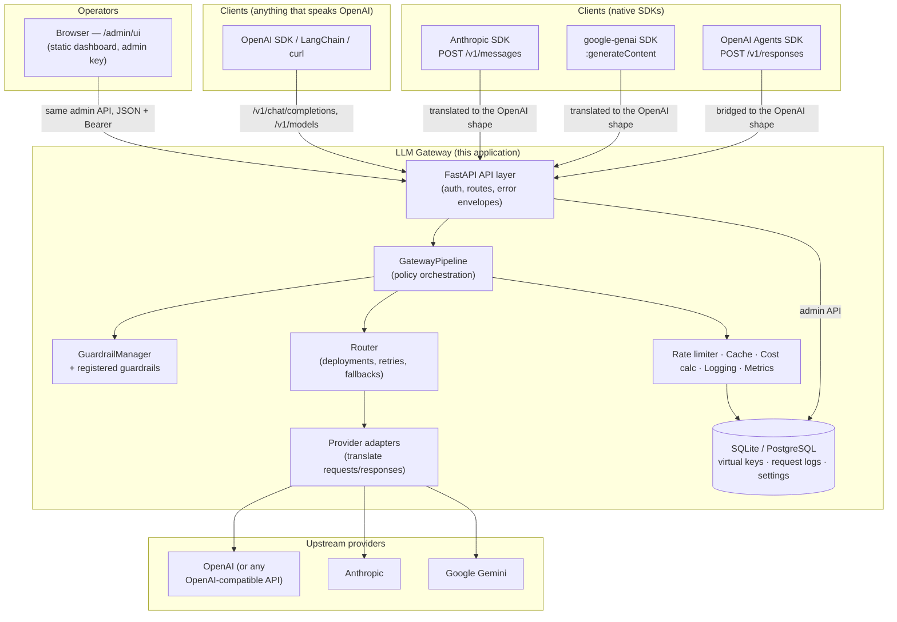
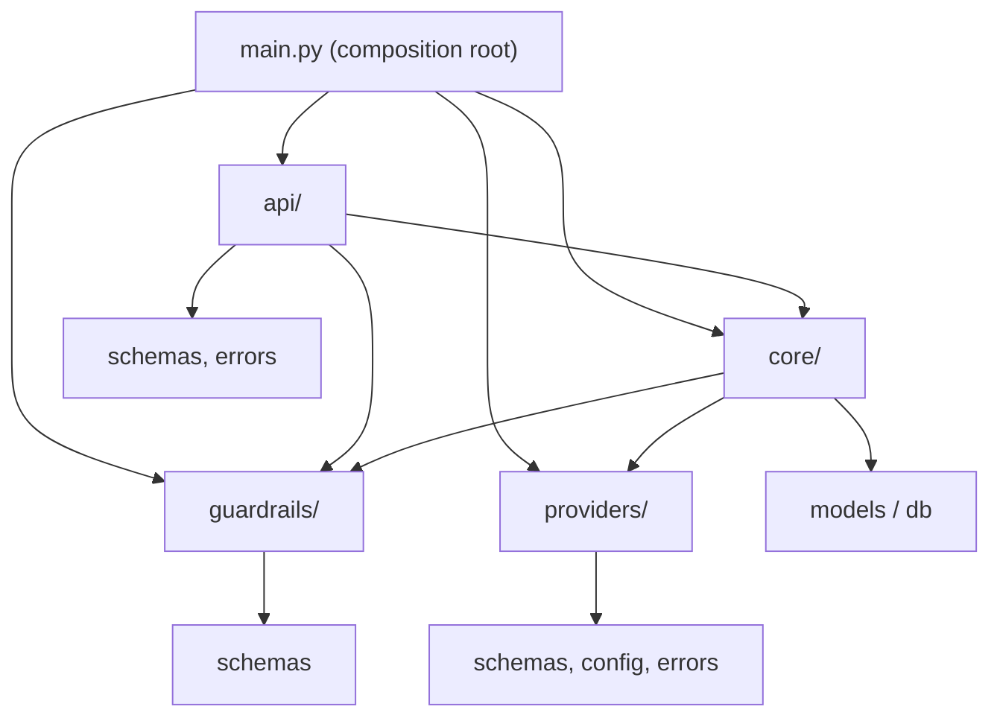
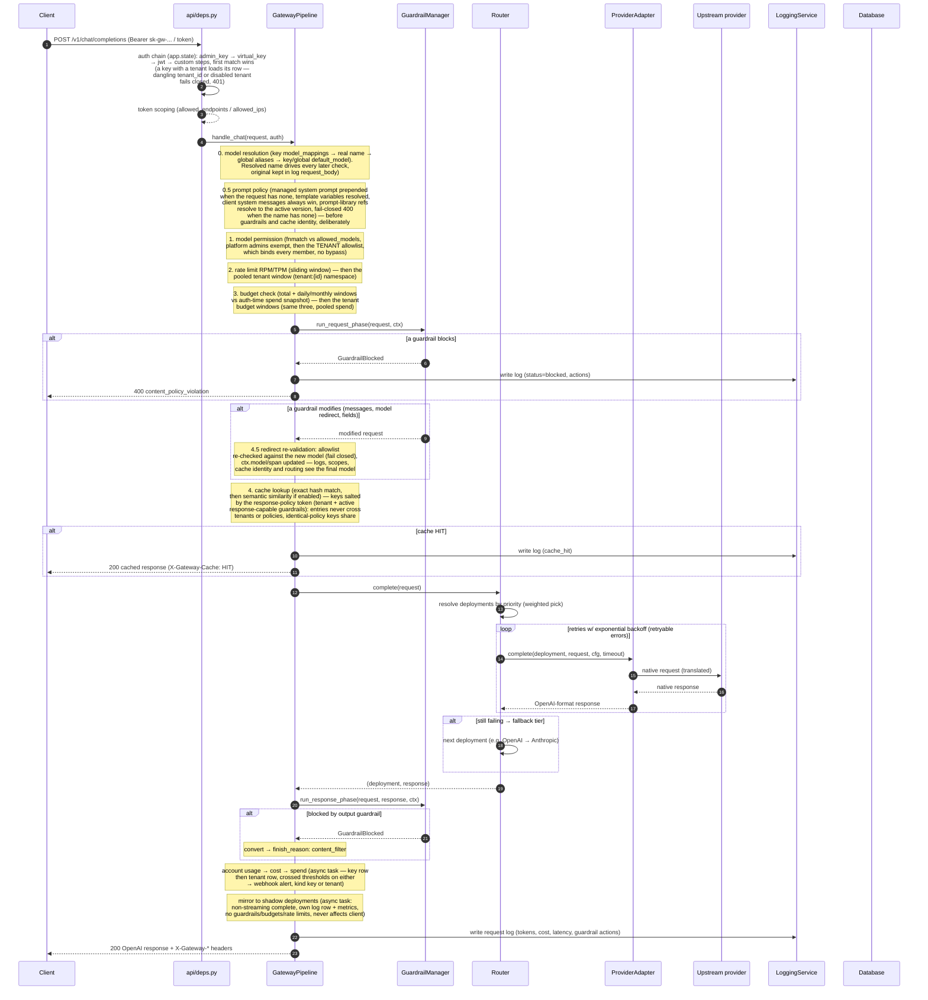
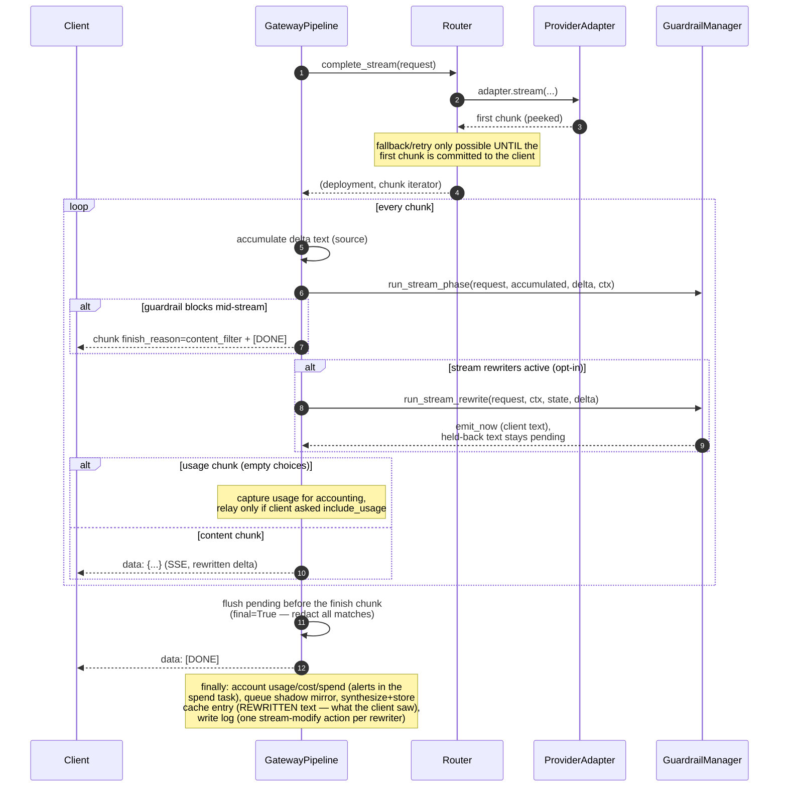
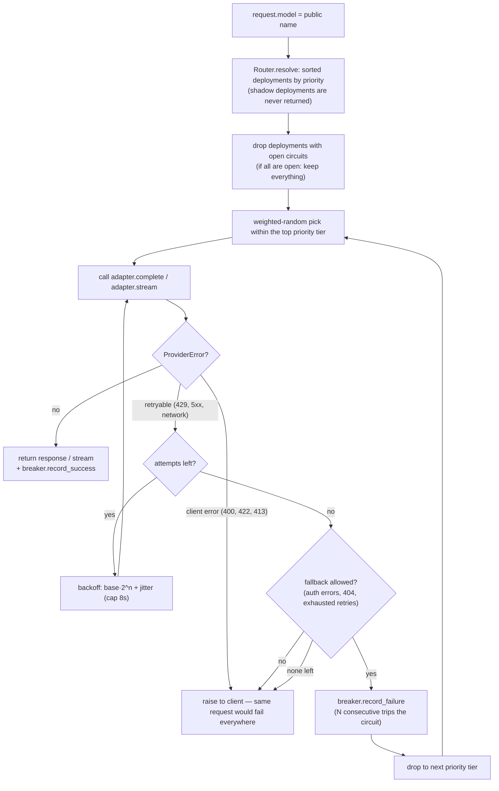
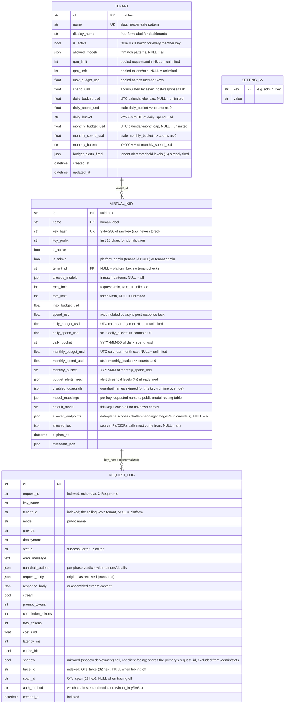
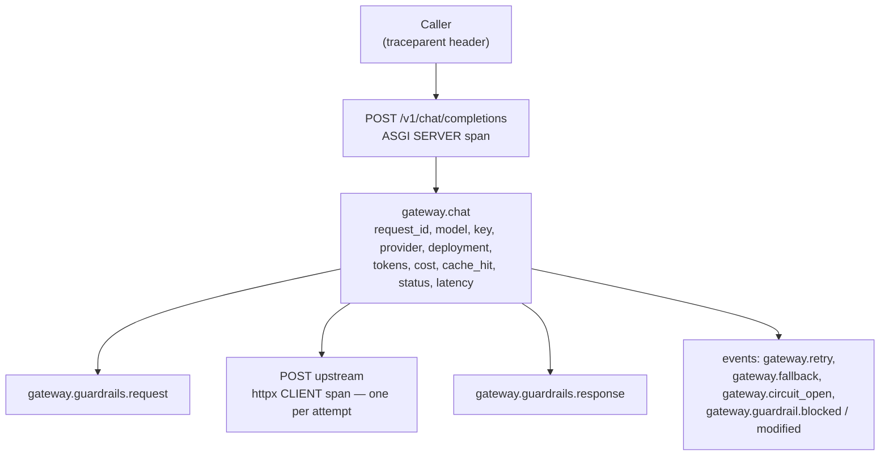

# Architecture

This document describes the LLM Gateway's architecture, module boundaries, request lifecycle, extension points, and an honest assessment of how modular and flexible the system currently is.

- **Codebase**: 60 Python files, ~16,100 lines, 736 tests (+ one static HTML file — the admin dashboard)
- **Stack**: Python 3.12+ / FastAPI (async) / httpx / SQLAlchemy 2 (async) / Pydantic v2
- **Companion docs**: [README.md](README.md) for usage, configuration and quick start

---

## 1. Design goals

The gateway exists to sit **between clients and LLM providers** and provide centralized control. Four properties drove every structural decision:

| Goal | How it shaped the code |
|---|---|
| **Clients see one API** | The gateway speaks the OpenAI wire format north (client) and translates to provider-native formats south. Clients switch providers by changing a model name, never their code. |
| **Everything is inspectable** | Every request/response flows through explicit pipeline phases that can observe, modify, or reject traffic. Nothing bypasses the pipeline. |
| **Policies are pluggable** | Guardrails, provider adapters, authenticators, rate limiting, caching, cost and logging are interfaces + registries, not hardcoded branches. New behaviour is added by *registering*, not by editing the pipeline. |
| **Composition is config-driven** | Which providers exist, which guardrails run, which models map to which deployments — all declared in `config.yaml`, assembled by the app factory at startup. |

---

## 2. System context



---

## 3. Module map

```
gateway/
├── main.py                 App factory (create_app): composes ALL services; lifespan (DB init,
│                           key seeding, log-retention background task, SIGHUP →
│                           reload, readiness flag, drain-before-close), reload_gateway
│                           (one path for /admin/reload + SIGHUP), /healthz liveness
│                           (never checks deps) + /readyz readiness (503 while
│                           starting/draining/DB-down; breakers informational),
│                           exception handlers
├── config.py               Two-layer config: env Settings (secrets/DB) + YAML GatewayConfig (providers,
│                           models — incl. shadow deployments/canary weights — model_aliases/default_model,
│                           guardrails + their scopes, cache, routing incl. breaker backend, auth chain
│                           (admin_key/virtual_key/jwt/custom + JWT verification), audit + alerts webhooks,
│                           pricing (per-1M-token + modality unit prices), logging incl.
│                           store_bodies/retention_days/
│                           background_write, metrics incl. per_key,
│                           prompts incl. system_prompt/variables, multipart upload cap)
├── schemas.py              OpenAI-compatible pydantic models (request, response, chunks, admin);
│                           ChatCompletionRequest carries private attrs (never serialized,
│                           excluded from cache identity/logs) for the native Responses
│                           southbound — the bridge body + pristine-messages snapshot
├── errors.py               OpenAI-style error envelope + typed errors (ProviderError, GuardrailBlocked,
│                           RateLimitError, BudgetExceededError, ...)
├── models.py / db.py       SQLAlchemy ORM (Tenant, VirtualKey, RequestLog, Prompt,
│                           SettingKV) + async engine management incl. get_engine (readiness
│                           checks, VACUUM INTO backups)
├── bootstrap.py           First-boot seeding: admin key, default virtual key
├── serve.py + __main__.py `python -m gateway` runner (wrapped by scripts/gateway.sh):
│                           HTTP by default, HTTPS via three certificate modes —
│                           --self-signed (dev pair generated under deploy/certs/,
│                           reused after), --ssl-cert/--ssl-key (any PEM pair —
│                           private/org CA; also GATEWAY_SSL_CERT/GATEWAY_SSL_KEY
│                           env), --letsencrypt DOMAIN (certbot's live layout;
│                           restart after renewal — certs load at bind time);
│                           --redirect-http [PORT] adds a plain-HTTP listener
│                           308-redirecting every request to the HTTPS URL
│                           (method-preserving, Host-header aware, own daemon
│                           thread — uvicorn skips signals off the main thread);
│                           flags > env; TLS config errors surface as CLI usage
│                           errors, never stack traces
├── utils.py                Content flattening (text + [image]/[audio] part
│                           placeholders), token estimation, truncation,
│                           audio format<->MIME mapping helpers
│
├── api/                    ── HTTP layer (thin: parse → authenticate → delegate) ──
│   ├── deps.py             require_api_key: extract credential (Bearer,
│   │                       x-api-key, x-goog-api-key, api-key, ?key= — one
│   │                       namespace for all inbound wire formats) → hand it
│   │                       to the auth chain (app.state), then enforce token
│   │                       scoping (allowed_endpoints — chat / embeddings
│   │                       (incl. Gemini :embedContent/:batchEmbedContents) /
│   │                       images / audio / models — + allowed_ips, never
│   │                       on admins); require_admin gates the admin API,
│   │                       require_platform_admin additionally excludes
│   │                       tenant admins (the platform's own config
│   │                       endpoints: tenants, prompts, routing, guardrails,
│   │                       reload, backups). Every rejection — missing
│   │                       credential, chain 401, IP/endpoint-scope 403 —
│   │                       also logs one WARNING line on gateway.auth
│   │                       (method, path, client, reason, 12-char
│   │                       credential hint; failed auth never reaches
│   │                       the request-log pipeline, so this is its
│   │                       only server-side trace besides the
│   │                       gateway_auth_total counter)
│   ├── chat.py             POST /v1/chat/completions → pipeline.handle_chat
│   ├── embeddings.py       POST /v1/embeddings → pipeline.handle_embedding
│   ├── models.py           GET /v1/models (per-key filtered, incl. the key's mapping
│   │                       names) + GET /v1/models/{model}
│   │                       (OpenAI model object; the endpoint agent frameworks
│   │                       validate models against at startup)
│   ├── anthropic_native.py POST /v1/messages — native Anthropic Messages API
│   │                       inbound: parses to the internal OpenAI shape and
│   │                       re-renders responses/SSE (message_start, text/tool
│   │                       deltas, message_delta usage). Pure translation
│   │                       functions + a stateful stream renderer, like the
│   │                       provider adapters but reversed. Image blocks
│   │                       become image_url parts; the format has no audio
│   │                       input blocks at all; an image in an assistant
│   │                       response (image-capable routing) renders as an
│   │                       honest [generated image: …] text note
│   ├── gemini_native.py    POST /v1[/beta]/models/{model}:generateContent and
│   │                       :streamGenerateContent — native Gemini inbound with
│   │                       the same structure (parse → pipeline → render);
│   │                       inlineData parts parse to image_url (images) or
│   │                       input_audio (audio) parts and render back to
│   │                       inlineData on the response side; generationConfig
│   │                       responseModalities AUDIO + speechConfig parse to
│   │                       the internal audio-output request (modalities +
│   │                       audio.voice) and message.audio renders back to a
│   │                       text part + inlineData. Also serves native
│   │                       embeddings: :embedContent / :batchEmbedContents
│   │                       parse to the internal EmbeddingRequest (→
│   │                       pipeline.handle_embedding) and render replies in
│   │                       Gemini's {embedding}/{embeddings} shape;
│   │                       taskType/title are refused with 400s (they
│   │                       change embedding quality) and mixed batch
│   │                       sub-request models/dimensionalities likewise
│   ├── openai_responses.py POST /v1/responses — OpenAI Responses API inbound
│   │                       (the OpenAI Agents SDK's default transport):
│   │                       stateless bridge to the chat-completions core.
│   │                       Parses the chat-convertible subset (input items,
│   │                       instructions, function tools, text.format,
│   │                       input_image and input_audio parts) and
│   │                       re-renders responses/SSE in Responses shape
│   │                       (response.created → output_text.delta →
│   │                       response.completed); stateful features
│   │                       (previous_response_id, background, server-side
│   │                       tools) are rejected with clear 400s. Shares
│   │                       cache entries with /v1/chat/completions.
│   │                       Also attaches the original body + a pristine
│   │                       messages snapshot as private attrs, feeding
│   │                       the native Responses southbound
│   ├── images.py           POST /v1/images/generations → pipeline
│   │                       .handle_image_generation (stream: true rejected
│   │                       with a 400 — it would bypass accounting) +
│   │                       /v1/images/edits + /v1/images/variations
│   │                       (multipart parsed once at the edge, validated
│   │                       against uploads.max_upload_mb — 413 beyond;
│   │                       image parts may be files, repeated image[]
│   │                       files or base64 strings; unknown form fields
│   │                       ride along for provider passthrough)
│   ├── audio.py            POST /v1/audio/transcriptions + /translations
│   │                       (multipart parsed once at the edge, validated
│   │                       against uploads.max_upload_mb — 413 beyond —
│   │                       unknown form fields ride along for provider
│   │                       passthrough) + /v1/audio/speech (JSON in,
│   │                       binary audio streamed out)
│   └── admin.py            Keys CRUD (incl. per-key model_mappings / default_model,
│                           prompt policy fields and scoping fields; tenancy —
│                           tenant admins are forced into their own tenant on
│                           create (mismatch 400), refused re-homing (403),
│                           and see 404s for other tenants' keys/logs),
│                           tenants CRUD (platform admins: slug + display
│                           name + policy ceiling, budget re-arm on PATCH,
│                           delete refused while keys reference it), the prompt
│                           library CRUD (create/version, summaries, per-name
│                           versions, activate/candidate/fraction patch, delete —
│                           every mutation audited), logs (list omits
│                           bodies, /admin/logs/{id} returns
│                           them in full; tenant scoping forced for tenant
│                           admins, ?tenant_id= filter for platform), stats
│                           (by_tenant breakdown for platform admins),
│                           usage export (CSV/JSON billing
│                           extract, tenant filter + per-tenant aggregates),
│                           routing/guardrail introspection (key mutations
│                           and breaker resets emit audit records), operations —
│                           POST /admin/reload (hot-reload config.yaml; invalid
│                           config = 400, running one stays live; restart_required
│                           lists what a reload cannot swap) and the SQLite
│                           backup endpoints (POST /admin/backup online VACUUM
│                           INTO snapshot; GET/DELETE /admin/backups, flat
│                           names only) — and GET /admin/ui serving the static
│                           dashboard
│
├── core/                   ── Policy & orchestration (framework-agnostic; no FastAPI types) ──
│   ├── pipeline.py         GatewayPipeline: the chat request lifecycle (see §5) + the
│   │                       embeddings path (same pre-flight checks, no guardrails);
│   │                       _serve_simple is the shared wrapper for every non-chat
│   │                       surface (embeddings, images, audio: context, in-flight
│   │                       metric, span, error-path logging — streaming-aware, like
│   │                       handle_chat: a StreamingResponse finishes its own span)
│   │                       and handle_image_generation / handle_image_edit /
│   │                       handle_image_variation (one _serve_image tail: resolve →
│   │                       permission → rate limit → budget → dispatch → per-image
│   │                       cost) and handle_transcription / handle_speech run the
│   │                       modality pipelines on it — no guardrails, no response
│   │                       cache (X-Gateway-Cache: NONE), unit-priced cost via
│   │                       _account_cost (per image / per minute / per 1M chars);
│   │                       speech streams the provider's audio through a generator
│   │                       that accounts/logs/ends the span once the body completes
│   │                       (the streaming-chat shape — spend survives disconnects);
│   │                       uploaded files are never persisted (log rows carry file
│   │                       metadata; speech responses a note with media type + byte
│   │                       count);
│   │                       _resolve_model normalizes requested names to public names
│   │                       (per-key model_mappings → real names → global aliases →
│   │                       key default_model → global default) before any check,
│   │                       so permissions/caches/scopes/logs see one name;
│   │                       step 0.5 applies the prompt policy (core/prompts.py) —
│   │                       managed system prompt + {{variables}} — before guardrails
│   │                       and cache lookup, so checks and cache identity see the
│   │                       final prompt; a key's system_prompt_ref resolves through
│   │                       the prompt library first (fail-closed 400 on a name with
│   │                       no active version);
│   │                       step 4.5 re-checks the model allowlist after the
│   │                       guardrail phase (a reject-and-redirect redirect can
│   │                       never bypass permissions — fail closed, key-level
│   │                       admins exempt; the TENANT allowlist binds every
│   │                       member, tenant admins included) and updates
│   │                       ctx.model/span so rate-limit
│   │                       series, logs, response-phase scopes and cache
│   │                       identity all see the final model;
│   │                       tenancy (see §6): member keys additionally pass
│   │                       the tenant's model allowlist, a second pooled
│   │                       rate-limit window (tenant:{id} namespace, TPM
│   │                       included) and the tenant's three budget windows
│   │                       — no admin bypass at that layer by design;
│   │                       spend accounting writes the tenant row too and
│   │                       responses carry X-Gateway-Tenant;
│   │                       cache lookup/store salt the key with a
│   │                       response-policy token (tenant + active
│   │                       response-capable guardrails — see manager.py)
│   │                       so entries never cross tenants or policies
│   │                       _stream_with_guardrails runs block-style checks on
│   │                       the SOURCE text, then chains stream rewriters
│   │                       (rewrite_stream_text) — held-back text flushes
│   │                       before the finish chunk and at end-of-stream, and
│   │                       the cache entry / log response_body record the
│   │                       rewritten text the client actually saw;
│   │                       _queue_shadow mirrors successful requests to shadow
│   │                       deployments and _queue_prompt_ab mirrors a fraction of
│   │                       them to the library prompt's candidate version (same
│   │                       deployment, candidate swapped into the system slot;
│   │                       background tasks, like spend accounting);
│   │                       per-key series (metrics.per_key) emit beside the
│   │                       global ones in _request_metric/_account_usage — the
│   │                       same call sites the mirrors never reach
│   │                       apply_config swaps config-derived policy in place
│   │                       (hot-reload: guardrails, models/routing, pricing,
│   │                       aliases, prompt knobs; built before assignment so
│   │                       a bad config raises with the old one still live),
│   │                       and _spawn/drain_background_tasks track that
│   │                       fire-and-forget work so shutdown drains it before
│   │                       the engine goes away
│   ├── context.py          RequestContext / AuthContext — per-request state threaded
│   │                       everywhere; AuthContext carries the key's routing
│   │                       overrides (model_mappings / default_model) and prompt
│   │                       policy (system_prompt / system_prompt_ref /
│   │                       prompt_variables) plus the snapshotted tenant row
│   │                       (id/name + its allowlist/limits/budget windows —
│   │                       the same auth-time-consistency trade-off the key's
│   │                       budget fields make); RequestContext.route names
│   │                       the inbound surface (chat / responses /
│   │                       messages / gemini) that guardrail route
│   │                       scopes match against
│   ├── router.py           Deployment selection, weighted LB, retries w/ backoff, fallback tiers
│   │                       — one shared non-streaming executor (_dispatch: resolve →
│   │                       breaker filter → retries → fallback) behind complete /
│   │                       embed / generate_image / edit_image / vary_image /
│   │                       transcribe / speak, so every
│   │                       modality gets the identical contract. Shadow deployments
│   │                       are excluded from serving (resolve
│   │                       filters them; shadow_deployments() lists the mirroring
│   │                       targets); apply_config hot-swaps models/deployments
│   │                       and routing policy in place — breakers and provider
│   │                       adapters survive the swap
│   ├── breaker.py         Per-deployment circuit breakers: closed → open (skip) → half-open (probe);
│   │                       request-level failure counting, Prometheus state gauge,
│   │                       admin reset; register() is idempotent — a config
│   │                       hot-reload keeps existing breaker state
│   │                       Async registry facade (in-memory backend — the sync state
│   │                       machine is untouched); RedisCircuitBreakerRegistry below
│   │                       is the interchangeable shared-state backend
│   ├── ratelimit.py        Sliding-window RPM/TPM, in-memory (async interface)
│   ├── redis_backends.py   RedisRateLimiter + RedisResponseCache + RedisCircuitBreaker
│   │                       Registry — shared windows, cache entries and circuit-breaker
│   │                       state across workers/replicas, semantics preserved
│   ├── cache.py            Exact-match response cache + stream replay (async
│   │                       interface); cache_key_for salts the normalized
│   │                       request with the caller's response-policy token
│   ├── semantic_cache.py   Semantic cache: embeds the normalized request (via the
│   │                       configured embeddings model, routed like any embeddings
│   │                       call — see embed_fn_for in router.py) and serves the best
│   │                       same-model response above a cosine threshold; buckets
│   │                       are (model, policy token) so near-duplicates never
│   │                       cross tenants or policies; TTL + LRU
│   │                       bounded, embedder failures degrade to a miss
│   ├── cost.py             CostCalculator: per-1M-token pricing, longest-prefix lookup;
│   │                       unit prices for non-token modalities (image_usd,
│   │                       audio_usd_per_minute, speech_usd_per_1m_chars —
│   │                       same config block, same prefix match)
│   ├── auth.py             Pluggable auth chain (Authenticator ABC → AuthChain.
│   │                       from_config): built-in admin_key (constant-time vs
│   │                       app.state), virtual_key (SHA-256 row lookup) and jwt
│   │                       (HS256 secret or JWKS with kid-rotation refresh; the
│   │                       token's key_claim names the virtual key whose row
│   │                       supplies all policy) steps + "pkg.module:ClassName"
│   │                       custom loading, unknown names failing at startup;
│   │                       auth_context_from_key snapshots a row (incl. scoping
│   │                       + routing overrides and auth_method for logs) and
│   │                       load_tenant_for_key loads the key's tenant row
│   │                       into the same snapshot — failing closed on a
│   │                       dangling tenant_id (corrupt state) and a disabled
│   │                       tenant (the kill switch), so a member key is
│   │                       never served as an unrestricted platform key
│   ├── audit.py             AuditLogger: one JSON record per security-relevant
│   │                       admin action (key create/update/revoke, breaker
│   │                       reset), delivered best-effort by a background task
│   │                       (never blocks the admin call), counted on AUDIT
│   ├── prompts.py          Gateway-managed prompt policy: apply_prompt_policy
│   │                       (managed system prompt prepended when the request
│   │                       carries none — client system/developer messages,
│   │                       incl. every native inbound format's system field,
│   │                       always win) + substitute ({{variable}} resolution,
│   │                       known names only — unknown placeholders and literal
│   │                       braces pass through); runs between model resolution
│   │                       and the guardrail phases, so checks and cache
│   │                       identity see the final prompt
│   ├── prompt_library.py   Versioned prompt library (prompt ops): CRUD over the
│   │                       prompts table (create_version auto-activates the
│   │                       first of a name; patch_version activates/uncandidates
│   │                       siblings — one active, at most one candidate per
│   │                       name; delete refuses the active version) + cached
│   │                       resolve() for the data plane (in-process TTL,
│   │                       admin writes invalidate immediately — the TTL is the
│   │                       cross-replica backstop); feeds pipeline step 0.5
│   │                       and the A/B mirror (_queue_prompt_ab)
│   ├── alerts.py           BudgetAlertManager: threshold crossings → webhook. Fired-level
│   │                       state persists on the budgeted row — key or tenant
│   │                       (kind= on evaluate; the webhook payload says which,
│   │                       tenants identified as tenant:{id}) — survives restarts,
│   │                       correct across workers; raising a budget re-arms;
│   │                       best-effort delivery
│   └── logging_svc.py      Request log persistence + spend accounting — add_spend uses
│                           UPDATE…RETURNING for an atomic post-update snapshot and
│                           feeds it to the alert manager (same background task);
│                           _add_tenant_spend runs the identical statement on the
│                           tenant row (pooled member spend + tenant alerts, a
│                           separate transaction so a tenant-write failure never
│                           loses the key's accounting);
│                           the same statement rolls the daily/monthly budget
│                           windows (CASE on the stored bucket id: same window →
│                           accumulate, rolled → replace), so concurrent requests
│                           can never straddle a boundary;
│                           store_bodies=false skips persisting bodies (PII-safe mode),
│                           prune() deletes rows older than retention_days (called from
│                           the lifespan retention loop, counted on LOGS_PRUNED);
│                           QueuedLoggingService (logging.background_write) is a
│                           drop-in subclass whose write_request_log only
│                           enqueues — a lazily started consumer performs the
│                           writes; full queue drops (LOGS_DROPPED), stop()
│                           drains (lifespan teardown + tests)
│
├── guardrails/             ── The policy plugin framework ──
│   ├── base.py             Guardrail ABC (check_request / check_response /
│   │                       check_stream_delta / rewrite_stream_text) +
│   │                       GuardrailResult (allow/modify/block; modify can
│   │                       carry messages, a model redirect and arbitrary
│   │                       request fields — they chain across guardrails)
│   │                       + per-guardrail mode (enforce/observe) + scope
│   ├── manager.py          Registry, config/entrypoint loading, phase
│   │                       execution (one model_copy per MODIFY, chained),
│   │                       observe-mode enforcement (verdicts logged, not
│   │                       applied), mid-stream rewriting (StreamRewriteState
│   │                       per request, run_stream_rewrite chains rewriters —
│   │                       each sees the previous one's output), scoping:
│   │                       _in_scope (fnmatch over key name / public model /
│   │                       inbound route) + per-key disabled_guardrails
│   │                       override — out-of-scope guardrails are skipped
│   │                       before any phase runs; response_policy_token
│   │                       fingerprints the response-capable guardrails
│   │                       active for a caller (+ the tenant) to salt cache
│   │                       identity — a hit skips response guardrails, so
│   │                       entries may only serve callers whose policy
│   │                       (and tenant) shaped them
│   └── builtins/           pii_redaction · prompt_injection · keyword_blocklist ·
│                           output_moderation · response_schema · request_limits
│                           (block or reject-and-redirect on exceed) ·
│                           presidio_pii (Microsoft Presidio; optional 'guardrails' extra)
│
├── providers/              ── Upstream translation layer ──
│   ├── base.py             ProviderAdapter ABC (complete / stream / embed /
│   │                       generate_image / edit_image / vary_image /
│   │                       transcribe / speak) + provider
│   │                       error mapping; the non-chat methods default to
│   │                       501-with-fallback, so chat-only providers fall
│   │                       through to a modality-capable deployment
│   ├── openai_adapter.py   Near-passthrough (works for any OpenAI-compatible base URL);
│   │                       URL/header construction lives in overridable hooks
│   │                       (_chat_url / _responses_url / _embed_url /
│   │                       _images_url / _images_edits_url / _images_
│   │                       variations_url / _audio_url / _speech_url /
│   │                       _headers + _auth_headers for multipart, where
│   │                       httpx owns the Content-Type);
│   │                       native_responses deployments forward the original
│   │                       Responses body southbound (see responses_native.py)
│   ├── azure_adapter.py    Azure OpenAI: subclasses the OpenAI adapter, overrides only
│   │                       the hooks — deployment-addressed URLs
│   │                       (/openai/deployments/{name}/...?api-version=), api-key
│   │                       header, optional providers.azure.api_version
│   ├── anthropic_adapter.py / gemini_adapter.py
│   │                       Full request/response/stream translation incl. tools,
│   │                       images and audio input (pure translation functions +
│   │                       stateful stream translators); the Anthropic adapter
│   │                       refuses input_audio parts (no audio input in the
│   │                       Messages API) with fallback=True so the routing
│   │                       group falls through; the Gemini adapter maps
│   │                       input_audio ↔ inlineData, sets responseModalities
│   │                       TEXT+IMAGE for image models in chat (image-to-image:
│   │                       inlineData output becomes image_url content parts,
│   │                       streaming refused — no chunk-delta representation)
│   │                       and also translates image generation and editing
│   │                       (OpenAI Images → generateContent with
│   │                       responseModalities; uploads ride as inlineData input
│   │                       parts, one image per call, n = n calls) and speaks
│   │                       TTS natively (generateContent AUDIO modality,
│   │                       OpenAI→Gemini voice mapping with pass-through, raw
│   │                       PCM served as WAV — stdlib wave header — or raw for
│   │                       response_format: pcm)
│   ├── responses_native.py Native Responses southbound: native_body (decision — flag on,
│   │                       bridge body attached, messages still the pristine parse —
│   │                       plus the build with the provider-native model id) and the
│   │                       back-translations (completion_to_chat,
│   │                       stream_events_to_chunks) that keep the chat shape as the
│   │                       spine; a guardrail/prompt-policy modification means
│   │                       falling back to the chat conversion (nothing dropped)
│   └── sse.py              Shared SSE line parser
│
└── observability/
    ├── metrics.py          Prometheus counters/histograms/gauges (24 series),
    │                       incl. the opt-in per-key family (KeyLabeler caps
    │                       key-name cardinality at metrics.per_key_max_series,
    │                       collapsing the rest into __overflow__)
    ├── tracing.py          OpenTelemetry setup: resource, head-based sampler
    │                       (OTEL_TRACES_SAMPLER), BatchSpanProcessor (OTEL_BSP_*),
    │                       OTLP/console exporter selection
    ├── logs.py             Structured logging: JsonFormatter / TextFormatter
    │                       (GATEWAY_LOG_FORMAT — both carry the per-request
    │                       record's extras; text installs a root stdout
    │                       handler when root is unconfigured, basicConfig
    │                       semantics, so plain uvicorn actually prints
    │                       INFO records) + OTel logs pipeline (records
    │                       stamped with the current span's trace context)
    ├── wire.py             Wire capture for request-log rows: allowlisted
    │                       client request headers (set by the middleware),
    │                       the upstream request as sent to the provider
    │                       (method/path/native body, via httpx request
    │                       hooks) and allowlisted provider response
    │                       headers (via response hooks) — context-local,
    │                       snapshotted into RequestContext before the row
    │                       is written
    └── metrics_bridge.py   Prometheus → OTel bridge: mirrors gateway.* series
                            into an OTLP metrics pipeline (observable instruments
                            reading the live prometheus_client registry)

└── static/
    └── admin.html          The admin dashboard: one self-contained HTML file
                            (inline CSS + vanilla JS, zero external resources —
                            no CDN, no build step, works air-gapped). Served at
                            /admin/ui without auth (the shell holds no data);
                            talks to the JSON admin API above with the admin key
                            pasted into a login overlay (kept in sessionStorage,
                            sent as Bearer). 6 tabs: overview stats (+ usage CSV
                            export for the selected window, by-tenant breakdown
                            when tenants have traffic), key
                            management (create/edit/revoke, raw key shown once,
                            tenant placement + admin-key grants for platform
                            admins; badges for tenant membership and admin
                            keys), tenant management (create/edit/delete,
                            pooled budget bars, kill switch — platform admins
                            only; a tenant admin lands on a scoped note),
                            request logs (filter, paginate, expand full bodies),
                            routing table with live breaker state + reset,
                            guardrail inventory. A test enforces the
                            no-external-resources invariant.
```

### Layering rules



**Dependency direction is strictly downward**: the API layer never touches providers directly; the pipeline never imports FastAPI response types into `core/` business logic (it returns `JSONResponse`/`StreamingResponse` but receives plain request models); guardrails and providers never import the pipeline. The composition root (`create_app`) is the *only* place that knows how to wire concrete implementations together — which is what makes the whole thing swappable.

---

## 4. The two extension frameworks

### 4.1 Guardrails — the primary extension point

Every byte of client↔provider traffic passes through guardrail phases. The framework is deliberately small (one ABC, one result type, one manager):


**Phase semantics:**

| Phase | When | Can modify | Can block | Block surfaces as |
|---|---|---|---|---|
| `check_request` | Before cache/routing/provider | messages, **model** (reject-and-redirect), **arbitrary request fields** (`temperature`, `tools`, ...) — all chaining | ✅ | HTTP 400 `content_policy_violation` |
| `check_response` | After provider call, before client | full response dict | ✅ | `finish_reason: "content_filter"` (OpenAI semantics) |
| `check_stream_delta` | Per streamed chunk | ❌ (block-only) | ✅ | terminal `content_filter` chunk + `[DONE]` |
| `rewrite_stream_text` | Per streamed chunk (opt-in) | **the stream text itself** — held-back text flushes before the finish chunk | ❌ | — (compose with `check_stream_delta` for blocks) |

**Registration paths (both require zero changes to core code):**

1. **Built-in by name** — `guardrails: [{name: pii_redaction, params: {...}}]` in `config.yaml`
2. **Custom class** — `guardrails: [{name: anything, class: "my_pkg.mod:MyGuardrail", params: {...}}]`; loaded via `importlib` by `GuardrailManager.from_config`

All verdicts are recorded into `RequestContext.guardrail_actions` (→ request logs → admin API) and Prometheus (`gateway_guardrail_blocks_total`). Guardrails run **sequentially in config order**; a `MODIFY` feeds the modified value to the next guardrail (chaining, e.g. redaction before injection-scoring) — messages, model and fields all compose in one `model_copy` per guardrail.

**Reject-and-redirect.** `GuardrailResult.redirect(model, reason)` turns a request-phase verdict into a routing decision — "this content is too expensive for the flagship model, serve it on the small one" instead of a 400. The pipeline re-checks the key's model allowlist after the guardrail phase (fail closed: a redirect can never bypass permissions), then routes, meters, logs and caches against the final model while `request_body` keeps what the client asked for. The built-in `request_limits` exposes the same pattern from config (`on_exceed: redirect` + `redirect_model`).

**Mid-stream rewriting.** `check_stream_delta` can only block — by the time it fires, the flagged text has reached the client. A guardrail with `supports_stream_rewrite = True` implements `rewrite_stream_text(text, final)` and rewrites the stream *as it flows*: the manager chains rewriters (each sees the previous one's output plus its own held-back buffer), the pipeline flushes held-back text before the finish chunk and at the end of the stream, and the response body / cache entry store what the client actually saw. Block-style checks still see the **source** text — moderation judges what the model said, not the rewrite. `pii_redaction`'s `mask_in_stream` implements the reserve heuristic: hold back the last `stream_reserve_chars` (default 100) of each delta, because a match split across provider chunks must never leak half-redacted.

**Observe mode.** Every guardrail entry accepts `mode: enforce` (default) or `mode: observe`. The manager — not the guardrail — enforces it: in observe mode a block/modify verdict is recorded in `guardrail_actions` (with `"mode": "observe"`), counted on `gateway_guardrail_observed_total{guardrail,phase,action}`, and emitted as a `gateway.guardrail.observed` span event (carrying the `would` action), but nothing is blocked or rewritten, and later guardrails still run over the *unmodified* traffic. This is the rollout path for new guardrails: run in observe, read the would-be verdict rate from logs/metrics, then flip to enforce. `gateway_guardrail_blocks_total` counts enforced blocks only, so alert semantics don't change between modes.

**Scoping.** Two composing mechanisms decide which *requests* a guardrail applies to — neither requires anything of the guardrail subclass:

1. **Config scope** (`guardrails[].scope`, fnmatch globs): `keys`/`exclude_keys` match the calling key's *name* (the admin key is `"admin"`), `models`/`exclude_models` match the public model name *after* alias resolution (and after any guardrail redirect), `routes`/`exclude_routes` match the inbound API surface (`chat` / `responses` / `messages` / `gemini` — per-route policy without separate guardrail instances). `exclude_*` wins over the matching include list, and all present fields must match (`AND`).
2. **Per-key runtime override** (`VirtualKey.disabled_guardrails`, a flat name list set via the admin API/UI without a restart): always wins over config scope — disable-only, so the blast radius of a mis-edit is "one guardrail on one key", never "guardrail off for everyone".

The manager filters (`_in_scope` + `_active`) *before* running any phase, so an out-of-scope guardrail produces no verdict, no log entry and no metric — as if it weren't configured. Scopes show up in `describe()` → `/admin/guardrails` and the dashboard's guardrail inventory.

**Presidio (`presidio_pii`, optional `guardrails` extra).** The regex `pii_redaction` builtin is deliberately heuristic; `presidio_pii` wraps [Microsoft Presidio](https://github.com/microsoft/presidio) for real detection quality: a curated default entity set (emails, phones, cards, IBANs, IPs, US SSN/ITIN/bank numbers, and — with the NLP engine — `PERSON`/`LOCATION`), per-entity `block_entities` (block instead of redact), `score_threshold`, and `mask_in_response`. The engine is constructed once per process and shared (`_ENGINE_CACHE`); analysis runs in a worker thread (`asyncio.to_thread`) since spacy NER is CPU-bound. `use_nlp: false` builds a pattern-only engine (no model load, no NER entities — the defaults silently drop them; an explicit request for them raises). Unlike the regex builtin it has no stream phase at all: per-chunk full-text analysis would be O(n²), and the reserve heuristic that makes `pii_redaction`'s `mask_in_stream` cheap does not map onto analyzer scores.

### 4.2 Provider adapters

Adding an upstream provider means implementing one ABC and adding a registry entry — the router, pipeline, guardrails, and clients are untouched:


**The key contract**: adapters *speak OpenAI on both sides*. `complete()` returns an OpenAI `chat.completion` dict; `stream()` yields OpenAI `chat.completion.chunk` dicts (usage attached to a final empty-choices chunk); `embed()` returns an OpenAI `list[embedding]` dict (canonical float form — `encoding_format: base64` is applied by the pipeline on the way out, so cache entries stay provider-neutral). This is what decouples the entire upper stack from provider specifics — the pipeline doesn't know Anthropic exists. Chat-only providers keep the base `embed()` default: a clear 501 that the router treats as "not retryable here, fall through to the next deployment".

Two structural choices make adapters independently testable:

- **Translation is pure** — `anthropic_adapter.translate_request(request, native_model) → dict` and `translate_response(native, public_model) → dict` are side-effect-free functions (unit-tested without HTTP).
- **Stream translation is a stateful converter** — `AnthropicStreamTranslator` / `GeminiStreamTranslator` consume native SSE events and emit OpenAI chunks; the adapter's I/O shell is thin.
- **HTTP client is injected** — every adapter takes an `httpx.AsyncClient`, so tests wire in `httpx.MockTransport` and the same adapter code runs against a fake upstream (all 736 tests run with no network).

Note also: because the OpenAI adapter is a passthrough over a configurable `api_base`, **any OpenAI-compatible service (vLLM, Ollama, Groq, Together, …) is already supported** without new code — for chat, embeddings, images and audio.

### 4.3 Embeddings

`POST /v1/embeddings` reuses the whole policy stack with a thinner path: model permission → rate limit (~chars/4 per input) → budget → exact-match cache → `router.embed` (same retry/fallback/breaker contract as `complete`) → usage/cost accounting → request log. The differences from chat, all deliberate:

- **No guardrails** — the guardrail phases are typed over chat messages (`ChatCompletionRequest`); applying them to embedding inputs would need a separate phase signature. PII in embedding inputs must be handled client-side for now.
- **Cache is exact-match over (model, input, dimensions)** — embeddings are deterministic, so hit rates are typically much higher than for chat. `encoding_format` is not part of the key: the cache stores the canonical float form and base64 (little-endian float32, like OpenAI) is re-encoded per request.
- **Gemini translation** — one `batchEmbedContents` call per ≤100 inputs (the API's batch limit), `dimensions` → `outputDimensionality`; token usage is estimated (~chars/4) because the API returns no counts. Anthropic has no embeddings API: the base adapter's default raises a clear 501 that the router treats as a non-retryable, fall-through error — so a mixed routing group (Anthropic primary, OpenAI fallback) still serves embeddings.
- **No `/v1/embeddings` for pre-tokenized input** (arrays of token ids) — tokenize client-side.

### 4.4 Images & audio

The modality endpoints (`/v1/images/generations`, `/v1/images/edits`, `/v1/images/variations`, `/v1/audio/transcriptions`, `/v1/audio/translations`, `/v1/audio/speech`) are a fourth *kind* of surface, built on the same two pieces the embeddings path uses — the shared non-streaming executor (`router._dispatch`: resolve → breaker filter → retries → fallback, so a failing image deployment fails over exactly like a chat one) and the shared pipeline wrapper (`pipeline._serve_simple`: context, in-flight metric, span, error-path logging — streaming-aware, so a streamed speech response finishes its own span when the body completes). The modality handlers add:

- **Adapter contract with graceful gaps** — `generate_image` / `edit_image` / `vary_image` / `transcribe` / `speak` on `ProviderAdapter`, each defaulting to a 501 that is non-retryable on the deployment but falls through the routing group. OpenAI and Azure implement all of them (Azure, as ever, by overriding only the URL hooks); Gemini translates image generation *and editing* to `generateContent` with `responseModalities` (uploaded images ride as inlineData input parts next to the prompt — one image per call, `n` = `n` sequential calls; `size`/`quality`/`mask` have no Gemini equivalent) and speaks TTS natively (AUDIO modality, OpenAI voice names mapped to Gemini prebuilt voices — a documented approximate pairing, unknown names pass through — with raw PCM served as WAV via a stdlib `wave` header, or raw for `response_format: pcm`; no mp3 transcoding, `speed` ignored); Anthropic has no image/audio APIs and relies on the fall-through.
- **Unit-priced accounting** — `_account_cost` mirrors `_account_usage` minus the usage dict: cost comes from `CostCalculator`'s unit prices (`image_usd` per generated/edited image, `audio_usd_per_minute` from the duration a `verbose_json` transcription reports — plain `json` reports none and costs nothing, a documented trade-off — and `speech_usd_per_1m_chars`), while token counters stay estimates for the log row and TPM. For streamed speech, the header carries the (char-based, known-upfront) cost and the actual accounting lands when the body completes — spend survives client disconnects because the finalize path runs in the generator's `finally`.
- **Multipart at the edge** — the audio and image-edit/variation endpoints parse `multipart/form-data` once in the API layer, validate the upload against `uploads.max_upload_mb` (413 beyond), and the OpenAI adapter re-serializes it upstream with *unknown form fields passed through* (provider-specific parameters keep working without gateway changes). Image parts may be uploaded files (single `image`, repeated `image[]`), or base64 strings (with an optional `data:` URL prefix) for base64-native clients.
- **Never-persisted uploads** — log rows carry file metadata (names, sizes) only, and a speech response is logged as a note (media type + byte count). No response cache for any of these surfaces (`X-Gateway-Cache: NONE`): generation is non-deterministic and transcription is cheap relative to its upload.

### 4.5 Multimodal chat

Audio and images also ride *inside* chat messages, not just through the modality endpoints. The internal representation is OpenAI's — `input_audio` parts (`{data: <base64>, format: wav|mp3}`) alongside the `image_url` parts vision has always used — and every inbound format reaches it:

- **OpenAI chat / Responses bridge** — `input_audio` parts pass through the OpenAI/Azure adapters verbatim (they are near-passthroughs over content); the Responses bridge accepts `input_audio` input items (the Agents SDK shape) and maps them onto the same parts.
- **Native Gemini** — `inlineData` parts with an `audio/*` mimeType parse to `input_audio` (format = the MIME subtype, `audio/mpeg` normalized to `mp3`; parameters like `rate=` ride along and round-trip), and `input_audio` renders back to `inlineData` southbound. Image `inlineData` keeps using `image_url` data-URL parts, as before.
- **Native Anthropic** — the Messages API has no audio input block type at all, so the southbound adapter *refuses* rather than silently dropping the audio: a 400 (`audio_input_not_supported`) with `fallback=True`, so a mixed routing group (Anthropic primary, OpenAI or Gemini fallback) still serves the request — the same pattern as `response_format`.

Two cross-cutting behaviors:

- **Flattening** — guardrails, managed prompts and token estimation see `content_to_text`, where an audio part becomes `[audio]` (like `[image]`). The placeholder keeps guardrail text-matching working and keeps base64 out of anything text-shaped; the trade-off is that TPM pre-flight under-counts audio (real billing uses provider-reported usage).
- **Image-to-image chat** — a Gemini image model on the chat surface: the adapter sets `responseModalities: [TEXT, IMAGE]` for native models with `image` in their name (covers gemini-2.5-flash-image and the 2.0 preview), input images ride as inline parts, and output `inlineData` becomes an `image_url` content part in `message.content` (mixed text+image responses become content-part lists). Native Gemini responses render the parts back to `inlineData`; the Anthropic-native surface renders a `[generated image: …]` text note (its assistant messages cannot carry image blocks). Streaming is refused with a clear 400 — an image has no chunk-delta representation, and silently dropping it from a stream would be the exact failure mode the gateway exists to prevent.

**Audio output in chat** is the mirror image: the client asks for speech with OpenAI's `modalities: ["text", "audio"]` + `audio: {voice, format}` (gpt-4o-audio shape), and the reply carries `message.audio` (`{id, data, expires_at, transcript}` — the words in `transcript`, the base64 sound in `data`, `content` null).

- **OpenAI / Azure** — both fields ride verbatim (the adapters are near-passthroughs) and `message.audio` / streamed `delta.audio` chunks pass back through — the gateway's canonical audio-response shape *is* OpenAI's.
- **Gemini** — `modalities`+`audio.voice` translate to `responseModalities: [TEXT, AUDIO]` + `speechConfig` (voice mapped through the same TTS voice map; an explicit audio request overrides the image-model heuristic). The reply's text parts are the transcript and its `inlineData` PCM becomes `message.audio.data` — WAV-wrapped by default (`audio.format: wav`), raw for `pcm16`, mirroring the TTS serving rules. Streaming is refused with a clear 400 (`audio_streaming_not_supported`): Gemini streams raw PCM with no OpenAI chunk-delta representation, and re-framing WAV headers mid-stream is not something the gateway does — retry with `stream: false`.
- **Native Gemini inbound** — `generationConfig.responseModalities: [TEXT, AUDIO]` + `speechConfig` parse to the internal audio-output request (and translate back southbound, so a Gemini deployment round-trips); the reply renders as a text part + `inlineData` (WAV-labeled, RIFF-sniffed; raw pcm16 labeled `audio/L16;rate=24000`).
- **Anthropic** — no audio output in the Messages API: the adapter refuses with a 400 (`audio_output_not_supported`, `fallback=True`) so a mixed routing group still serves the request; the Anthropic-*native* surface renders an audio reply's transcript as its text block (that is exactly what the model said).
- **Guardrails see the words, never the bytes** — `utils.assistant_text` flattens `content` *plus* `audio.transcript`, so keyword blocklists, output moderation and prompt-injection checks see speech; the redactors redact the transcript text (audio bytes are never rewritten). Streamed `delta.audio.transcript` deltas accumulate into the same stream-phase checks that guard text, and the log's emitted text includes them.
- **The Responses bridge** has no audio-output request field (its subset is text-shaped); if an audio response reaches it anyway, the transcript renders as `output_text` rather than vanishing.

**Native Gemini embeddings inbound** — `POST /v1[/beta]/models/{model}:embedContent` and `:batchEmbedContents` close the last inbound-format gap: they parse to the internal `EmbeddingRequest` and run the exact embeddings pipeline (§4.3 — allowlists, rate limits, budgets, caching, retries/failover, logs), rendering replies in Gemini's `{embedding: {values}}` / `{embeddings: [{values}]}` shape. The `:method` paths map to the `embeddings` token scope (a chat-only key gets 403). Two Gemini-only fields are refused with 400s rather than silently dropped, because both change the result: `taskType`/`title` (a RETRIEVAL_DOCUMENT embedding differs from the default) and mixed per-sub-request `model`/`outputDimensionality` in a batch (the gateway routes the whole batch to one deployment). `outputDimensionality` maps to `dimensions`; the body's `model` fields (native names) are ignored — the URL model routes, as everywhere.


---

## 5. Request lifecycle

*(The embeddings path is the same pipeline minus guardrails and streaming — see §4.3; images and audio likewise — see §4.4.)*

### 5.1 Non-streaming sequence



### 5.2 Streaming sequence (differences only)



Two properties worth highlighting:

- **Failover before commitment** — the router peeks the first chunk before handing the stream to the client, so a dead provider triggers retries/fallback transparently. After the first chunk is sent, switching providers is no longer possible (the client already saw partial output).
- **Guardrails see streamed text incrementally** — `accumulated_text` is everything sent so far, so output moderation works on the growing response, not just complete ones. Block checks see the *source* text (what the model said); rewriters change what the client receives, and their held-back text flushes right before the finish chunk — so a PII span split across provider chunks never reaches the client in any form.

### 5.3 Routing decision flow



---

## 6. Data model



**Tenancy.** A `Tenant` is an organization of virtual keys with its own policy ceiling: `allowed_models`, RPM/TPM and the same three budget windows keys have, mirrored field-for-field so the enforcement code paths stay symmetric. The semantics are strictly *narrowing*: a member key must pass both its own checks and the tenant's (model allowlists intersect; rate limits are two windows — the key's and the pooled `tenant:{id}` one; budgets check both snapshots). There is **no admin bypass at the tenant layer** — that is the point of tenancy: a *tenant admin* (`is_admin` key with a `tenant_id`) manages that tenant's keys and reads its logs/stats/usage, but the ceiling binds them like every other member. A *platform admin* is `is_admin` with no tenant: they configure the platform (tenants, prompts, routing, guardrails, reload, backups — `require_platform_admin`) and can re-home keys between tenants; tenant admins' key creation is forced into their own tenant (a mismatching explicit `tenant_id` is a 400, not a silent override) and re-homing is a 403. Cross-tenant ids answer 404 rather than 403 (confirming another tenant's key exists would leak it). `load_tenant_for_key` fails **closed**: a dangling `tenant_id` (corrupt state — deletes are refused while keys reference the tenant) or `is_active: false` (the kill switch) rejects every member key at auth time, so a tenant's keys can never be served as unrestricted platform keys. Spend accounting writes both rows — the key's UPDATE…RETURNING first, then the identical statement on the tenant row in a separate transaction (a tenant-write failure never loses the key's accounting) — and budget alerts fire per level on either, `kind: "key" | "tenant"` in the payload. Cache identity folds the tenant (plus the response-policy token) into every chat cache key and the tenant alone into embeddings keys: entries never cross tenants, while keys with identical policies still share them.

Storage is swappable at the engine level: `GATEWAY_DATABASE_URL=sqlite+aiosqlite:///...` → `postgresql+asyncpg://...` (the `postgres` extra, asyncpg) with no code changes — only async SQLAlchemy is used. JSON columns compile to JSONB on PostgreSQL via a shared variant type (`JSONColumn` in `models.py`), which keeps the budget-alert compare-and-swap meaningful there (semantic JSONB equality; plain `json` has no `=` operator); PostgreSQL engines also pre-ping pooled connections so server-side drops recycle instead of surfacing as 500s. The whole test suite runs against either backend — `GATEWAY_TEST_DATABASE_URL` points `conftest` at a live PostgreSQL server, where each test gets its own database (created and dropped around the run; the `VACUUM INTO` backup tests skip, and a test pins the `pg_dump`-pointing 400 refusal). Online backups stay SQLite-only by construction.

There is no Alembic; `init_engine` runs `create_all` preceded by a small in-place upgrade pass (`_add_missing_columns_sync` in `db.py`) that `ALTER TABLE ... ADD COLUMN`s every *nullable* model column an existing table lacks (plus single-column indexes). Databases created before a column existed (e.g. `trace_id`, `model_mappings`) are upgraded transparently on the next start; non-nullable additions are reported instead of applied.

---

## 7. Configuration & composition

Two layers, resolved once at startup (the YAML layer can be re-resolved at runtime — see below):

| Layer | File | Owns | Injected into |
|---|---|---|---|
| **Env (`Settings`)** | `.env` / environment | secrets & runtime: admin key, DB URL, config path, log level | `create_app(settings=...)` |
| **YAML (`GatewayConfig`)** | `config.yaml` | topology & policy: providers, models→deployments, model aliases/default, guardrails (mode + scope), cache, routing, alerts, semantic cache, pricing, logging (bodies/retention) | `create_app(config=...)` |

`create_app()` is the **composition root** — the single place where concrete implementations are instantiated and wired:

```
create_app(settings, config, http_client, tracer_provider, redis_client, alert_http_client, semantic_embedder)
 ├── http_client (injectable — MockTransport in tests)
 ├── tracer_provider (injectable — in-memory exporter in tests; else auto-config
 │                    when settings.otel_enabled; None → OTel is a no-op)
 │    └─ FastAPI + httpx instrumentation, tracer handed to pipeline & guardrails
 ├── build_providers(config, client)      → dict[str, ProviderAdapter]
 ├── Router(config, providers, breakers)   ← also owns the per-deployment circuit
 │    └─ breakers: CircuitBreakerRegistry (memory) | RedisCircuitBreakerRegistry
 │       (config.routing.breaker.backend): open circuits are filtered in the
 │       async Router._available; trips/recoveries land on gateway_circuit_state
 │       (Redis backend: state shared fleet-wide, gauges re-synced per scrape)
 ├── GuardrailManager.from_config(config.guardrails, tracer)   ← loads builtins & custom classes
 ├── redis_client (injectable — fakeredis in tests; else built from config.redis
 │                 when a backend selects redis)
 ├── cache:        ResponseCache (memory) | RedisResponseCache (config.cache.backend)
 ├── rate_limiter: RateLimiter (memory)   | RedisRateLimiter (config.rate_limit.backend)
 ├── CostCalculator(config.pricing)
 ├── semantic:      SemanticCache (config.semantic_cache) — None unless enabled;
 │    embedder = injected semantic_embedder (tests) or embed_fn_for(router, model)
 │    routing through the normal embeddings machinery; a configured model with
 │    no deployment disables the layer with one startup warning
  ├── BudgetAlertManager(config.alerts, client=alert_http_client)
  │    └─ own non-instrumented httpx client (alert POSTs stay out of request
  │       traces); no webhook URL resolved → delivery is a metrics-only no-op
  ├── AuditLogger(config.audit, client=audit_http_client)
  │    └─ same delivery story for admin-action records (key CRUD, breaker
  │       reset): fire-and-forget background task, one retry, counted on AUDIT
 ├── LoggingService(config.logging, alerts=BudgetAlertManager)
 │    └─ add_spend commits the spend, then evaluates alerts in the same
 │       background task (webhooks never block requests); store_bodies
 │       false → bodies never persisted; lifespan starts a cancellable
 │       retention loop (prune() when logging.retention_days is set);
 │       logging.background_write swaps in the QueuedLoggingService
 │       subclass — write_request_log only enqueues, a lazily started
 │       consumer does the writes (full queue drops + LOGS_DROPPED;
 │       lifespan teardown drains before dispose_engine)
 ├── GatewayPipeline(config, guardrails, router, cache, rate_limiter, cost, logging, tracer,
 │                    prompt_library=PromptLibrary(config.prompts.library_cache_seconds))
 │    └─ step 0.5 reads config.prompts + the key's prompt policy
 │       (AuthContext.system_prompt / system_prompt_ref /
 │       prompt_variables) via core/prompts.apply_prompt_policy; a
 │       system_prompt_ref resolves through the library first (the resolved
 │       prompt is remembered on the context, driving _queue_prompt_ab —
 │       the A/B mirror to the candidate version)
      └── attached to app.state.pipeline (and the library to
          app.state.prompt_library for the admin routes); routes access
          them via request.app.state
  └── AuthChain.from_config(config.auth, admin_key_provider,
  │   jwks_http_client) — on app.state.auth_chain (admin_key step reads
  │   app.state.admin_key, seeded by the lifespan; JWT step lazily owns
  │   a JWKS client, closed in the lifespan teardown)
```

Every constructor parameter is an injection point: tests (and any alternative deployment) can substitute any of them without touching the pipeline.

### Re-composition at runtime (hot-reload)

`create_app` composes once, but the config-derived half of the tree can be **swapped in place**. `reload_gateway(app)` — the one path behind both `POST /admin/reload` and SIGHUP — re-reads `config.yaml` and calls `pipeline.apply_config(config)` → `router.apply_config(config)`, which build the new guardrails, model groups, routing policy, pricing, aliases and prompt knobs *before* anything is assigned: an invalid config raises with the old one still live, and a reload that changed infra-bound sections (`providers`, `auth`, `cache`/`rate_limit`/breaker *backends*, `redis`, `semantic_cache`, `logging`/`alerts`/`audit` delivery, `metrics`) reports them in `restart_required` rather than pretending to apply them. Circuit breakers and provider adapters survive the swap by design (`breaker.register()` is idempotent — a reload is not a health event; the adapters own the HTTP client).

Shutdown is the mirror image of composition, in reverse dependency order: `/readyz` flips to 503 first (load balancers route elsewhere), in-flight requests finish (uvicorn's graceful window), tracked background work — `pipeline._spawn`'d spend accounting, shadow mirrors, prompt A/B — drains (bounded at 10s), then the log queue, telemetry, HTTP clients and finally the engine close. Liveness (`/healthz`) deliberately checks nothing but the process, so a wedged dependency fails readiness without also getting the pod killed.

---

## 8. How modular is it, really? (Honest assessment)

### 8.1 Genuinely flexible ✅

| Area | Mechanism | Effort to extend |
|---|---|---|
| **Request/response policies** | Guardrail ABC, 4 phases (request/response/stream-block/stream-rewrite), config registration, dynamic class loading, observe mode, per-key/model/route scoping, reject-and-redirect, chained modifications | New guardrail = 1 file + 3 lines YAML. No core edits. |
| **Upstream providers** | ProviderAdapter ABC + registry; OpenAI-compat passthrough for free (URL/header construction is hook-based — Azure OpenAI is a subclass overriding exactly those three hooks) | New provider = 1 adapter file + registry entry. |
| **Provider topology** | YAML models/deployments with priorities & weights; `model_aliases`/`default_model` remap client-facing names | Pure config; cross-provider fallback and name remapping without code. |
| **Stateful-service backends** | Rate limiter, cache and circuit-breaker registry each have in-memory and Redis implementations behind one async interface; selected in YAML | Multi-replica correctness = 3 lines of config; custom backends = one class implementing the interface. |
| **HTTP behaviour under test** | `http_client` injected; translation functions are pure | Adapters unit-tested without network. |
| **Storage** | Async SQLAlchemy engine URL | SQLite → Postgres by env var. |
| **Observability** | Metrics are centralized in `observability/`; OTel spans come from the API (no-op until a provider is installed); logs are structured rows | Add a Prometheus series, a span attribute or a log consumer without touching phases. |
| **Error surface** | One `GatewayError` type → OpenAI envelope, everywhere | New error categories inherit the format for free. |
| **Operations** | Config hot-reload (`apply_config` on pipeline+router; one path for `/admin/reload` and SIGHUP), readiness/liveness split, online backups (`VACUUM INTO`), tracked background work with drain-on-shutdown | Policy changes ship without a restart; new policy knobs ride the same swap. |

### 8.2 Where it is rigid today ⚠️

Being honest about the seams — these are the current trade-offs (all are localizable; none require redesigning the pipeline concept):

1. **One endpoint domain (southbound).** The core abstraction is chat-completions-shaped; the four *inbound* wire formats — OpenAI chat, Anthropic Messages, Gemini generateContent, and the OpenAI Responses API (a stateless bridge in `api/openai_responses.py` covering the chat-convertible subset the Agents SDK sends) — are thin translations over it; adding a fifth is one more such file, not a core change. Southbound Responses now exists *for OpenAI and Azure OpenAI* (`deployment.native_responses`, `providers/responses_native.py`: the original body forwarded to the provider's `/responses`, the response translated back into the chat shape — policy/cache/accounting unchanged, with a pristine-messages fallback so a guardrail or prompt-policy modification is never silently dropped). Images and audio now exist as first-class non-chat surfaces (`generate_image` / `edit_image` / `vary_image` / `transcribe` / `speak` on `ProviderAdapter`, 501-with-fallback defaults so chat-only providers need no special handling — the router falls through), with OpenAI/Azure passing all of them through, Gemini translating image generation *and editing* to `generateContent` and speaking TTS natively (voice mapping, PCM-as-WAV), and speech streaming end to end. Audio *in chat* works across every inbound format — `input_audio` parts in, `message.audio`/`modalities`+`audio` out (Anthropic refuses both directions — no audio in the Messages API — and falls through, see §4.5) — and Gemini image models serve image-to-image chat with images in and out. Native Gemini *embeddings* are inbound too (`:embedContent`/`:batchEmbedContents`, §4.5), so every Gemini chat client can point at the gateway wholesale. The modality matrix is deliberately shallow: no Gemini or Anthropic *audio understanding* (no Whisper-style transcription APIs), Gemini images have no size/quality/mask mapping and `n` means `n` sequential calls, transcription is billed only from the duration `verbose_json` reports, Gemini TTS and audio-output chat are not transcoded to mp3 & friends (WAV or raw PCM), audio-output chat does not stream on Gemini (no WAV re-framing mid-stream), and audio *uploads* are OpenAI-multipart-shaped only. Still missing: native Responses for Anthropic/Gemini (no such endpoint). Adding that means generalizing `ProviderAdapter` and the schema layer, not just registering something.
2. **Pipeline phase order is fixed in code.** auth → rate-limit → budget → guardrails → cache → routing → respond. You cannot reorder or disable phases via config (e.g., "check cache before rate limits"). Guardrails *within* the request phase are ordered; *phases* are not.
3. ~~Request-phase guardrails can only modify `messages`~~ **Solved:** `GuardrailResult` now carries `modified_model` (reject-and-redirect — "serve this on the small model" instead of blocking, with the pipeline re-checking the key's allowlist after the guardrail phase, fail closed) and `modified_request_fields` (arbitrary `ChatCompletionRequest` fields: `temperature`, `tools`, ...). All three compose and chain across guardrails (one `model_copy` per guardrail, each seeing the previous one's output).
4. ~~Stream guardrails are block-only~~ **Solved:** guardrails can opt into mid-stream rewriting (`supports_stream_rewrite` + `rewrite_stream_text`) — held-back text flushes before the finish chunk, so PII masked as it streams never reaches the client, no matter how the provider chunked it. Block checks (`check_stream_delta`) still see the source text. Remaining caveat: rewriting is reserve-based, not clairvoyant — a match that can grow longer than the rewriter's hold-back window can be split (see `stream_reserve_chars`).
5. **Service selection beyond the built-ins is code.** The rate limiter, response cache and circuit-breaker registry have two built-in backends each (in-memory, Redis) selectable from `config.yaml`, but swapping in something else (e.g., a DynamoDB cache) still means calling `create_app` differently — the selection switch covers the shipped implementations only.
6. ~~Auth is a fixed strategy~~ **Solved for the gateway's own scale:** authentication is now a pluggable chain (`auth.chain`, `core/auth.py`) with built-in `admin_key` / `virtual_key` / `jwt` steps and `"pkg.module:ClassName"` custom steps — the same dynamic-loading story guardrails have. The JWT step delegates *policy* to the key row its token names (a deliberate single-source-of-truth choice), which also means there is no standalone "user" concept: every principal is a virtual key, and revoking that key revokes every token naming it. Not covered: mTLS client certificates, and per-key *cache* overrides (per-team TTL/size) still don't exist — the cache is global.
7. ~~Single-process state~~ **Mostly solved:** rate limiting, caching and circuit-breaker state all have Redis backends (`rate_limit.backend: redis`, `cache.backend: redis`, `routing.breaker.backend: redis`) that share windows, entries and circuits across workers/replicas — the multi-replica caveat now only applies if you deliberately keep the in-memory backends. RPM/TPM semantics are identical (true sliding window via Redis sorted sets); breaker state lives in one hash per deployment with every read-modify-write inside a WATCH/MULTI transaction (one replica's trip opens the circuit fleet-wide), and a Redis outage fails the breaker *open* — routing continues, circuits just stop protecting until Redis returns.
8. ~~Inline logging~~ **Solved, config-selectable:** `logging.background_write` moves the request-log INSERT behind a bounded queue drained by a lazily started background consumer (`QueuedLoggingService`, a drop-in subclass of `LoggingService` — same call sites, no pipeline changes). The default remains the awaited write, deliberately: it preserves the invariant that a returned response implies its log row is queryable, which the admin UI, exports and ~10 test suites lean on. The queue trades that for hot-path headroom: a full queue drops rows (counted on `gateway_logs_dropped_total`) instead of pushing back-pressure into latency, and the lifespan teardown drains everything pending. (Retention was already backgrounded — `logging.retention_days` prunes old rows from a lifespan loop — and `store_bodies: false` keeps bodies out of the write entirely.)
9. ~~Guardrail scope is global~~ **Solved:** `guardrails[].scope` (fnmatch globs over key names, public model names *and inbound routes* — `routes`/`exclude_routes` with values `chat`/`responses`/`messages`/`gemini`, so per-route policy needs no separate guardrail instances) plus per-key runtime overrides (`disabled_guardrails` on the key row, admin-API-settable without a restart) cover per-key, per-model, per-route and exclusion scoping; they compose with observe mode, and out-of-scope guardrails cost nothing (skipped before any phase). Still missing: a first-class tenant dimension in `scope` (tenants exist now — see below — but a tenant-wide guardrail is expressed as key-name globs or per-key `disabled_guardrails`, not a `scope.tenant` field).
10. ~~No tenant concept~~ **Solved:** tenants (`models.Tenant`) group virtual keys under a narrowing policy ceiling — allowlist, RPM/TPM, the three budget windows — with no admin bypass at the tenant layer; tenant admins are scoped (own keys/logs/stats/usage, 404 on cross-tenant ids, 403 on platform endpoints) and auth fails closed on dangling/disabled tenants (see §6). Remaining gaps, honestly: tenant guardrail scoping has no first-class field (item 9), the admin UI has no tenant views (per-endpoint 403s degrade in-page for tenant admins), and tenant API-key budgets are the only pooling dimension — there is no per-tenant *model* pricing or rate-limit overrides per key-within-tenant beyond what the two stacked windows already enforce.

### 8.3 Extension recipes

**Add a guardrail** (most common case):

```python
# my_guardrails/min_length.py
from gateway.guardrails.base import Guardrail, GuardrailResult

class MinLengthGuardrail(Guardrail):
    name = "min_length"
    description = "Rejects trivially short prompts."

    def __init__(self, params=None):
        super().__init__(params)
        self.min_chars = self.params.get("min_chars", 5)

    async def check_request(self, request, ctx):
        total = sum(len(m.content or "") if isinstance(m.content, str) else 0
                    for m in request.messages)
        if total < self.min_chars:
            return GuardrailResult.block(f"prompt shorter than {self.min_chars} chars")
        return None  # None = no opinion; skip remaining phases too
```

```yaml
guardrails:
  - name: min_length
    enabled: true
    class: "my_guardrails.min_length:MinLengthGuardrail"
    params: {min_chars: 5}
```

Ship it safely with `mode: observe` first — verdicts land in `/admin/logs` and on `gateway_guardrail_observed_total` while traffic flows untouched; flip to `enforce` (the default) once the would-be verdict rate looks right.

**Add a provider** (e.g., a Bedrock adapter):

1. Implement `gateway/providers/bedrock_adapter.py` with `complete()` and `stream()` returning OpenAI-format dicts (translation functions pure, stream translator stateful).
2. Register in `BUILTIN_ADAPTERS` (`providers/__init__.py`) — one line.
3. Add `providers: bedrock: {...}` + a deployment in `config.yaml`.

**Run multiple workers/replicas (Redis backends)**: the shipped `RedisRateLimiter` / `RedisResponseCache` / `RedisCircuitBreakerRegistry` (`core/redis_backends.py`) preserve the in-memory semantics exactly — true sliding windows (sorted sets, one member per request; token counts in a companion hash), an exact-match cache with server-side TTL and LRU size bound (index sorted set scored by last access), and the same three-state breaker with one hash per deployment (every read-modify-write inside a WATCH/MULTI transaction, so concurrent replicas serialize instead of interleaving; one replica's trip opens the circuit fleet-wide). Enable via config, no code:

```yaml
redis:
  url_env: REDIS_URL        # or url: redis://redis:6379/0
  prefix: llm-gateway
rate_limit: {backend: redis}
cache:      {backend: redis}
routing:
  breaker: {backend: redis}
```

Keys are namespaced by the prefix and expire shortly after their window/TTL, so idle state cleans itself up (breaker hashes carry a TTL well beyond the cooldown). `check` is one pipelined round trip (plus an `HMGET` for TPM); multi-command steps run inside `MULTI`/`EXEC` transactions. If Redis is unavailable, the breaker fails *open* — `allow` routes anyway and record calls are dropped with a warning (the breaker is protection, not correctness); admin snapshots/reset surface the error instead of lying. Rolling your own backend still only requires the interface (`check` / `record_request` / `record_usage`, `get` / `put` / `clear`, and the async breaker facade) — `create_app(redis_client=...)` accepts an injected client.

**Run against Postgres**: `GATEWAY_DATABASE_URL=postgresql+asyncpg://...`. Tables are created on startup by the same `create_all`.

---

## 9. Testing architecture

```
tests/
├── conftest.py          Full app wired to MockTransport upstream (no network, ever);
│                        fresh temp SQLite DB per test (or, with
│                        GATEWAY_TEST_DATABASE_URL, a per-test database on a real
│                        PostgreSQL server — same suite, same isolation);
│                        ASGITransport client
├── test_guardrails.py   Unit tests per builtin + manager chaining/blocking + observe mode
├── test_guardrail_scoping.py  Scope matching matrix (keys/models include+exclude globs,
│                        admin-as-key-name, AND across fields) + per-key overrides
│                        (wins over scope, no-restart toggle via admin API) + e2e:
│                        scoped enforcement, PII modify respects scope, stream phase,
│                        no verdict/log entry when out of scope, /admin introspection
├── test_guardrail_surface.py  The wider guardrail surface (Tier 8): request-phase
│                        redirect (allowlist re-validation, cache identity, admin
│                        bypass, unknown-target 404), modified_request_fields,
│                        modification chaining, request_limits on_exceed: redirect,
│                        mid-stream rewriting (boundary-spanning PII, reserve
│                        flushing, source-text visibility for block checks, log +
│                        cache effects, observe discards output), per-route
│                        scoping (matrix + e2e across all four inbound formats)
├── test_adapters.py     Pure translation functions (Anthropic/Gemini request, response,
│                        stream translators, tool calls, images) + provider error mapping
├── test_embeddings.py   /v1/embeddings: adapter translation (OpenAI passthrough, Gemini
│                        batchEmbedContents incl. >100-input chunking, Anthropic 501),
│                        cache hit/encoding, policy (allowlist/RPM/TPM/budget), fallback,
│                        cost + log row, Gemini e2e, gateway.embedding span
├── test_pipeline.py     End-to-end through ASGI: auth, rate limits (RPM+TPM), budgets,
│                        cache hit/replay, fallback+retries, guardrails, streaming, headers,
│                        observe mode end-to-end (logs row shows mode)
├── test_model_aliasing.py  _resolve_model precedence (real name > alias > default_model),
│                        alias requests route/echo the canonical name, shared cache
│                        identity with direct names, /v1/models includes aliases,
│                        permissions match the resolved name, log keeps the original,
│                        embeddings path, default_model catch-all
├── test_per_key_models.py  Per-key model routing: _resolve_model precedence matrix
│                        (key mapping > real name > global alias > key default >
│                        global default), e2e steering (routes/echoes/logs the
│                        resolved name, request body keeps the original),
│                        permissions match the target, shared cache identity,
│                        admin create/patch round-trip (explicit null clears),
│                        embeddings path + /v1/models listing rules
├── test_auth_admin.py   Keys CRUD lifecycle, logs, stats, introspection
├── test_auth_chain.py  The pluggable chain: default order + admin-key removal,
│                        JWT step (HS256 policy/budgets/spend/logs via the named
│                        key row, exp+leeway, signature/iss/aud/key_claim,
│                        disabled-by-default, metric deltas, admin virtual key),
│                        RS256 via JWKS (caching, kid-rotation refresh, 503 when
│                        the IdP is down), custom Authenticator steps, invalid
│                        chain entries failing at construction
├── test_token_scoping.py  Per-key allowed_endpoints (chat covers native formats
│                        + Responses bridge; embeddings/models 403) and
│                        allowed_ips (plain/CIDR, malformed entries restrict),
│                        path→scope + IP-matching pure functions, PATCH
│                        set/clear, unknown scope names 400, admin bypass,
│                        JWT callers inherit scoping, both restrictions compose
├── test_audit_webhooks.py  Audit delivery: payload shape (actor key + auth
│                        method, details, no raw key material), JWT-admin
│                        actors, breaker reset, failure paths emit nothing,
│                        dead endpoint never fails the admin call, retry then
│                        sent, skipped-without-URL counting
├── test_admin_ui.py     Dashboard shell served unauthenticated at /admin/ui (all data
│                        endpoints still 401), /admin 307 redirect, offline invariant
│                        (no http/https substrings), tenants surface (table, dialog,
│                        key-dialog tenancy) markers, /admin/logs/{id} full row incl.
│                        bodies, 404 + admin-only auth on the detail endpoint
├── test_native_anthropic.py  /v1/messages: parse/render/stream-renderer units (tools,
│                        tool_result, images, stop reasons, error chunks) + e2e through
│                        the app (non-streaming shape, SSE event sequence, guardrail
│                        block, Anthropic error envelopes, cache shared with the OpenAI
│                        endpoint, request logged in normalized shape)
├── test_native_gemini.py     :generateContent/:streamGenerateContent (+/v1beta):
│                        parse/render/stream units (function calling, inlineData,
│                        candidateCount rejection) + e2e (Gemini shape, SSE chunks,
│                        x-goog-api-key + ?key= auth, Gemini error envelopes,
│                        cache sharing, tool roundtrip ids) + native embeddings
│                        (:embedContent single incl. outputDimensionality →
│                        dimensions and the v1beta alias, :batchEmbedContents
│                        in order, taskType/title 400s, batch model and
│                        dimensionality mismatch 400s, missing content/
│                        requests 400s, Gemini southbound round trip with
│                        models/… sub-request shape)
├── test_responses_bridge.py  /v1/responses bridge: parse/render/stream-renderer
│                        units (input items incl. function calls + outputs,
│                        text.format mapping, unsupported-feature 400s, SSE
│                        event sequence + sequence numbers) + e2e through the
│                        app (non-streaming, streaming, tool roundtrip, cache
│                        shared with /v1/chat/completions, OpenAI error
│                        envelopes, guardrail block, normalized log row)
├── test_native_responses_southbound.py  deployment.native_responses: native_body
│                        decision units (flag off, no bridge body, pristine
│                        vs modified messages, model-copy preserved),
│                        completion_to_chat / stream_events_to_chunks units
│                        (chunk sequence, failed event → 502, no-terminal
│                        close), e2e non-stream + stream round trips (original
│                        body southbound with native model, Responses-only
│                        fields survive), tool call round trips, fallbacks
│                        (guardrail modification, prompt-policy injection,
│                        plain chat, flag off), cache replay
├── test_system_prompts.py  Managed system prompts: apply_prompt_policy units
│                        (inject, client/developer wins, no-op), e2e per-key +
│                        global + override, all four inbound formats (client
│                        system wins, missing system injected), guardrail
│                        visibility (managed prompt tripping injection is
│                        blocked), cache identity, admin API roundtrip
├── test_prompt_templating.py  substitute units (known names, whitespace,
│                        unknown untouched, literal braces, non-string
│                        coercion) + policy units (message text, text parts
│                        only, injected prompt templated, client system
│                        resolves without injection) + e2e (global + per-key
│                        override, persona composition, unknown placeholders
│                        verbatim, all native formats, cache differentiation,
│                        admin API roundtrip)
├── test_prompt_library.py  Prompt library (prompt ops): CRUD via the admin
│                        API (auto-activate first version, activation
│                        switches + uncandidates, one candidate per name,
│                        fraction clamping, delete-refuses-active, 404s,
│                        summaries) + serving (ref beats inline beats global,
│                        missing ref → fail-closed 400, activation changes
│                        serving without restart, cross-instance cache TTL)
│                        + A/B mirroring (mirror row shares request_id,
│                        shadow + prompt_variant flags, excluded from
│                        /admin/stats and key spend, fraction 0 mirrors
│                        nothing, candidate never serves clients, client
│                        system message and guardrail-rewritten prompts skip
│                        the mirror, metrics exposure, streamed requests
│                        mirror non-streaming)
├── test_compat.py       Agent-framework compatibility: GET /v1/models/{model}
│                        (OpenAI shape, per-key filtering, 404s), cache
│                        identity (logprobs/top_logprobs/logit_bias never
│                        served a cross-identity entry), response_format
│                        enforcement (Anthropic reject + router fallback,
│                        Gemini json_object/json_schema mapping), api-key
│                        header auth, opt-in CORS (preflight, expose
│                        headers, unlisted origins)
├── test_observability.py  OTel span tree/attributes/parenting, W3C propagation, streaming
│                        span lifetime, retry/fallback events, TTFT + in-flight metrics
├── test_redis_backends.py  Redis limiter/cache semantics (fakeredis, deterministic clock)
│                        + e2e on Redis backends incl. two apps sharing one client
├── test_breaker.py       Circuit state machine (injectable clock), router trip/skip/recover
│                        incl. streaming, all-open bypass, admin reset, gauge + trace event
├── test_redis_breaker.py  RedisCircuitBreakerRegistry: state machine vs fakeredis with a
│                        wall clock (trip/cooldown/probe/recovery, re-trip with fresh
│                        cooldown, all-open no-extension, TTL, reset keeps lifetime count,
│                        state shared across registries, fail-open on Redis outage)
│                        + e2e: two app replicas sharing one Redis — A's trip makes B
│                        skip the deployment, shared admin reset, gauge after scrape
├── test_alerts.py       Budget alerting: crossed_levels/rearm pure functions + e2e via a
│                        webhook sink (fire-once per level, 5xx retry, skipped without
│                        URL, budget-raise re-arm, no-budget keys never evaluate)
├── test_budget_windows.py  Daily/monthly budget windows: bucket helpers, 429 wording per
│                        period, e2e enforcement (daily/monthly), stale bucket counts as
│                        zero + lazy atomic reset, accumulation across requests, cache hits
│                        add no window spend, admin API fields (create/patch)
├── test_tenants.py       Multi-tenancy: tenant CRUD (slug validation, duplicate 409,
│                        delete refused while keys exist, budget re-arm on PATCH),
│                        tenant-admin scoping (own-tenant keys/logs/stats/usage,
│                        cross-tenant ids 404, platform endpoints 403, forced key
│                        creation + mismatch 400, re-homing 403 vs platform-admin
│                        re-home), enforcement (allowlist narrows incl. tenant
│                        admins, key+tenant allowlists intersect, pooled RPM
│                        window, pooled budget 429, inactive-tenant kill switch),
│                        cache isolation (tenant/policy-token salting for chat
│                        + embeddings, same-tenant sharing), pooled spend +
│                        tenant alerts (kind=tenant, fired levels persist),
│                        X-Gateway-Tenant header, by_tenant stats/usage
├── test_azure_adapter.py   Azure OpenAI adapter: deployment-addressed URLs + api-version
│                        override + quoted deployment names, api-key header (units) and
│                        e2e chat/stream/embeddings via the mock upstream, cross-provider
│                        failover Azure → OpenAI
├── test_shadow_deployments.py  Shadow deployments: router exclusion (all-shadow model
│                        503s), mirror fires on success only (skips cache hits + blocked),
│                        fraction clamp/roll, streamed requests mirrored non-streaming,
│                        shadow rows excluded from spend + /admin/stats, breaker recording,
│                        metrics + routing-table fields
├── test_usage_export.py  /admin/usage/export: CSV columns/order/attachment download,
│                        JSON summary + by_key/by_model/by_status aggregates, key/model/
│                        status filters, time windows (default 30d, naive=UTC), shadow
│                        rows excluded unless include_shadow, validation + admin auth
├── test_log_retention.py  PII-safe mode (store_bodies=false: bodies NULL, metadata
│                        kept) + retention: prune() deletes only old rows (injectable
│                        clock), no-op without retention_days, LOGS_PRUNED metric
├── test_background_logging.py  logging.background_write: rows arrive via the
│                        consumer (wait-for), default stays synchronous (row
│                        queryable on response), full queue drops + counts
│                        (conservation invariant), stop() drains and the
│                        service lazily restarts, no-op stop on fresh service
├── test_per_key_metrics.py  metrics.per_key: KeyLabeler units (cap, overflow,
│                        unknown), disabled by default, e2e requests/tokens/cost
│                        per key (success/cache_hit/blocked statuses), keys
│                        independent, shadow mirrors excluded, overflow
│                        collapses past per_key_max_series
├── test_semantic_cache.py  cosine_similarity + SemanticCache units (threshold, TTL via
│                        injectable clock, LRU bound, model isolation, embed failure)
│                        + e2e with a deterministic fake embedder (SEMANTIC header,
│                        stream replay, exact-hit precedence, model isolation, threshold)
│                        + real router-embedder wiring + startup disable on bad model
├── test_presidio_guardrail.py  Presidio detector (module-scoped engines: NLP + pattern-only),
│                        entity validation, block/redact, response masking, e2e through the app
├── test_ops.py           Operations tier: /healthz vs /readyz semantics (503 while
│                        starting/draining/DB-down, open breakers informational,
│                        liveness never checks deps), background-task drain
│                        (tracked _spawn work, bounded wait, stragglers reported),
│                        hot-reload (guardrail/model/alias swaps take effect live,
│                        invalid config keeps the old one running, breaker state
│                        survives, restart_required honesty, /admin/reload + SIGHUP
│                        share one path), SQLite backups (VACUUM INTO snapshot is
│                        a valid DB with the rows, list/delete, bad-name 400;
│                        non-SQLite backend refused with 400 + pg_dump pointer) and
│                        the deployment artifacts' contracts (compose healthcheck
│                        on /readyz, graceful-shutdown window, volumes)
├── test_images.py        Image generation + edits + variations: unit-price
│                        lookups (overrides, longest-prefix, token fields
│                        untouched), generation e2e (native model + prompt
│                        upstream, per-image cost), n billing, unpriced =
│                        no cost header, fallback from a chat-only provider
│                        (Anthropic 501 → OpenAI serves), breaker trip +
│                        failover, RPM, allowlist 404, endpoint scope 403,
│                        stream:true rejected 400, auth 401, log rows
│                        (bodies), Gemini translation (n = n generateContent
│                        calls); edits (multipart forwarding incl. native
│                        model + prompt, b64-string and data-URL input,
│                        invalid-b64 400, repeated image[] files, mask
│                        forwarding, Gemini inline-input translation, 413
│                        size cap, missing-field 400s, unsupported-provider
│                        fallback, scope, uploads-never-logged) and
│                        variations (no-prompt multipart, per-image n cost,
│                        Gemini 501 when nothing supports the surface)
├── test_audio.py         Audio: multipart forwarding (native model, file name,
│                        params), unknown-field passthrough, verbose_json
│                        duration-based billing (json = no duration = no cost),
│                        text/srt passthrough, translations endpoint, 413 size
│                        cap, missing file/model 400s, allowlist, fallback from
│                        unsupported providers, retry-then-failover, TTS e2e
│                        (char-based cost, streamed multi-chunk body with
│                        post-stream accounting + log note, pre-stream
│                        upstream failure → normal failover), Gemini TTS
│                        (voice mapping alloy→Kore, WAV default with RIFF
│                        header + exact payload, raw pcm passthrough, voice
│                        pass-through, per-char cost; the voice map is total
│                        over OpenAI's 11 voices and injective into Gemini's
│                        prebuilt set), audio bytes never in
│                        log rows, endpoint scope, auth
├── test_multimodal_chat.py  Multimodal chat — input: units (content_to_text
│                        [audio] placeholder, audio format↔MIME round trips
│                        incl. parameter-carrying mimes, Gemini input_audio →
│                        inlineData, Anthropic refusal + unchanged text/image
│                        translation, Gemini inlineData image output →
│                        image_url parts, image-model modality config) and
│                        e2e (OpenAI passthrough of input_audio, Anthropic
│                        refusal + routing fall-through, Anthropic-only 400,
│                        Gemini audio round trip, native-Gemini inlineData
│                        audio round trip, Responses-bridge input_audio incl.
│                        missing-data 400, image-to-image chat, streaming
│                        refusal 400, native-Gemini image round trip,
│                        Anthropic-native [generated image] note, faithful
│                        request logging). Output: units (assistant_text
│                        transcript flattening, Anthropic refusal, Gemini
│                        request translation incl. voice mapping and the
│                        image-heuristic override, response translation
│                        WAV-wrap + raw pcm16, Anthropic-native transcript
│                        block, PII redaction of transcripts with bytes
│                        untouched, Responses-bridge output_text render) and
│                        e2e (OpenAI modalities/audio passthrough incl.
│                        streamed delta.audio, Anthropic refusal + routing
│                        fall-through, Gemini translation + WAV/pcm16
│                        serving, streaming refusal 400, native-Gemini
│                        audio round trip, response- and stream-phase
│                        guardrail blocks on transcripts)
└── test_core.py         CostCalculator (prefix pricing + modality unit prices) + RateLimiter windows
```

Design choices that make this cheap: the mock upstream is an `httpx.MockTransport` handler (captures every request body for asserting *what the provider received* — e.g., that PII was redacted before it left); `db.reset_engine_for_tests()` isolates state per test; `create_app`'s injectable constructor means the production code path *is* the test path.

Additionally, `scripts/sdk_compat_check.py` runs the real **OpenAI Python SDK** against a live gateway instance (mock upstream) to prove client compatibility — streaming, non-streaming, embeddings (float + base64), model listing, and error shapes. The same pattern proves the native inbound formats with the real vendor SDKs: `scripts/anthropic_sdk_check.py` (`uv run --with anthropic python scripts/anthropic_sdk_check.py`) and `scripts/gemini_sdk_check.py` (`uv run --with google-genai python scripts/gemini_sdk_check.py`) — non-streaming, streaming (incl. accumulated usage), system prompts, tool calls, and typed error mapping for each format. And `scripts/agents_sdk_check.py` (`uv run --with openai-agents python scripts/agents_sdk_check.py`) proves the Responses API bridge end-to-end: the raw OpenAI SDK's `responses.create` (text, streaming, function calls, typed 404 mapping) plus the real **OpenAI Agents SDK** — `Runner.run` and `Runner.run_streamed`, each driving a full tool-call roundtrip through the gateway.

---

## 10. Observability

Three pillars, all wired from `create_app` and all testable in-process:

| Pillar | Status | Where |
|---|---|---|
| **Metrics** | Always on — Prometheus, 24 series at `/metrics` (per-key family opt-in); optional OTLP mirror | `observability/metrics.py`, `observability/metrics_bridge.py` |
| **Logs** | Always on — one `RequestLog` row per request (now with `trace_id`/`span_id`); optional JSON stdout + OTel logs pipeline; wire capture: allowlisted client request headers, the upstream request as sent to the provider and allowlisted provider response headers | `core/logging_svc.py`, `observability/logs.py`, `observability/wire.py` |
| **Traces** | Opt-in (`GATEWAY_OTEL_ENABLED=true`) — OpenTelemetry, W3C propagation, configurable sampling & batching | `observability/tracing.py` |

A full **self-hosted stack** (collector with tail-based sampling, Jaeger, Loki, Prometheus with alert rules, Grafana dashboard) ships in `deploy/` — see §10.5.

### 10.1 Metrics — Prometheus first, OTLP optional

`gateway_requests_total{provider,model,status}` · `gateway_request_latency_seconds{provider}` · `gateway_stream_ttft_seconds{model}` (time-to-first-chunk, observed per streamed response including cache replays) · `gateway_requests_inflight` (gauge; streams count until the body completes) · `gateway_tokens_total{type}` · `gateway_cost_usd_total{model}` · `gateway_guardrail_blocks_total{guardrail,phase}` (enforced blocks only) · `gateway_guardrail_observed_total{guardrail,phase,action}` (would-be verdicts in observe mode) · `gateway_cache_hits_total{result}` (hit / semantic / miss) · `gateway_circuit_state{deployment,provider}` (gauge: 0=closed, 1=half_open, 2=open; re-synced on every scrape because OPEN→HALF_OPEN happens on the clock, without an event) · `gateway_circuit_transitions_total{deployment,provider,state}` · `gateway_alerts_total{kind,outcome}` (budget-threshold webhooks: `sent` / `failed` / `skipped` when no URL is configured) · `gateway_auth_total{authenticator,result}` (per auth-chain step: authenticated / rejected) · `gateway_audit_events_total{event,outcome}` (admin-action audit records: `sent` / `failed` / `skipped` when no URL is configured) · `gateway_logs_pruned_total` (request log rows deleted by the retention task) · `gateway_logs_dropped_total` (rows dropped because the `logging.background_write` queue was full) · `gateway_shadow_requests_total{deployment,outcome}` (requests mirrored to shadow deployments — success/error, never affects the client) · `gateway_shadow_latency_seconds{deployment}` (latency of mirrored shadow calls) · `gateway_prompt_mirror_requests_total{prompt,outcome}` (requests mirrored to a library prompt's A/B candidate version — never client-facing) · `gateway_prompt_mirror_latency_seconds{prompt}` (latency of mirrored prompt A/B calls) · per-key family, opt-in via `metrics.per_key` and emitted right beside the global request/token/cost counters: `gateway_key_requests_total{key,status}` · `gateway_key_tokens_total{key,type}` · `gateway_key_cost_usd_total{key}` (shadow mirrors excluded) · `gateway_key_label_overflow_total` (keys collapsed into `__overflow__` past `metrics.per_key_max_series` distinct labels).

Scraping `/metrics` is the primary, full-fidelity path (exact histograms). When tracing is enabled *and* an OTLP metrics endpoint is configured, `metrics_bridge.py` additionally mirrors every `gateway.*` series into OTLP with the same names and labels — counters become observable counters, gauges observable gauges, and histograms become `_count`/`_sum`/`_bucket{le}` gauges (this SDK has no observable histogram instrument). The bridge reads the live `prometheus_client` registry from callbacks on each collection interval, so recording code is untouched; it only starts when `OTEL_EXPORTER_OTLP_METRICS_ENDPOINT` (or the generic endpoint) is set.

### 10.2 Tracing — with sampling and batching

Span creation goes through the OTel *API*, which is a no-op until a `TracerProvider` is installed — so the pipeline, guardrail manager and router can create spans unconditionally at zero cost when tracing is off. There are exactly two ways a provider appears:

1. **Injection** — `create_app(tracer_provider=...)` (this is what tests do, with an `InMemorySpanExporter`; no global state is touched).
2. **Env-gated auto-config** — `GATEWAY_OTEL_ENABLED=true` → `configure_tracing()` installs the global provider: OTLP/HTTP exporter when `OTEL_EXPORTER_OTLP_TRACES_ENDPOINT`/`OTEL_EXPORTER_OTLP_ENDPOINT` is set, console exporter otherwise.

Sampling is split by design. **Head-based, in-process**: `resolve_sampler()` honors the standard `OTEL_TRACES_SAMPLER`/`OTEL_TRACES_SAMPLER_ARG` (all six standard names; unknown values fall back to the SDK default with a warning). **Tail-based, at the collector**: keep-error/keep-slow/subsample decisions need the finished trace, so they belong to the collector — `deploy/otel-collector/config.yaml` ships a `tail_sampling` policy (errors + slower-than-5s + 10% baseline). Span export uses a `BatchSpanProcessor` tuned by the standard `OTEL_BSP_*` variables (`SCHEDULE_DELAY`, `MAX_QUEUE_SIZE`, `MAX_EXPORT_BATCH_SIZE`, `EXPORT_TIMEOUT`; defaults 5000ms/2048/512/30000ms, invalid values fall back).

When a provider is present, `create_app` also instruments FastAPI (server spans, extracting the inbound W3C `traceparent`) and the shared httpx client (client spans per upstream call, injecting `traceparent` outbound) — so a trace started by the caller continues through the gateway and into the provider request:



The one structural subtlety is the **streaming span lifetime**: `handle_chat()` returns a `StreamingResponse` long before the body is produced, so the `gateway.chat` span is created there but ended in the stream wrapper (`use_span(span, end_on_exit=True)` inside the generator). That guarantees the span closes when the stream truly completes — including client disconnects and cancellation, because the wrapper's `finally` always runs — and that the in-flight gauge tracks real work, not just handler time. TTFT is observed at the first chunk that passes through the wrapper, which makes cache replays report near-zero TTFT (accurate: nothing upstream happened).

### 10.3 Logs — DB rows, JSON stdout, and the OTel pipeline

Every request produces exactly one `RequestLog` row (queryable via `/admin/logs`, now filterable by `?trace_id=`) **and** one structured log record (`logger.info("chat request completed", extra={...})` on `gateway.pipeline` carrying request_id, trace_id, span_id, model, provider, deployment, status, stream, cache_hit, tokens, cost, latency, error). Two optional outputs ride on that record:

- **JSON stdout** (`GATEWAY_LOG_FORMAT=json`): a `JsonFormatter` serializes the record to one JSON line — `extra` fields become top-level keys, `None` values are dropped. `text` keeps stdlib formatting.
- **OTel logs pipeline** (tracing on + OTLP log endpoint): `logs.py`'s `OTelLogHandler` translates Python records to OTel log records and stamps them with the **current span's** trace/span ids. The per-request record is emitted while `gateway.chat` is still active (the pipeline restructured `handle_chat` so all logging happens inside the `use_span` scope), so exported logs join their trace in OTel-native backends. The SDK's own `LoggingHandler` is deprecated, hence the small custom one.

Two compliance knobs shape the DB rows (both in `logging:`): `store_bodies: false` writes `request_body`/`response_body` as NULL — metadata (tokens, cost, latency, status, guardrail verdicts) is still stored, though `guardrail_actions.details` and `error_message` may quote traffic fragments — and `retention_days` makes a cancellable lifespan task call `LoggingService.prune()` at startup and then every `retention_interval_seconds`, deleting older rows (counted on `gateway_logs_pruned_total`). A third knob changes the write's *timing*: `background_write: true` swaps in `QueuedLoggingService`, whose `write_request_log` only enqueues to a bounded queue (`queue_size`) drained by a lazily started consumer — a full queue drops the row (counted on `gateway_logs_dropped_total`) instead of blocking, and the lifespan teardown drains everything pending before `dispose_engine()`. See §8.2 item 8 for why it is not the default.

### 10.4 Trace ↔ log correlation

When tracing is enabled, the pipeline captures the span context's hex ids into the request context, and `logging_svc.py` persists them: `request_logs.trace_id` (indexed) and `span_id`. The ids are the same in three places — the Jaeger trace, the `?trace_id=` filtered admin log row, and the JSON/OTel log records — so a trace id from any of them locates the others. When tracing is off, both columns are `NULL` and `X-Request-Id` remains the correlation key.

### 10.5 The shipped stack (`deploy/`)

`docker-compose.observability.yml` runs the whole thing: gateway (JSON logs + tracing on), an OTel collector (tail sampling; traces → Jaeger, logs → Loki via native OTLP), Jaeger, Prometheus (scrapes the gateway's `/metrics` directly, evaluates seven alert rules in `prometheus/alerts.yml`: error rate, no successful requests, guardrail-block spike, p95 latency, p95 TTFT, retry storm, open circuit breaker), Loki, and Grafana with a provisioned 11-panel dashboard (including circuit-breaker state per deployment) and Loki→Jaeger trace-id cross-linking. Start it with:

```bash
docker compose -f deploy/docker-compose.observability.yml up --build
# gateway :8000 · jaeger :16686 · prometheus :9090 · grafana :3000
```

The compose gateway deliberately sets per-signal OTLP endpoints for traces and logs only — metrics stay on scraping. The collector's metrics pipeline (and its `prometheus` exporter) are present but commented out for OTLP-native setups.

### 10.6 What is still missing (honest list)

- No **Alertmanager** — the Prometheus alert rules evaluate but nothing routes them anywhere. Budget-threshold *webhooks* are wired (`core/alerts.py`, §3); Prometheus rule alerts are not.
- The metrics bridge's histogram representation (`_count`/`_sum`/`_bucket` gauges) loses OTel-native histogram semantics; scraping `/metrics` remains exact.
- Per-key metrics (spend/rate by virtual key) are only available as DB aggregates (`/admin/stats`), not Prometheus series.

---

## 11. Related reading

- [README.md](README.md) — quick start, configuration reference, endpoint list
- `gateway/guardrails/base.py` — the guardrail contract (docstrings are the spec)
- `gateway/providers/base.py` — the adapter contract
- `gateway/core/pipeline.py` — the lifecycle, phase by phase
